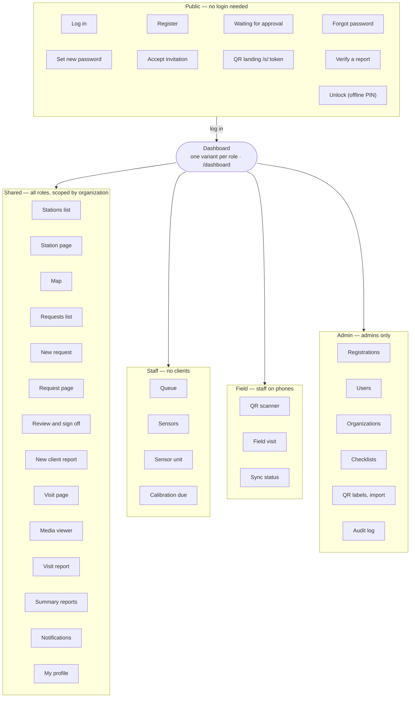
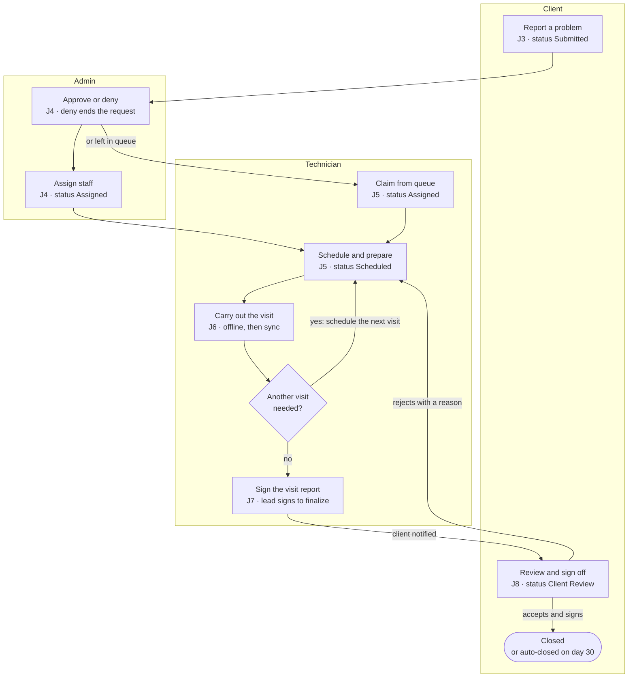
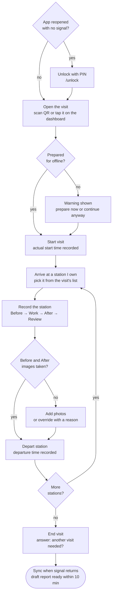

# App Flow Document
## AWS-MMS — Automatic Weather Station Maintenance Management System

| | |
|---|---|
| **Version** | 1.1 |
| **Date** | 2026-10-16 |
| **Status** | Draft for review |
| **Changes in 1.1** | Follows PRD 1.1 and TRD 2.0: a new **Unlock** page (offline PIN), station owners on visits (J5, J6), J6 checks preparation before the visit starts, reopened reports return the request to In progress (J7, J8), and new routing and edge states for offline sessions and sync conflicts. 37 pages |
| **Companion documents** | [PRD.md](PRD.md) v1.1 (Product Requirements), [TRD.md](TRD.md) v2.0 (Technical Requirements) |
| **Live copy** | [Claude Doc](https://claude.ai/code/artifact/51ce0c78-20c6-4218-b22b-4f69ee6024d1) (1.0; superseded by this file) |

---

## 1. Purpose and scope

This APD shows, for each main journey in AWS-MMS, what happens when a user clicks and which page comes next. It turns the workflows in PRD §5–§6 and the frontend notes in TRD §13 into pages and routes for design and build.

- **Sources:** `docs/PRD.md` v1.1 and `docs/TRD.md` v2.0, both dated 2026-10-16.
- **Routes:** the TRD fixes only `/s/:token` (QR landing) and `/visits/:id/media/:mediaId`. Every other route here is *proposed* and can be renamed during build.
- **Not covered:** visual design, API calls (see TRD) and request status rules beyond what decides the next page (see PRD §5).

**How to read the journeys.** Each journey is a numbered table: **On page** · **User does** · **What happens / next page**. Branches and loops are drawn as diagrams. A role in brackets, such as *[Admin]*, means only that role sees the action.

---

## 2. User roles

Four roles share one app. After login each lands on their own dashboard, and the layout (client, staff or field) decides the menus they see.

| Role | Example persona | Lands on after login | Layout | Main journeys |
|---|---|---|---|---|
| Client | Maria, client operations officer | Client dashboard | Client | J1, J3, J8, J9 |
| Technician | Devon, field technician | Technician dashboard | Staff on desktop; field on phones during a visit | J5, J6, J7 |
| Admin | Andrea, admin and senior technician | Admin dashboard | Staff (field when attending a visit) | J1, J4, J5, J6, J7, J10 |
| Viewer | Paul, operations manager | Admin dashboard, read-only | Staff, action buttons hidden | J10 |

- A staff user can hold several roles (for example Technician and Admin). They see the union of menus and land on the Admin dashboard.
- A client never sees another organization's data. Any link to it opens the **Not found** page, never "access denied".

---

## 3. Site map and page inventory

The app has 37 pages in five areas: public, shared, staff, field and admin. The site map below shows how they group; the table lists each page's route, who can open it and where it is usually reached from.

| Area | Page | Route | Who can open | Usually reached from |
|---|---|---|---|---|
| Public | Log in | `/login` | Everyone | App start, logout, session expiry, QR scan when logged out |
| Public | Register | `/register` | Everyone | "Create an account" on Log in |
| Public | Waiting for approval | `/register/pending` | Newly registered client | Register (submit), login attempt by a pending account |
| Public | Forgot password | `/forgot-password` | Everyone | "Forgot password?" on Log in |
| Public | Set new password | `/reset-password/:token` | Holder of the emailed link | Password reset email |
| Public | Accept invitation | `/invite/:token` | Invited user | Invitation email |
| Public | QR landing | `/s/:token` | Everyone (resolves after login) | Phone camera or in-app scanner |
| Public | Verify a report | `/verify` | Everyone | Link printed on signed PDFs (RPT-11, could-have) |
| Public | Unlock | `/unlock` | Staff with an offline session on this device | App start with no signal and no live session (AUTH-12) |
| Shared | Dashboard | `/dashboard` | All roles (one variant each) | Login, logo, `/` |
| Shared | Stations list | `/stations` | All roles (clients: own org) | Main menu |
| Shared | Station page | `/stations/:id` | All roles (clients: summary) | Stations list, map, QR landing, request page |
| Shared | Map | `/map` | All roles | Main menu |
| Shared | Requests list | `/requests` | All roles (clients: own org) | Main menu, dashboard widgets |
| Shared | New request | `/requests/new` | Client, Admin | "Report a problem" (dashboard, station page, QR landing), "New request" |
| Shared | Request page | `/requests/:id` | All roles (clients: own org) | Requests list, notifications, dashboard |
| Shared | Review completed work | `/requests/:id/review` | Client | "Review and sign off" on request page, Client Review email |
| Shared | New client report | `/requests/:id/client-reports/new` | Client | "Add a client report" on request page |
| Shared | Visit page | `/visits/:id` | All roles (clients: own org, no drafts) | Request page, technician dashboard |
| Shared | Media viewer | `/visits/:id/media/:mediaId` | All roles with access | Visit page, QR code in visit report PDF |
| Shared | Visit report | `/visit-reports/:id` | Staff (draft and final), client (final only) | Visit page, request page, notifications |
| Shared | Summary reports | `/reports` | All roles (clients: 3 report types) | Main menu |
| Shared | Notifications | `/notifications` | All roles | Bell icon |
| Shared | My profile | `/profile` | All roles | User menu |
| Staff | Queue | `/queue` | Technician, Admin | Main menu, dashboard "Queue" widget |
| Staff | Sensors | `/sensors` | Staff | Main menu |
| Staff | Sensor unit | `/sensors/units/:id` | Staff | Sensors, station page Sensors tab |
| Staff | Calibration due | `/calibration` | Staff | Main menu, dashboard widget |
| Field | QR scanner | `/scan` | Staff | Field bottom bar |
| Field | Field visit | `/visits/:id/field` | Attending staff | "Start visit" or "Continue visit" |
| Field | Sync status | `/sync` | Staff | Sync badge |
| Admin | Registrations | `/admin/registrations` | Admin | Admin menu, dashboard widget |
| Admin | Users | `/admin/users` | Admin | Admin menu |
| Admin | Organizations | `/admin/organizations` | Admin | Admin menu |
| Admin | Checklist templates | `/admin/checklists` | Admin | Admin menu |
| Admin | QR labels and station import | `/admin/stations-tools` | Admin | Admin menu |
| Admin | Audit log | `/admin/audit` | Admin | Admin menu |

The station and request pages use tabs rather than separate routes:

- **Station page:** Overview · Sensors · Documents · Configurations *[Staff]* · Requests · Visits · Reports · Calibration · History *[Staff]*.
- **Request page:** Overview · Comments · Visits · Reports · History *[Staff]*.

---

## 4. Main user journeys

Ten journeys cover the app. Six of them (J3 to J8) chain into one maintenance request, passing from client to admin to technician and back to the client for sign-off.

| # | Journey | Who | Starts on | Ends on |
|---|---|---|---|---|
| J1 | Register and get approved | Client, Admin | `/login` | Client dashboard |
| J2 | Log in and reset a password | All | `/login` | Dashboard |
| J3 | Report a fault | Client | Dashboard, station page or QR | Request page (Submitted) |
| J4 | Approve, deny and assign requests | Admin | Admin dashboard | Request page (Assigned) or queue |
| J5 | Claim, schedule and prepare a visit | Technician | Technician dashboard | Visit page (ready offline) |
| J6 | Carry out a visit with no signal | Technician | QR scan or visit page | Sync status |
| J7 | Edit, sign and finalize a visit report | Technician (lead), Admin | Notification | Visit report (Final) |
| J8 | Review and sign off completed work | Client | Email or notification | Request page (Closed or Reopened) |
| J9 | Add a client report | Client | Request page | Request page, Reports tab |
| J10 | Run summary reports and check the audit log | Staff, Viewer, Admin | Main menu | Downloaded PDF or CSV |

Two loops send work back to the technician: another visit needed (J6) and a client rejection (J8). Both return the request to Assigned with the same staff.

### J1 · Register and get approved

A new client cannot log in until an admin approves them; the decision reaches them by email.

| # | On page | User does | What happens / next page |
|---|---|---|---|
| 1 | `/login` | Clicks **Create an account** | → `/register` |
| 2 | `/register` | Enters name, email, phone and password, picks their organization or types a new name, clicks **Register** | Account saved as Pending → `/register/pending` ("We'll email you when your account is approved") |
| 3 | Admin dashboard *[Admin]* | Clicks the **Registrations pending** widget | → `/admin/registrations` |
| 4 | `/admin/registrations` *[Admin]* | Opens a registration, clicks **Approve**, links it to an existing organization or creates one, confirms | Row leaves the list; approval email sent. Stays on `/admin/registrations` |
| 4b | `/admin/registrations` *[Admin]* | Clicks **Reject** and types a reason | Row leaves the list; rejection email with the reason sent |
| 5 | Approval email | Clicks **Log in** | → `/login` |
| 6 | `/login` | Logs in | → Client dashboard |

Invited users skip steps 1–4: the invitation email opens `/invite/:token`, they set a password, click **Save** and land on their dashboard. Staff accounts are always created this way.

### J2 · Log in and reset a password

Login sends each user to their dashboard, or back to the page they were trying to open. The request-level sequence, including throttling and session refresh, is in [TRD §6.1.1](TRD.md#611-login-sequence).

| # | On page | User does | What happens / next page |
|---|---|---|---|
| 1 | `/login` | Enters email and password, clicks **Log in** | → the `next` page if one was saved (deep link, QR scan), else `/dashboard` |
| 2 | `/login` | Clicks **Forgot password?** | → `/forgot-password` |
| 3 | `/forgot-password` | Enters email, clicks **Send link** | Same page shows "If that email is registered, a link is on its way" whether or not it is |
| 4 | Reset email | Clicks the link (valid 1 hour, single use) | → `/reset-password/:token` |
| 5 | `/reset-password/:token` | Enters the new password twice, clicks **Save** | All other sessions are logged out → `/login` with a "Password changed" banner |

### J3 · Report a fault

A client can start a request from four places; the station is filled in when they start from a station.

| # | On page | User does | What happens / next page |
|---|---|---|---|
| 1 | Client dashboard, station page, QR landing or requests list | Clicks **Report a problem** (or **New request**) | → `/requests/new`, with the station pre-selected when started from a station |
| 2 | `/requests/new` | Picks one or more of their stations; enters title, description, category and priority; attaches photos or PDFs; clicks **Submit** | Request created as Submitted with a reference such as `MR-2026-0042` → `/requests/:id` with a confirmation toast |
| 2b | `/requests/new` | Clicks **Cancel** | Asks to discard if anything was typed → the page they came from |
| 3 | `/requests/:id` | Watches the status timeline | Updates live as the request moves to Approved, Assigned and Scheduled (with planned dates) |
| 4 | Bell icon | Clicks a status notification | → `/requests/:id` |
| 5 | `/requests/:id`, Comments tab | Types a comment, adds files, clicks **Post** | Comment appears at the bottom of the thread; editable for 15 minutes |
| 6 | `/requests/:id` | Clicks **Edit** or **Cancel request** (only while Submitted, Approved or Assigned) | Edit → `/requests/new` pre-filled, then back. Cancel → confirm dialog → status Cancelled, stays on page |

### J4 · Approve, deny and assign requests

The admin dashboard is the starting point; every decision is made on the request page and keeps the admin there.

| # | On page | User does | What happens / next page |
|---|---|---|---|
| 1 | Admin dashboard | Clicks **Requests awaiting approval** | → `/requests?status=submitted` |
| 2 | `/requests` | Clicks a request row | → `/requests/:id` |
| 3 | `/requests/:id` | Clicks **Approve** | Status Approved; request joins the queue; client notified. Stays on page |
| 3b | `/requests/:id` | Clicks **Deny**, types a reason (required), confirms | Status Denied; client sees the reason. Stays on page |
| 4 | `/requests/:id` | Clicks **Assign staff**, picks one or more staff, clicks **Assign** | Status Assigned; staff notified. Stays on page |
| 4b | `/requests/:id` | Leaves it unassigned | Request waits in `/queue` for any technician to claim |
| 5 | `/requests/new` | Creates a request for any organization (planned or internal work) | Same form as J3 plus an **Organization** picker; starts as Approved → `/requests/:id` |

### J5 · Claim, schedule and prepare a visit

A visit must be prepared while online so it can be carried out with no signal.

| # | On page | User does | What happens / next page |
|---|---|---|---|
| 1 | Technician dashboard | Clicks the **Queue** widget | → `/queue` |
| 2 | `/queue` | Clicks **Claim** on a request | Assigned to them; admins notified → `/requests/:id` |
| 3 | `/requests/:id` | Clicks **Schedule visit**; sets planned start and end, attending staff (marks one **lead**), stations covered, the **owner** of each station (defaults to the lead) and notes; clicks **Save** | Visit created; request Scheduled; client notified of the dates → `/visits/:id`. Another visit can be scheduled for the same request at the same time, for example a second team |
| 4 | `/visits/:id` | Clicks **Prepare for field** | If this phone has no PIN yet, asks the technician to set a 4–6 digit PIN first. Then downloads the request, stations, sensors, calibration status, latest configuration, checklists and (optionally) manuals. Shows progress, then a **Ready offline** badge. Stays on page |
| 5 | `/visits/:id` | Clicks **Reschedule** or **Cancel visit** (before it starts) | Dialog → visit updated or cancelled; client notified. If the visit is prepared on someone's phone, the dialog warns that unsynced work may come back as a conflict. If no other visit is planned, the request returns to Assigned |
| 5b | `/visits/:id` *[Lead, Admin]* | Clicks **Change owner** on a station | Picks another attending technician. Both are notified. Needs a connection |

### J6 · Carry out a visit with no signal

The field visit is a stepper per station (Before → Work → After → Review). Every step saves to the phone and syncs later.

The technician loops through Arrive, Record and Depart once for each station they own; the photo check is the only gate, and an override with a reason gets past it. At stations owned by another attending technician they can still add photos and videos.

| # | On page | User does | What happens / next page |
|---|---|---|---|
| 0 | `/unlock` (app reopened with no signal) | Enters their PIN | Field data opens → the page they were on, or the technician dashboard. Five wrong PINs: "Connect to the internet and log in to continue. Your work is saved on this phone." |
| 1 | Field bottom bar | Taps **Scan** and scans the station's QR label | `/scan` → `/s/:token` resolves from the prepared bundle → `/stations/:id` (field view) |
| 1b | Technician dashboard | Taps the visit under **My upcoming visits** | → `/visits/:id` |
| 2 | Station page or `/visits/:id` | Taps **Start visit** | If the visit was not prepared, a warning first offers **Prepare now** (needs signal) or **Continue anyway**. Then the actual start is recorded → `/visits/:id/field` |
| 3 | `/visits/:id/field` | Picks a station they own and taps **Arrive** | Arrival time recorded → the station's **Before** step. A station owned by someone else opens read-only, with "Owned by Devon Brown. You can add photos and videos." |
| 4 | Before step | Takes photos and videos, taps **Next** | → **Work** step |
| 5 | Work step | Completes the checklist (OK, Fixed, Issue, N/A), records sensor actions with old and new serials and calibration readings, captures a new configuration version, notes parts, issues and data download, taps **Next** | → **After** step. An unknown serial is created and flagged for an admin |
| 6 | After step | Takes photos and videos, taps **Next** | → **Review** step |
| 7 | Review step | Taps **Depart station** | Needs at least one Before and one After image. If missing: **Add photos** (back to that step) or **Override** with a reason. Departure recorded → station list |
| 8 | `/visits/:id/field` | Repeats steps 3–7 for each station they own, then taps **End visit** | Asks **Another visit needed?** Yes needs notes on the remaining work |
| 9 | End visit dialog | Answers and taps **End visit** | Visit ended → `/sync` showing, for example, "5 changes and 18 files waiting to sync" |
| 10 | `/sync` (back in signal) | Waits, or taps **Sync now** | Uploads resume where they stopped; sensor inventory updates. Within 10 minutes a **Draft report ready** notification links to J7. Anything the server couldn't apply is listed with the reason (§6) |

If the answer at step 8 was **Yes**, the request returns to Assigned (unless another visit is still planned or under way) and J5 starts again for the next visit. If **No**, it waits for the visit reports in J7.

### J7 · Edit, sign and finalize a visit report

Staff edit only the narrative; facts are fixed in the work record and flow back into the draft. The lead's signature finalizes it.

| # | On page | User does | What happens / next page |
|---|---|---|---|
| 1 | Notification | Clicks **Draft report ready** | → `/visit-reports/:id` in draft mode (DRAFT watermark) |
| 2 | `/visit-reports/:id` | Edits summary, work performed, recommendations and follow-up; picks photos and captions | Saves as they type. Stays on page |
| 3 | `/visit-reports/:id` | Clicks **Fix in work record** next to a wrong fact | → `/visits/:id` work record; on save the draft's facts refresh → back to `/visit-reports/:id` |
| 4 | `/visit-reports/:id` | Clicks **Preview PDF** | Opens the PDF in a new tab |
| 5 | `/visit-reports/:id` | Clicks **Sign**; types full name, draws signature, ticks the attestation; clicks **Sign** | Signature added (needs signal). Any later edit clears the signatures |
| 6 | `/visit-reports/:id` *[Lead]* | Clicks **Finalize** (enabled once the lead has signed), confirms | Shows "Finalizing…" while the PDF renders; then report Final; work records locked. If no further visit is needed and every visit report of the request is final, request → Client Review and the client is notified. Stays on page with **Download PDF**. If rendering fails, the report returns to Draft with its signatures kept and a **Try again** banner |
| 7 | `/visit-reports/:id` *[Admin]* | On a final report, clicks **Reopen for correction** and types a reason | Old version marked Superseded; a new draft (version +1) opens on the same page; back to step 2. If the request was in Client Review, it returns to In progress and the client is told a corrected report is coming. If it was Closed, it stays Closed and the client gets the corrected report and a new close-out report |

### J8 · Review and sign off completed work

The client either accepts with a signature, which closes the request, or rejects with a reason, which sends it back to the same staff.

| # | On page | User does | What happens / next page |
|---|---|---|---|
| 1 | Client Review email or notification | Clicks **Review the work** | → `/requests/:id` with a Client Review banner |
| 2 | `/requests/:id` | Clicks **Review and sign off** | → `/requests/:id/review`: final visit reports, media and summary |
| 3 | `/requests/:id/review` | Clicks **Accept work**; types full name, draws signature, ticks the attestation; clicks **Sign and accept** | Request Closed; close-out report generated; staff and admins notified → `/requests/:id` showing Closed and the close-out report |
| 3b | `/requests/:id/review` | Clicks **Reject**, types a reason (required), clicks **Send** | Request Reopened, then straight back to Assigned with the same staff; they and the admins are notified → `/requests/:id` |
| 4 | Reminder email (days 7, 21, 28) | Clicks **Review the work** | → `/requests/:id/review` |
| 5 | — (no response by day 30) | Nothing | Request closed automatically; close-out report says it was auto-closed |

If an admin reopens a visit report while the request is in Client Review, the request returns to In progress, reminders stop, and `/requests/:id/review` shows "A corrected report is on its way. You'll be asked to review again." The 30 days start again when the corrected report is final.

### J9 · Add a client report

A client can add their own report to a request at any time, as a PDF or an online form.

| # | On page | User does | What happens / next page |
|---|---|---|---|
| 1 | `/requests/:id`, Reports tab | Clicks **Add a client report** | → `/requests/:id/client-reports/new` |
| 2 | `/requests/:id/client-reports/new` | Chooses **Upload a PDF**, picks a file, enters title and date, clicks **Submit** | Report attached → `/requests/:id`, Reports tab |
| 2b | `/requests/:id/client-reports/new` | Chooses **Fill in the online form**; enters title, date, stations, summary, per-station observations, data-quality notes and attachments | — |
| 3 | Online form | Clicks **Save draft** | Draft saved; stays on page. Reopened later from **Continue draft** on the Reports tab |
| 4 | Online form | Clicks **Submit** | Rendered to PDF and attached; can no longer be edited → `/requests/:id`, Reports tab |

### J10 · Run summary reports and check the audit log

Summary reports are open to staff and Viewers (clients get three types); the audit log is for admins only.

| # | On page | User does | What happens / next page |
|---|---|---|---|
| 1 | Main menu | Clicks **Reports** | → `/reports` |
| 2 | `/reports` | Picks a report type; sets date range, organization, country and station; clicks **Generate** | Report builds (up to 2 minutes) and appears in the list. Stays on page |
| 3 | `/reports` | Clicks **Download PDF** or **Download CSV** (tabular reports) | File downloads |
| 4 | Admin menu *[Admin]* | Clicks **Audit log** | → `/admin/audit` |
| 5 | `/admin/audit` *[Admin]* | Filters by actor, action, resource, organization and date; clicks a row | Drawer shows the record with before and after values |
| 6 | `/admin/audit` *[Admin]* | Clicks **Export CSV** | File downloads |
| 7 | Station, request or visit page *[Staff]* | Clicks the **History** tab | Shows that record's audit entries in place |

---

## 5. Global navigation, login gates and redirects

Every page except the public ones needs a login, and the router sends each user back to where they were heading once they log in. The server still checks every rule; the router only decides which page to show.

### 5.1 Menus by role

| Layout | Main menu | Always visible |
|---|---|---|
| Client | Dashboard · Stations · Map · Requests · Reports | Bell · user menu (Profile, Log out) · **Report a problem** button |
| Staff (Technician) | Dashboard · Queue · Requests · Stations · Map · Sensors · Calibration · Reports | Bell · user menu · sync badge |
| Staff (Admin) | Technician menu + Admin (Registrations, Users, Organizations, Checklist templates, QR labels and import, Audit log) | Bell · user menu · sync badge |
| Staff (Viewer) | Dashboard · Requests · Stations · Map · Sensors · Calibration · Reports | Bell · user menu; no action buttons anywhere |
| Field (phones) | Bottom bar: Visit · Scan · Stations · Sync | Sync badge with waiting count |

Staff on a phone switch to the field layout when they open `/visits/:id/field`, `/scan` or `/sync`, and back to the staff layout when they leave them.

### 5.2 Routing rules

| Situation | What happens | Next page |
|---|---|---|
| Logged-out user opens any private page (deep link, notification email, QR) | Page saved as `next` | `/login`, then the saved page after login |
| Logged-in user opens `/login`, `/register` or `/` | — | `/dashboard` |
| User opens a page their role cannot use (for example a client on `/admin/*`) | — | Not found page |
| Client opens another organization's station, request, visit or report | Same response as a missing record | Not found page |
| Viewer opens a create or edit route | — | The matching read-only page |
| Access token expires while online | Refreshed silently (one refresh at a time across tabs) | Same page |
| Staff app starts with no signal and an offline session on this device | Field data stays locked until the PIN is entered | `/unlock`, then the saved page |
| Five wrong PINs on `/unlock` | Offline unlock turned off until the next online login; data kept | `/unlock` shows "Connect and log in to continue" |
| Refresh fails (30-day session ended, user disabled, organization deactivated) | Offline work stays queued on the device | `/login` with a reason banner; then back to the same page |
| User clicks **Log out** | Session and offline profile ended on this device; prepared bundles deleted; queued offline work is kept and syncs after this user logs in again | `/login` |
| Staff open an online-only page with no signal (approvals, new request, signing, admin) | Page shows "This needs a connection" and keeps the user in place | Same page; retries when signal returns |

### 5.3 QR landing (`/s/:token`) by role

| Who scans | Online | Offline |
|---|---|---|
| Not logged in | `/login`, then as below | `/login` (cannot resolve) |
| Staff | `/stations/:id` with full details and **Start visit** | After PIN unlock if the app was restarted: `/stations/:id` from the prepared bundle; "Station not prepared" if it is not cached |
| Client, own station | `/stations/:id` summary with open requests, past reports and **Report a problem** | Not supported (field mode is staff-only) |
| Client, another organization's station | Not found page | — |
| Anyone, revoked code | "This code is no longer valid" page with a link to `/stations` | Same, if the revocation was synced |

---

## 6. Error, empty and edge states

Most errors keep the user on the same page with a message; only lost access or a missing record sends them elsewhere.

| Where | Situation | What the user sees | Next page |
|---|---|---|---|
| `/login` | Wrong email or password | "Email or password is incorrect" (never says which) | Same page |
| `/login` | 5 failed attempts | "Too many attempts, try again in 15 minutes" | Same page |
| `/login` | Account still pending | Waiting-for-approval message | `/register/pending` |
| `/login` | Account rejected, disabled, or organization deactivated | "This account cannot sign in. Contact the service desk." | Same page |
| `/register` | Password under 10 characters or on a breached list | Inline field error | Same page |
| `/reset-password/:token`, `/invite/:token` | Link expired (1 hour / 7 days) or already used | "This link has expired" with **Send a new link** | `/forgot-password` |
| `/requests/:id` | Client opens a request after it is Scheduled | **Edit** and **Cancel** are hidden; a note says to comment instead | Same page |
| `/requests/:id`, Comments | Comment older than 15 minutes | **Edit** is hidden | Same page |
| Station page | **Start visit** on a visit not prepared for offline | Warning with **Prepare now** or **Continue anyway** | Stays, or `/visits/:id/field` |
| `/visits/:id/field` | Phone storage below 1 GB free | Warning banner with storage used | Same page |
| Review step | No Before or After image for a station | **Depart station** blocked; **Add photos** or **Override** with reason | That step, or station list |
| `/sync` | Upload interrupted | Item shows "Paused, will resume"; picks up from the last part | Same page |
| `/sync` | Login needed to sync | "Log in to finish syncing. Your work is saved on this phone." | `/login`, then `/sync` |
| `/sync` | Station owner changed while offline | "Devon Brown now owns WXR-012. Your work on it is saved on this phone; export it and pass it on." with **Export** | Same page |
| `/sync` | Visit cancelled while offline | "This visit was cancelled while you were offline. Your work is saved on this phone and an admin has been told." | Same page; syncs after an admin restores the visit |
| `/sync` | Visit locked (report final) while offline | "This visit's report is final. Your changes are saved on this phone; ask an admin to reopen the report." with **Export** | Same page |
| `/visits/:id/field` | Opening a station owned by another technician | Read-only work record; photo and video capture still available | Same page |
| `/visits/:id/field` *[Admin, Lead]* | Changing a station owner, or cancelling a visit prepared on a phone | Dialog warns that unsynced work on that phone will come back as a conflict | Same page |
| `/visit-reports/:id` | Finalizing failed | Warning banner "The PDF couldn't be produced. Your signatures are kept." with **Try again** | Same page |
| `/visit-reports/:id` | Report edited after someone signed | Banner: signatures cleared, sign again | Same page |
| `/visit-reports/:id` | Client opens a draft report link | Same as a missing record | Not found page |
| `/requests/:id/review` | Request no longer in Client Review (accepted, auto-closed, rejected elsewhere, or a report reopened for correction) | Banner with the current status | `/requests/:id` |
| Any upload | File over the limit (video 200 MB, image 25 MB, document 50 MB) or fails the virus scan | Inline error on that file | Same page |
| Any page | Server unavailable | Error banner with **Try again** | Same page |
| Any list or dashboard widget | Nothing to show | Empty state with the next action, for example "No open requests. **Report a problem**" | Same page |

---

## 7. Open questions

| # | Question | Assumption used in this APD |
|---|---|---|
| A1 | Are the proposed routes acceptable for build? | Yes; rename freely, but keep `/s/:token` and `/visits/:id/media/:mediaId` from the TRD |
| A2 | Is the queue its own page or a filter on the requests list? | Its own page, `/queue` |
| A3 | After a technician claims a request, should they stay on the queue or open the request? | Open the request, so they can schedule straight away |
| A4 | Where does a user with Technician and Admin roles land? | Admin dashboard, with the technician widgets added |
| A5 | Can a client scan a QR code without logging in and see anything at all? | No; QR-2 requires login first |
| A6 | Do phones switch to the field layout automatically, or by a toggle? | Automatically on field pages only |
| A7 | Should the client be told who the assigned technician is? | **Decided 2026-10-16: yes.** Clients see assigned and attending staff by name (no contact details) on the request and visit pages (DBD D4) |
| A8 | Should a finished summary report notify the user if they leave `/reports`? | No; it waits in the report list |
| A9 | How does a technician get back into the app after a restart with no signal? | **Decided 2026-10-16:** a device PIN on `/unlock` (PRD AUTH-12) |
| A10 | What happens when two technicians work at the same station? | **Decided 2026-10-16:** one owner per station records the work; others add media (PRD OFF-11) |
