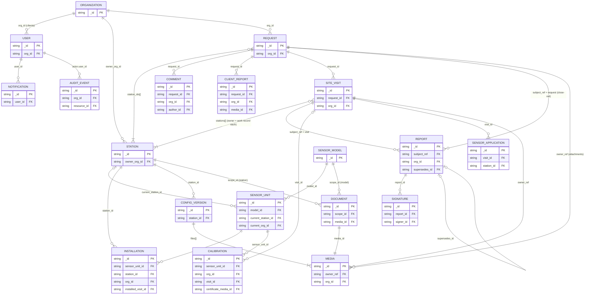

# Background Schema Document (BSD)
## AWS-MMS — Automatic Weather Station Maintenance Management System

| | |
|---|---|
| **Version** | 1.3 |
| **Date** | 2026-10-17 |
| **Status** | Draft for review |
| **Changes in 1.1** | Follows TRD 2.0: five services and six databases; SeaweedFS instead of MinIO; Nginx instead of Kong; `org_id` copied onto sensor installations and calibrations (closes B2); model documents reached through operations (B4); files start staff-only (ADR-19); station owners on visits; offline profile and PIN verifier on the device; read models rebuilt by backfill. B3 closed by TRD §5 indexes; B5 and B6 recorded as decisions |
| **Changes in 1.2** | Follows TRD 2.1 (auth as built): reset and invitation rows hold no token until the link is minted on send; the sealed refresh successor; `organizations.name_key`; the Redis access-token revocation list in the enforcement layers |
| **Changes in 1.3** | auth's `settings` collection (one document, `branding`: the organization's Material 3 brand colours, decision W4-12); the PWA keeps its last copy in `localStorage` (`mms-branding`), with the per-device `mms-motion` setting |
| **Companion documents** | [PRD.md](PRD.md) v1.1 (Product Requirements), [TRD.md](TRD.md) v2.0 (Technical Requirements), [AFD.md](AFD.md) (App Flow), [DBD.md](DBD.md) (Design Brief) |
| **Live copy** | [Claude Doc](https://claude.ai/code/artifact/bfd6c029-c1d7-4fc0-a6fe-b75502654c02) (1.0; superseded by this file) |

> The entity diagram is redrawn here as Mermaid.

---

## Purpose and scope

Client data lives in one MongoDB replica set (six databases owned by five services) and four private buckets in the S3 store (SeaweedFS). Every client-owned record carries an `org_id`, and that field is how a client is kept inside their own organization's data. This document is the single reference for where each record lives, its shape, who can reach it, and how records point at each other.

- **Source documents:** PRD v1.1 (requirement IDs such as STN-6, AUD-3) and TRD v2.0 §5 (data model), §6 (authorization), §7 (offline store), §10 (buckets), §16.4 (backups). Where this document and TRD §5 disagree, TRD §5 wins until this document is approved.
- **Covers:** server-side system-of-record data (MongoDB, S3 store), the report read model, and the device-side offline store (IndexedDB).
- **Does not cover:** Kafka event payloads (TRD §8.4), API request/response shapes (OpenAPI per service), screen layouts (AFD, Design Brief).
- **Conventions used throughout:** `_id` is a UUIDv7 string created by whoever creates the record, the PWA included. Every document has `created_at`, `updated_at`, `created_by` and `version`. All times are UTC ISO 8601. Each station carries an IANA `time_zone` for display.

## Where client data lives

All client data is held on the organization's own production host, with a copy on a second backup host (NFR-10, TRD §16). No public cloud is used; "AWS" in the product name means Automatic Weather Station. MongoDB and the S3 store are the only systems of record; Kafka, Redis and the browser store are working copies.

### Systems of record

| Store | Holds | System of record? | Backup |
| --- | --- | --- | --- |
| MongoDB `rs0`, 6 databases | Every business record: users, organizations, stations, sensors, requests, visits, reports, signatures, notifications, audit | Yes | Nightly encrypted `mongodump --oplog` to backup host; 14 daily, 12 monthly |
| S3 `mms-originals` | Raw photo and video uploads | Yes, for 30 days | Replicated; deleted 30 days after processing by the `purge_originals` cron (NFR-8) |
| S3 `mms-media` | Processed WebP images, H.264 videos, thumbnails | Yes | Continuous replication (`weed filer.sync`) |
| S3 `mms-documents` | Manuals, datasheets, configuration files, client PDFs, calibration certificates | Yes | Replicated; versioning and object lock on config files where SeaweedFS supports them |
| S3 `mms-reports` | Rendered visit, close-out, client-form, label and summary PDFs | Yes | Replicated; versioning and object lock on finals where supported |

Object keys are never reused and no API overwrites a finalized report or a config file, so these files stay immutable even without store-level object lock (TRD §10.1).

### Working copies (not backed up)

| Store | Holds | Lost on failure? |
| --- | --- | --- |
| Kafka (4 topics, 14-day retention) | Domain events in transit | Read models rebuilt from current state with `backfill.py` (TRD §8.6) |
| Redis | Job queues, JWKS cache, login throttle, outbox leader leases, WebSocket fan-out, 60 s dashboard cache | Queued jobs re-enqueued by reconciliation crons |
| Device IndexedDB (Dexie) | Prepared visit bundles and files, offline work records, queued operations and media, offline profile | Only until synced; deleted after the server confirms (OFF-8) or on logout (bundles and files only) |

### Databases by owning service

Each service owns its database and has a MongoDB user that can reach only that database (ADR-2). `platform` owns two databases, each with its own user, so the audit user can stay insert-only. No service reads another service's database; it calls an `/internal/*` endpoint or keeps a read model built from events.

| Database | Service | Owns | Client data in it |
| --- | --- | --- | --- |
| `auth` | auth | users, organizations, tokens, signing keys | Client user accounts and their organization |
| `operations` | operations | stations, sensor models and units, installations, calibrations, sensor applications, documents, config versions; requests, comments, client reports; site visits, work records, checklist templates, sync log, counters | Their stations, installed sensors, requests, comments, client reports, acceptance signatures, visits |
| `media` | media | media metadata (files are in the S3 store) | Photos, videos and files about their stations and requests |
| `report` | report | reports, signatures, report jobs, dashboard read model | Visit and close-out reports for their requests |
| `notification` | platform | notifications, preferences, user directory | Their notifications and email settings |
| `audit` | platform | audit events, chain state | Actions on their records (admin-only to read) |

Producing databases (`auth`, `operations`, `media`, `report`) have an `outbox`. Consuming databases have `processed_events` (TTL 30 days). Every database has `_migrations`.

## Entity model

Organization is the root of all client data. Stations, requests, comments, client reports, visits, reports, media, installations and calibrations each carry its ID. A sensor unit carries the organization of the station it is currently installed at.

Every `FK` here is a plain ID string: MongoDB does not enforce it. Kafka, Redis and the device store hold copies only.

- **Organization 1 → n** users, stations, requests.
- **Request n ↔ n Station** through `requests.station_ids[]`; one request covers one or more of the same org's stations.
- **Request 1 → n** site visits (several may be open at once), comments, client reports.
- **Site visit 1 → n** station entries, each with one owner (`owner_staff_id`) and one embedded work record; a visit covers a subset of its request's stations.
- **Site visit 1 → n** report versions (`subject_ref = visit:{id}`); exactly one is `final` at a time, older finals are `superseded`.
- **Report version 1 → n** signatures, each tied to that version's `content_hash`.
- **Sensor unit 1 → n** installations over time; at most one has no `removed_at`.
- **Sensor action 1 → 1** sensor application, which records its effects on the inventory so a corrected action can be reversed and re-applied (TRD §3.2.3).
- **Media n → 1** owner, named by `owner_ref` (a visit station phase, request, comment, document, config version, calibration or client report).

## Schema definitions

The tables below list each collection's purpose, the fields that matter for ownership and relationships, and its indexes. Full field lists are in TRD §5. The scope column says which field a client query is filtered on ("—" means clients never read the collection). Inside `operations`, references between stations, requests and visits are checked in the same transaction. A reference across databases is a plain ID string: MongoDB does not enforce it, so the writing service checks it through an `/internal/*` call before saving.

### auth

| Collection | Purpose | Key fields | Client scope | Indexes |
| --- | --- | --- | --- | --- |
| `users` | Every account, staff and client | `email`, `password_hash` (Argon2id), `roles[]`, `org_id` (clients only), `status`, `theme`, `time_zone` | Own record only | `email` unique; `status`; `org_id` |
| `organizations` | Client organizations | `name`, `name_key` (unique ignoring case and spacing), `country` (ISO alpha-2), `contact_email`, `status` | Own org only | `name_key` unique |
| `refresh_tokens` | Rotating sessions, 30 days from the last refresh | `user_id`, `token_hash`, `family_id`, `replaced_by`, `rotated_at` (30 s reuse grace), `successor_enc` (sealed under a key only the previous token can derive), `expires_at` | — | `token_hash` unique; `family_id`; `user_id`; TTL on `expires_at` |
| `password_resets`, `invitations` | Single-use emailed tokens | `user_id`, `token_hash` (null until minted on send), `minted_at`, `expires_at`, `used_at`, `superseded` | — | `token_hash` unique where set; TTL on `expires_at` |
| `signing_keys` | Ed25519 JWT keys | `_id` = `kid`, `public_jwk`, `private_key_ref`, `active` | — | — |
| `settings` | Organization-wide settings, one document each; today only `branding` | `_id` = `"branding"`, `material` (`name`, `seed`, `schemes.light`/`dark`: 49 Material roles as `#RRGGBB`, `palettes`: 5 × tones 0–100) or null for the built-in colours, `updated_at`, `updated_by`, `version` | Everyone reads it, before sign-in too (`GET /api/v1/auth/branding`; no personal data); admins write it, each change audited as `branding.updated` | `_id` only |

Rule: a user with the `client` role holds no staff role, and has exactly one `org_id` once active.

### operations — stations module

| Collection | Purpose | Key fields | Client scope | Indexes |
| --- | --- | --- | --- | --- |
| `stations` | One per weather station | `code` unique, `owner_org_id` (never changes), `owner_org_name` (copy), `country`, `time_zone`, `location` (GeoJSON point), `status`, `qr_token` unique, `current_config_version` | `owner_org_id` | `code`, `qr_token` unique; `owner_org_id`; `country`; 2dsphere on `location` |
| `sensor_models` | Catalogue of makes and models | `kind`, `manufacturer`, `model`, `default_calibration_interval_days` | Read via installed units only | — |
| `sensor_units` | One physical unit by serial | `model_id`, `serial`, `status`, `current_station_id`, `current_org_id`, `calibration_due_at`, `needs_review` | `current_org_id` | `(model_id, serial)` unique; `calibration_due_at`; `current_org_id` |
| `installations` | Which unit sat where, and when | `sensor_unit_id`, `station_id`, `org_id`, `parameter`, `installed_at`, `removed_at`, `installed_visit_id`, `removed_visit_id`, `source_action_id` | `org_id` | `(station_id, removed_at)`; `org_id`; `source_action_id` unique |
| `calibrations` | Field and lab calibrations | `_id` = sensor action ID (from a visit), `sensor_unit_id`, `station_id`, `org_id`, `visit_id`, `readings[]`, `result`, `certificate_media_id` | `org_id` | `(sensor_unit_id, at)`; `org_id` |
| `sensor_applications` | Effects of each applied sensor action, for reversal | `_id` = action ID, `visit_id`, `station_id`, `action_hash`, `effects` | — | `visit_id` |
| `documents` | Manuals and station documents, versioned | `scope` (model or station), `scope_id`, `doc_type`, `client_visible`, `media_id`, `supersedes_id`, `is_current` | Station docs: own station and `client_visible`. Model docs: `client_visible` and a unit of that model installed at one of the client's stations | `(scope, scope_id, is_current)` |
| `config_versions` | Numbered config file sets | `station_id`, `version` (1..n), `files[]` (`media_id`, `sha256`), `visit_id` | — (staff only, STN-6) | `(station_id, version)` unique |

`org_id` on installations and calibrations is copied from the station when the record is written. Stations never change owner (B5), so the copy never goes stale.

### operations — requests module

| Collection | Purpose | Key fields | Client scope | Indexes |
| --- | --- | --- | --- | --- |
| `requests` | Maintenance requests and their state | `ref` (MR-YYYY-NNNN) unique, `org_id`, `station_ids[]`, `status`, `status_history[]`, `assigned_staff_ids[]`, `rework_since`, `review_started_at`, `client_verification` (outcome + signature), `milestones` | `org_id` | `ref` unique; `(org_id, status)`; `(status, assigned_staff_ids)`; `(status, review_started_at)` |
| `comments` | Flat thread per request | `request_id`, `org_id`, `author_id`, `body`, `internal`, `edited_at` | `org_id`, and `internal = false` | `(request_id, created_at)` |
| `client_reports` | Client's own PDF or form report | `request_id`, `org_id`, `kind`, `status` (draft or submitted), `media_id`, `report_id`, `form` | `org_id` | `request_id` |
| `counters` | Reference number sequences | `_id` = "MR-2026" or "VR-2026-0042", `seq` | — | — |

### operations — visits module

| Collection | Purpose | Key fields | Client scope | Indexes |
| --- | --- | --- | --- | --- |
| `site_visits` | One trip for one request, with an owner and a work record per station | `ref` (VR-YYYY-NNNN-NN), `request_id`, `org_id`, `staff_ids[]`, `lead_staff_id`, `status`, `locked`, `report_status`, `prepared_on[]`, `stations[]` (each with `owner_staff_id`, `media[]` and `work`) | `org_id` | `request_id`; `(staff_ids, planned_start)`; `status` |
| `checklist_templates` | Admin-managed checklists, versioned | `station_type`, `sensor_model_id`, `version`, `items[]`, `active` | — | `(station_type, active)` |
| `sync_operations` | Idempotency log for offline sync | `_id` = client op ID, `user_id`, `device_id`, `result` | — | TTL 90 days on `applied_at` |

The work record is embedded in `site_visits.stations[].work`, not a separate collection, so a visit and all its station work save in one write. Only the station's owner writes it (ADR-18). Its `sensor_actions[]` and `config_versions[]` items carry device-made IDs; operations uses those IDs to apply them exactly once and to reverse a corrected action.

### media

| Collection | Purpose | Key fields | Client scope | Indexes |
| --- | --- | --- | --- | --- |
| `media` | Metadata for every stored file | `owner_service`, `owner_ref` (e.g. `visit:{id}:station:{sid}:before`), `org_id` (null for model documents), `visibility` (staff or org), `visibility_version`, `kind`, `checksum_sha256`, `original_key`, `processed_key`, `thumbnail_key`, `status`, `upload_id` | `org_id`, and `visibility = org` | `owner_ref`; `(org_id, kind)`; `status`; `upload_id` |

### report

| Collection | Purpose | Key fields | Client scope | Indexes |
| --- | --- | --- | --- | --- |
| `reports` | Visit, close-out, client-form, label and summary reports, all versions | `type`, `subject_ref` (e.g. `visit:{id}`), `request_id`, `org_id`, `number`, `version`, `status` (draft, finalizing, final, superseded), `content`, `content_hash`, `pdf_key`, `pdf_sha256`, `supersedes_id` | `org_id`, and `status = final` | `(subject_ref, version)` unique; `pdf_sha256`; `(type, status)`; `request_id` |
| `signatures` | Technician signatures on a report version | `report_id`, `report_version`, `signer_id`, `typed_name`, `image_png_b64` (≤ 100 KB), `content_hash`, `ip`, `user_agent` | Shown inside final reports | `report_id` |
| `report_jobs` | Rendering jobs | `type`, `params`, `status`, `requested_by` | Own jobs | — |
| `request_facts`, `visit_facts`, `station_facts`, `calibration_facts`, `sensor_events` | Read model for dashboards and summary reports, built from events and backfill | Each carries `org_id` and the `aggregate_version` it was built from | `org_id` | `(org_id, status)` on `request_facts`; `(org_id, due_at)` on `calibration_facts` |

### platform: notification and audit databases

| Collection | Database | Purpose | Key fields | Client scope | Indexes |
| --- | --- | --- | --- | --- | --- |
| `notifications` | `notification` | In-app notifications | `user_id`, `type`, `link`, `read_at` | Own `user_id` | TTL 1 year on `created_at` |
| `preferences` | `notification` | Email on/off per type | `_id` = `user_id`, `email{}` | Own | — |
| `user_directory` | `notification` | Copy of users for recipient lookup | `_id` = `user_id`, `email`, `roles`, `org_id`, `status`, `aggregate_version` | — | — |
| `audit_events` | `audit` | Hash-chained, insert-only trail | `_id` = source event ID, `seq`, `actor{}`, `action`, `resource{type, id}`, `org_id`, `before`, `after`, `prev_hash`, `hash` | — (admin only) | `seq` unique; `(resource.type, resource.id, at)`; `(actor.user_id, at)`; `(action, at)`; `(org_id, at)` |
| `audit_state` | `audit` | Chain head | `last_seq`, `last_hash` | — | — |

### Device store (IndexedDB, TRD §7.1)

| Table | Holds | Personal or client data | Cleared |
| --- | --- | --- | --- |
| `bundles`, `files` | Prepared visits, stations, sensors, manuals and config files | Station and client data for prepared visits | On logout or change of user; after the visit syncs and ends |
| `visits`, `outbox`, `blobs` | Work records, queued operations, captured photos, videos and config files | Client station data; photos | After the server confirms each item (OFF-8). Kept through logout, tied to `user_id` |
| `meta` | Device ID, offline profile (`id`, `name`, `roles`, `org_id`), PIN verifier (PBKDF2 hash and salt), `offline_until`, failed PIN count | Staff name and roles | Profile and verifier removed on logout |

## Access control

A client sees only records whose `org_id` (`owner_org_id` on stations, `current_org_id` on sensor units) equals the `org_id` in their access token. That filter is added in each service's repository layer, so endpoint code cannot skip it; anything outside it returns 404, not 403 (ADR-16). Staff see everything; viewers see what staff see but cannot write, and cannot read the audit log.

### Who can read and write what

| Data | Client | Technician | Admin | Viewer |
| --- | --- | --- | --- | --- |
| Own user profile | Read, edit name, phone, password, time zone, theme | Same | Same | Same |
| Other users | Staff `{id, name}` on their requests and visits only; never email or phone | Read | Read, write | Read |
| Organizations | Own org, read | Read | Read, write | Read |
| Stations, installed sensors, calibration status | Own org, read summary | Read, write | Read, write | Read |
| Configuration versions | None | Read, write (never delete) | Read, write (never delete) | Read |
| Documents | Own stations' `client_visible` docs, and `client_visible` docs for models installed at their stations; read | Read, write | Read, write | Read |
| Requests | Own org: create, edit and cancel until Scheduled, verify | Read; claim; write when assigned | Read, write, approve, assign, cancel until Closed | Read |
| Comments | Own org, non-internal; write | Read, write, mark internal | Read, write | Read |
| Site visits | Own org, read (owners shown by name) | Read; add media when in `staff_ids` | Read; schedule, change owners, restore | Read |
| Work records | Own org, read | Write the stations they own, until locked | Write any station, until locked | Read |
| Media | Own org, `visibility = org` | Read; write as uploader or attending staff | Read, write, delete | Read |
| Reports | Own org, final versions only | Read; edit and sign when attending | Read, write, finalize, reopen | Read |
| Client reports | Own org: create, edit draft, submit | Read | Read | Read |
| Audit trail | None | History tab per resource | Search, export, verify | History tab per resource |

### Enforcement layers

| Layer | What it enforces |
| --- | --- |
| Nginx | Routing by path, rate limits (300/min per IP with an office allowlist; 10/min on login, register, reset and report verify), request IDs. Returns 404 for `/internal/` and `/.well-known/`. Does not check tokens. Same-origin API, so no CORS |
| Each service | Verifies the EdDSA JWT locally and refuses tokens on the Redis revocation list (disabled users, deactivated orgs, resets, role changes); checks roles with `require_roles(...)`; adds the org filter in the repository; hides internal comments, drafts, staff-only documents and config versions from clients; enforces station ownership on work records |
| MongoDB | One user per database. The audit user has only `find` and `insert` on `audit_events` (plus `createIndex` for migrations and updates to `audit_state` and `_migrations`) |
| S3 store | One access key per service, limited to the buckets it needs. All buckets private. Files reached only through presigned URLs: 10 minutes to download, 1 hour per upload part. CORS limited to the app origin |
| Media read check | Staff: allowed. Client: `media.org_id` = token `org_id` and `visibility = org`. Checked locally, no network call |
| Device | Offline field data opens only for the cached staff user after PIN unlock; five wrong PINs require an online login |
| Infrastructure | Only Nginx ports 80 and 443 are public. SeaweedFS, Kafka UI and Grafana are reached only over VPN or SSH tunnel |
| Service-to-service | `/internal/*` endpoints need a 5-minute service token and are never routed by Nginx |

### How visibility is set on files

Files **fail closed** (ADR-19):

1. When an upload is created, media asks the owning service whether the uploader may attach to that `owner_ref`. The answer fixes the file's `org_id`. Every file starts `visibility = staff`.
2. When the owning service attaches the file, it emits `media.visibility_requested` in the same transaction: `org` for visit media, request attachments, non-internal comment attachments, client reports and client-visible station documents. Media applies only the newest `visibility_version`.
3. Making a comment internal, or a document staff-only, emits the same event with `staff`. Config files stay `staff` always.
4. **Model documents** have no `org_id` and stay `staff` in media. Clients download them only through operations `GET /api/v1/documents/{id}/download`, which checks that a unit of that model is installed at one of the client's stations and then fetches a presigned URL from media.

## Data classification and encryption

Personal data is limited to names, emails, phones, signatures and audit metadata (NFR-7); credentials are stored only as hashes. Everything travels over TLS 1.2+, and backups are encrypted. Live disks use full-disk encryption (B1 default).

| Class | Fields | Where | Protection |
| --- | --- | --- | --- |
| Credentials | `password_hash`; `token_hash` on refresh, reset and invitation tokens; `private_key_ref`; device PIN verifier | `auth`; device `meta` | Argon2id for passwords; SHA-256 for 256-bit tokens; private keys outside the database, referenced only; PIN as a PBKDF2 hash with salt, never the PIN itself |
| Personal data | `users.name`, `email`, `phone`; `organizations.contact_email`, `phone`, `address`; `user_directory` copy | `auth`, `notification` | Email and phone never sent to client users; failed-login events carry `email_hash`, not the email |
| Signatures | `image_png_b64`, `typed_name`, `ip`, `user_agent` | `report.signatures`, `operations.requests.client_verification` | Kept indefinitely; tied to a `content_hash` so a signature cannot move to other content |
| Audit metadata | `actor.ip`, `user_agent`, `device_id` | `audit` | Insert-only; admin read only |
| Client business data | Requests, comments, client reports, visit records, reports | `operations`, `report` | Org-scoped (see Access control) |
| Station and asset data | Coordinates, sensors, serials, calibrations | `operations` | Coordinates are site data, not personal data |
| Staff-only data | Config files, internal comments, draft reports, staff-only documents | `operations`, `report`, `mms-documents` | Filtered out for clients in the repository layer; files `visibility = staff` |
| Media | Photos, videos | `mms-originals`, `mms-media` | GPS and personal EXIF removed from processed images (MED-7); originals with EXIF purged after 30 days |

### Encryption

| Where | Status |
| --- | --- |
| Browser to Nginx | TLS 1.2+, HSTS 1 year |
| Inside the Docker network | Authenticated (MongoDB, Redis, Kafka SASL/SCRAM, S3 keys); not encrypted in transit |
| MongoDB backups | Compressed and encrypted before copy |
| MongoDB and S3 disks at rest | Full-disk encryption (LUKS) on both hosts, set up by the organization's IT (B1 default) |
| Device IndexedDB | Not encrypted by the app; relies on the phone's own device encryption. Offline access is gated by the PIN |

## Lifecycle: retention, backup and deletion

Business and audit records are kept indefinitely and are never hard-deleted through the app (NFR-8). Only tokens, idempotency logs, notifications, unapproved registrations, raw media originals and abandoned uploads expire on a timer.

### Retention

| Data | Kept for | Mechanism |
| --- | --- | --- |
| Requests, visits, work records, reports, signatures, sensor and calibration history, sensor applications, config versions | Indefinitely | No TTL |
| Audit events | Indefinitely | Insert-only; no TTL |
| Processed media, documents, report PDFs | Indefinitely | No deletion job |
| Raw photo and video originals | 30 days after processing (configurable) | Daily `purge_originals` cron in media; sets `original_purged_at` |
| Incomplete multipart uploads | 48 hours | Daily `abort_stale_uploads` cron in media |
| Notifications | 1 year | TTL on `created_at` |
| Sync operation log | 90 days | TTL on `applied_at` |
| `processed_events` | 30 days | TTL |
| Published `outbox` rows | 7 days | TTL |
| Refresh, reset and invitation tokens | Until expiry (30 days, 1 hour, 7 days) | TTL on `expires_at` |
| Pending client registrations | 30 days (configurable, AUTH-5) | Daily cron in auth |
| Kafka events | 14 days; dead letters 30 days | Topic retention |
| Device offline profile | Until logout, or `offline_until` (30 days) | Removed by the app |

### What "delete" means for each record

| Record | Action available | Result |
| --- | --- | --- |
| User | Disable | `status = disabled`; all sessions revoked; record kept. Their offline session can no longer sync |
| Organization | Deactivate | `status = inactive`; its users cannot log in; all data kept (ORG-4) |
| Request | Cancel | `status = cancelled` with reason; record kept; work already recorded kept |
| Visit | Cancel (Planned only); admin can restore | `status = cancelled`; restore returns it to Planned |
| Media | Delete (uploader until the visit is locked, or admin) | Soft delete: `status = deleted`, audited; object kept |
| Document | New version | Old version `is_current = false`, still downloadable (DOC-3) |
| Config version | None | Cannot be changed or deleted (CFG-2); a correction adds a new version |
| Sensor action corrected | Reverse and re-apply | Effects undone and redone in one transaction; `sensor.application_reversed` audited; refused if the unit changed again later |
| Final report | Reopen (admin) | Old version `superseded`, kept; its PDF kept |
| Audit event | None | Database role allows only insert |

### Backup and restore

| Data | Method | Retention | Targets |
| --- | --- | --- | --- |
| MongoDB, all 6 databases | Nightly `mongodump --oplog`, encrypted, copied to the backup host | 14 daily, 12 monthly | RPO ≤ 24 h, RTO ≤ 8 h |
| S3 store, all 4 buckets | Continuous `weed filer.sync` to SeaweedFS on the backup host; nightly `rclone check` | Replica + versioning where enabled | Same |
| Kafka | Not backed up | — | Read models rebuilt with `backfill.py` |

Restore is tested quarterly into staging, and each test includes an audit hash-chain check.

## Decisions and open questions

| # | Question | Status |
| --- | --- | --- |
| B1 | Are the MongoDB and S3 disks encrypted at rest on the production and backup hosts? | Open. Default: yes, full-disk encryption (LUKS) on both hosts, set up by the organization's IT |
| B2 | `sensor_units`, `installations` and `calibrations` carried no `org_id`. | **Closed (1.1):** installations and calibrations copy the station's `org_id`; sensor units carry `current_org_id`. Safe because stations never change owner (B5) |
| B3 | TRD gave no indexes for `media` or the report read model. | **Closed (1.1):** adopted in TRD 2.0 §5.3 and §5.4 |
| B4 | A model document marked `client_visible` appears on every station using that model. Should every client with such a station see it? | **Decided: yes.** Delivered through operations' document download endpoint, because the file belongs to no single organization |
| B5 | If a station moves to another organization, who sees its history? | **Decided 2026-10-16: stations never change owner organization.** `owner_org_id` is fixed at creation |
| B6 | How is a person's request to erase their personal data handled? | **Decided 2026-10-16: there are no personal-data erasure requests.** No erasure procedure is built |
