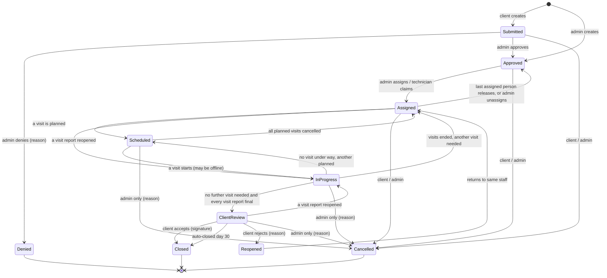

# Product Requirements Document
## AWS-MMS — Automatic Weather Station Maintenance Management System

| | |
|---|---|
| **Version** | 1.5 |
| **Date** | 2026-10-22 |
| **Status** | Final draft for approval |
| **Changes in 1.5** | The visit board replaces the work record (decisions W11-16 to W11-35, 2026-10-22): a station on a visit is recorded as Notes, Tasks, Recommendations and Config (VIS-5, VIS-7, VIS-8 rewritten); VIS-6 dropped; checklist templates removed; sensor swaps, unknown serials and field calibrations are recorded on the Sensors page, not through a visit (SEN-4, SEN-5, CAL-1); a Config element's After files become a configuration version (CFG-4). §6.2, §9 phase 4 and Appendix A follow |
| **Changes in 1.4** | REQ-7: a technician can release a claim, and an admin can unassign; the request returns to the queue when nobody is left (decision W9-4, 2026-10-21). Section 5.1 shows the Assigned to Approved move |
| **Changes in 1.3** | AUD-1 also audits brand colour changes: admins can change the organization-wide colours on Settings (decision W4-12, 2026-10-17) |
| **Companion document** | [TRD.md](TRD.md) v2.1 (Technical Requirements Document) |
| **Supersedes** | PRD 1.0 and all drafts in [drafts/](drafts/) |
| **Changes in 1.1** | From the 2026-10-16 engineering review: one owner per station on a visit replaces offline merging (VIS-1, OFF-11); a request can have several visits open at once (§5.1); reopening a report during Client Review returns the request to In progress (RPT-6); admins can cancel during Client Review (§5.1); offline PIN unlock (AUTH-12); five services (NFR-13); §8 replaced by the Implementation Plan |
| **Changes in 1.2** | AUTH-1: the client types their organization's name; the admin links it to an existing organization or creates one at approval. A public pick list would show every client organization's name to anyone (decided 2026-10-17) |

---

## 1. Purpose

AWS-MMS is a web application for managing maintenance of **Automatic Weather Stations (AWS)** that the organization operates for external client organizations across several countries. It lets clients request maintenance on their stations and follow it to completion. It lets staff plan, carry out and document that work in the field, including where there is no mobile signal. It produces signed PDF reports for every site visit and summary reports across the station network.

### 1.1 Problems it solves

- Maintenance requests arrive by email and phone and are hard to track.
- Clients have no visibility of request status and no formal way to confirm work was done.
- Field work is recorded inconsistently, and photos sit on personal phones.
- There is no reliable history of which sensor (by serial number) was installed where, or when it was calibrated.
- Station documentation and configuration files are scattered and hard to reach on site.
- Visit reports are written by hand after each visit and are not signed off consistently.

### 1.2 Goals

| # | Goal | Measure of success |
|---|---|---|
| G1 | Every maintenance request is tracked from submission to closure | 100% of requests created in the app within 3 months of launch |
| G2 | Clients can see request status without contacting staff | 50% fewer status-enquiry calls/emails (baseline measured before launch) |
| G3 | Every site visit is documented consistently | 100% of visits have a board per station with at least one element |
| G4 | Visit reports are produced from structured data and signed | Draft report ready within 10 minutes of a visit syncing; 90% finalized and signed within 3 working days |
| G5 | Full sensor and calibration history per station | Every sensor swap and calibration recorded against serial numbers |
| G6 | Staff can work at sites with no signal | A complete visit can be recorded offline and synced later with no data loss |
| G7 | Clients formally confirm completed work | 100% of completed requests are accepted, rejected or auto-closed with an audit record |
| G8 | Significant actions are traceable | Every action listed in §4.15 produces an immutable audit record |

### 1.3 Non-goals (out of scope for v1)

- Ingesting, storing or displaying live weather observations or telemetry.
- Raising requests automatically from telemetry faults.
- **Routine / preventive maintenance plans** (planned for a later release; see §10). Admins can raise requests themselves for planned work in the meantime (REQ-2).
- Service-level targets, deadlines, breach tracking or escalation. Turnaround is *measured* for reporting only.
- External integrations and machine-to-machine API keys. The architecture reserves a place for them (see TRD §2.1 and NFR-15).
- Full spare-parts inventory, procurement, invoicing, billing or contracts.
- Native iOS/Android apps (the web app is installable as a PWA).
- Single sign-on, social login, multi-factor authentication or SMS notifications.
- GPS tracking of technicians.
- Multi-tenant SaaS: one organization runs one deployment.

---

## 2. Users and roles

### 2.1 Definitions

| Term | Meaning |
|---|---|
| **Staff** | Users who work for the organization that runs AWS-MMS |
| **Client** | Users from an external organization that owns one or more stations |
| **Client organization** | An external organization that owns stations and has one or more client users |
| **Station (AWS)** | An automatic weather station at a fixed site |
| **Maintenance request** | A request for work on one or more stations. Completed through one or more site visits |
| **Site visit** | One trip, possibly over several days, to one or more stations to carry out work for one request |
| **Board** | What was found and done at one station during one visit, recorded as elements: Notes, Tasks, Recommendations and Config (VIS-5) |
| **Element** | One sticky note on a board: a Note, Task, Recommendation or Config, with its own files and its own Share with client setting |
| **Visit report** | The PDF report of one site visit. It is drafted automatically, edited by staff, then signed and finalized |
| **Client report** | The client's own report on a request, either an uploaded PDF or an online form |
| **Sensor model** | A make and model of sensor or component (for example Vaisala HMP155) |
| **Sensor unit** | One physical sensor or component, identified by its serial number |

### 2.2 Roles

| Role | Description |
|---|---|
| **Client** | External user belonging to exactly one client organization. Sees only that organization's stations, requests and reports. Submits requests, comments, adds client reports, and accepts or rejects completed work. |
| **Technician** | Staff who carry out maintenance. Sees all stations and requests. Claims requests from the queue, schedules and records visits, edits and signs visit reports, and maintains station, sensor, document and configuration data. |
| **Admin** | Staff who manage the service. Everything a technician can do, plus: approve or reject client registrations, approve or deny requests, assign staff, manage users and organizations, view the audit log. |
| **Viewer** | Internal read-only staff, for example management. Can view everything staff can view (including internal comments and reports) but cannot change anything. Cannot see the audit log. |

- A staff user may hold several staff roles, for example Technician and Admin.
- A client cannot hold any staff role.
- Clients can never see another organization's data. A client asking for another organization's resource gets "not found".

### 2.3 Permission matrix

| Capability | Client | Technician | Admin | Viewer |
|---|---|---|---|---|
| View stations, sensors, documents, configs | Own org (summary; no configs) | All | All | All |
| Create / edit stations, sensors, documents, configs | — | ✅ | ✅ | — |
| Create a maintenance request | Own org | — | ✅ (any org) | — |
| Edit / cancel a request | Own, until Scheduled | — | ✅ until Closed | — |
| Approve / deny a request | — | — | ✅ | — |
| Assign staff | — | — | ✅ | — |
| Claim a request from the queue | — | ✅ | ✅ | — |
| Schedule a visit | — | Assigned staff | ✅ | — |
| Record a visit: media | — | Attending staff | Attending staff | — |
| Record a visit: add elements to a station's board | — | Any attending staff; edits by the element's author or the station's owner | The same; any element as admin | — |
| Edit, sign and finalize a visit report | — | Attending staff | ✅ | — |
| Comment on a request | Own org | ✅ | ✅ | — |
| See internal comments | — | ✅ | ✅ | ✅ |
| Add a client report (PDF or online form) | Own org | — | — | — |
| Accept / reject completed work (with signature) | Own org | — | — | — |
| Summary reports | Own org, limited types | ✅ | ✅ | ✅ |
| Dashboard | Client dashboard | Technician dashboard | Admin dashboard | Admin dashboard (read-only) |
| Manage users, organizations, registrations | — | — | ✅ | — |
| View audit log | — | — | ✅ | — |

### 2.4 Personas

**Maria, client operations officer** at an agricultural agency that owns 12 stations. A station has stopped reporting rainfall. She wants to report it, see when someone will go, read what was done, and sign off on the fix.

**Devon, technician.** He travels to remote sites, sometimes on another island, often without signal. He needs station details, the right manual and the sensor history on his phone. He needs to capture photos, videos and the work done quickly, trust that nothing is lost, and sign the report back at the office.

**Andrea, admin and senior technician.** She reviews requests, approves new client accounts, assigns work and checks the audit log. She needs an overview of workload, turnaround, calibrations due and station health. She sometimes goes on visits herself.

**Paul, operations manager (Viewer).** He looks at dashboards and reports to understand network health and workload. He never edits records.

---

## 3. Scope summary

| Area | v1 |
|---|---|
| Authentication: client self-registration with admin approval, login, password reset | ✅ |
| Client organizations and station ownership (multi-country) | ✅ |
| Stations, sensor models, sensor units and serial-number history | ✅ |
| Calibration tracking (records, certificates, due dates, due report) | ✅ |
| Station documents and versioned configuration sets | ✅ |
| Maintenance requests (multi-station) with full workflow | ✅ |
| Request queue, assignment, multi-staff visits, multi-day visits | ✅ |
| Site visits with before/during/after images and videos | ✅ |
| Visit board per station (Notes, Tasks, Recommendations, Config) | ✅ |
| Offline field capture with later sync | ✅ |
| Visit reports: automatic draft → staff edit → e-signature → final PDF | ✅ |
| Client acceptance with e-signature; 30-day auto-close | ✅ |
| Client reports: PDF upload or online form | ✅ |
| Summary reports (PDF and CSV) and role dashboards | ✅ |
| Station QR codes and printable labels | ✅ |
| Map of stations | ✅ |
| Real-time in-app notifications and email | ✅ |
| Immutable audit trail with admin viewer | ✅ |
| Routine / preventive maintenance plans | ❌ later release |
| External integrations and API keys | ❌ later release (architecture ready) |
| SLA targets | ❌ later release |

---

## 4. Functional requirements

Priorities: **M** = must have for launch, **S** = should have, **C** = could have.

### 4.1 Authentication and accounts

| ID | Requirement | Priority |
|---|---|---|
| AUTH-1 | A client can self-register with name, email, phone, password and their organization's name. The admin links the registration to an existing organization or creates one when approving it (AUTH-3). | M |
| AUTH-2 | A newly registered client has status **Pending** and cannot log in until approved. They see a "waiting for approval" message. | M |
| AUTH-3 | Admins see pending registrations and can approve them (linking to an existing organization or creating one) or reject them with a reason. | M |
| AUTH-4 | The user is emailed when their account is approved or rejected. | M |
| AUTH-5 | Pending registrations not acted on within 30 days are deleted automatically (period configurable). | S |
| AUTH-6 | Staff accounts are created by admins only. Admins can also invite client users directly. Invited users get an email to set their password. | M |
| AUTH-7 | All users log in with email and password. | M |
| AUTH-8 | Users can reset a forgotten password through a single-use emailed link valid for 1 hour. | M |
| AUTH-9 | Passwords are at least 10 characters and must not be on a known breached-password list. | M |
| AUTH-10 | Repeated failed logins are rate-limited. Error messages do not reveal whether an email is registered. | M |
| AUTH-11 | Admins can disable a user. A disabled user is logged out of all devices. | M |
| AUTH-12 | Staff stay logged in on their field device for up to 30 days so they can work offline. If the app or phone restarts with no signal, they reopen their field work with a device PIN, set the first time they prepare a visit. Five wrong PINs require an online login; no work is lost. | M |
| AUTH-13 | Users can edit their own name, phone, password and time-zone preference. | S |

### 4.2 Client organizations

| ID | Requirement | Priority |
|---|---|---|
| ORG-1 | Admins can create, edit and deactivate client organizations (name, country, contact email, phone, address). | M |
| ORG-2 | Each station is owned by exactly one organization. | M |
| ORG-3 | All users of an organization see all of that organization's stations, requests and reports. | M |
| ORG-4 | Deactivating an organization blocks its users from logging in. Its data is kept. | M |

### 4.3 Stations

| ID | Requirement | Priority |
|---|---|---|
| STN-1 | Staff can create and edit stations with: code, name, type, owner organization, **country**, **time zone**, region (optional), latitude, longitude, elevation, measured parameters (AT, RH, BP, RAIN, WS, WD, SR, others configurable), logger (model, serial, firmware), communications, power system, install date, status and access notes. | M |
| STN-2 | Station status is one of: Operational, Degraded, Offline, Decommissioned. | M |
| STN-3 | Staff can attach station photos. | S |
| STN-4 | Each station page shows installed sensors and components (model, serial, install date, last calibration, calibration due). | M |
| STN-5 | The station list can be searched and filtered by organization, country, type, status and parameter. | M |
| STN-6 | Clients can view (not edit) a summary of their own organization's stations: details, installed sensors, documents marked client-visible, requests and reports. Configuration files are staff-only. | M |
| STN-7 | A station page shows its open requests, visit history, reports, configuration history and calibration history. | M |
| STN-8 | Existing stations can be bulk-imported from a spreadsheet (one-off admin import). | M |

### 4.4 Sensors, components and calibration

| ID | Requirement | Priority |
|---|---|---|
| SEN-1 | Staff can manage a catalogue of **sensor models**: kind (sensor, logger, modem, battery, solar panel, other), manufacturer, model, parameter(s), default calibration interval. | M |
| SEN-2 | Staff can manage individual **sensor units** by serial number with status: In stock, Installed, In repair, Retired. | M |
| SEN-3 | The system keeps a full installation history: which serial was installed at which station, for which parameter, when, on which visit, and when and why it was removed. | M |
| SEN-4 | Sensor swaps are recorded on the Sensors page (install and remove), which updates the inventory and history. A visit records what was done as board elements but does not change the inventory (W11-17). | M |
| SEN-5 | A unit that is not yet in the inventory is added on the Sensors page before it is installed. (Superseded 2026-10-22, W11-17: visits no longer create units from serials typed in the field.) | M |
| CAL-1 | Calibrations are recorded on a sensor unit from the station's Calibration tab, for a field check or a lab calibration (a visit no longer records them itself, W11-17): date, method, reference instrument (model, serial, certificate due date), readings (reference / before / after with units), result (Pass, Adjusted, Fail), performed by. | M |
| CAL-2 | A calibration certificate (PDF) can be attached to a calibration record. | M |
| CAL-3 | Each unit shows last calibrated date and **calibration due date** (last date + interval; the interval can be overridden per unit). | M |
| CAL-4 | A **Calibration due** report and dashboard widget list units overdue or due within N days (default 30), filterable by organization, country and station. | M |
| CAL-5 | Admins receive a weekly in-app and email digest of calibrations due in the next 30 days. | S |
| CAL-6 | A failed calibration flags the unit for follow-up and appears on the admin dashboard. | S |

### 4.5 Documents and configuration

| ID | Requirement | Priority |
|---|---|---|
| DOC-1 | Datasheets, operation manuals and maintenance manuals can be stored **per sensor model** and appear on every station using that model. | M |
| DOC-2 | Station-specific documents (installation documents, site drawings, other) can be stored **per station**. | M |
| DOC-3 | Documents have type, title, version, language, description, uploaded by and upload time. Uploading a new version keeps earlier versions downloadable. | M |
| DOC-4 | Each document can be marked **client-visible**. The default is staff-only. | M |
| CFG-1 | Staff can upload a **configuration version** for a station: a set of one or more files (TXT, XML, JSON, Python, CSV, logger programs, network or modem configs, related photos) with change notes. | M |
| CFG-2 | Configuration versions are numbered (v1, v2, …), timestamped, record who uploaded them and optionally the visit they relate to. They can never be overwritten or deleted through the app. | M |
| CFG-3 | Staff can view and download any version and see which files changed between two versions (by checksum). | M |
| CFG-4 | Technicians capture a new configuration version during a visit with a **Config** element: its After files become a version of the station when the visit ends; when they change after that, a technician saves them as the next version (W11-24, W11-37). Including offline. | S |

### 4.6 Maintenance requests

| ID | Requirement | Priority |
|---|---|---|
| REQ-1 | A client can create a maintenance request with title, description, category (Fault, Communications, Power, Calibration, Relocation, Inspection, Other), priority (Low, Normal, High, Urgent) and **one or more** of their stations. | M |
| REQ-2 | An admin can create a request on behalf of any organization (for example for planned or internal work). Admin-created requests start as **Approved**. | M |
| REQ-3 | A request can have photos and PDF attachments. | M |
| REQ-4 | Each request gets a human-readable reference, for example `MR-2026-0042`. | M |
| REQ-5 | A request follows the workflow in §5. Invalid status changes are not possible. | M |
| REQ-6 | Admins can approve or deny a submitted request. A denial requires a reason, which the client sees. | M |
| REQ-7 | Approved requests appear in a **queue**. Admins can assign one or more staff. Technicians can claim a request from the queue themselves, and release a claim they made (the request returns to the queue when nobody is left). | M |
| REQ-8 | Clients can view the status and full status history of their requests, and the list of visits under each request. | M |
| REQ-9 | Clients and staff can comment on a request. Comments are a flat, chronological thread and can have attachments. An author can edit a comment within 15 minutes; after that it is fixed. | M |
| REQ-10 | Staff can mark a comment as **internal**. Internal comments are never shown to clients. | S |
| REQ-11 | A client can edit or cancel their request while it is Submitted, Approved or Assigned. After that, only an admin can cancel (with a reason). | M |
| REQ-12 | When the work is done and the final visit report is signed, the request enters **Client Review** and the client is asked to accept or reject. | M |
| REQ-13 | **Accepting** requires the client's electronic signature and closes the request. **Rejecting** requires a reason, reopens the request and returns it to the same assigned staff. Admins are notified. | M |
| REQ-14 | If the client does not respond, they are reminded on days 7, 21 and 28. On day 30 the request is **closed automatically** and the close-out report states it was auto-closed. Both periods are configurable. | M |
| REQ-15 | Requests can be listed and filtered by status, organization, country, station, category, priority, assigned staff and date range. | M |
| REQ-16 | Turnaround times (submitted → approved → first visit → client review → closed) are recorded for reporting. No deadlines are enforced. | M |

### 4.7 Site visits

| ID | Requirement | Priority |
|---|---|---|
| VIS-1 | Assigned staff or admins can schedule a visit for a request: planned start and end (a visit may last several days), attending staff (one or more, one marked **lead**), which of the request's stations it covers, the **owner** of each station's work record (one of the attending staff; the lead by default), and notes. A request can have more than one visit planned or under way at the same time, for example two teams on different islands. | M |
| VIS-2 | A visit can be rescheduled or cancelled before it starts. Clients are notified of the date and any change. | M |
| VIS-3 | Visits always belong to a request. | M |
| VIS-4 | Starting a visit records the actual start time. Each station has its own arrival and departure times. | M |
| VIS-5 | Each station on a visit has a **board** where staff record the visit as elements of four kinds, shown as sticky notes: **Note** (yellow: title, description, photos and video), **Task** (green: title, description, a checklist of typed items, Before and After photos and video; complete when every item is checked), **Recommendation** (red: title, description, priority low / medium / high, photos and video; can be turned into a new request) and **Config** (purple: title, description, Before and After files of any kind, photos and video). Opening an element shows it in a dialog, with every file viewed in place. | M |
| VIS-6 | *Dropped 2026-10-22 (W11-34).* Before and After now belong to Tasks and Config, so nothing is required per station to end a visit. Ending with incomplete tasks shows a warning and asks to confirm. | — |
| VIS-7 | Any attending staff member or an admin can add an element to a station's board. The element's author, the station's owner or an admin can edit it, tick its items, add or remove its files, share it and delete it. The board can be changed from the visit's start until its report is finalized. Each element has a **Share with client** setting (on by default for Tasks and Recommendations); clients see shared elements once the visit has ended. | M |
| VIS-8 | A Task's items are typed by the technician. *(Checklist templates were removed 2026-10-22, W11-16.)* | M |
| VIS-9 | When ending a visit, staff state whether another visit is needed. If yes, they note the remaining work, and the request returns to be scheduled again. If no, the request waits for the visit report to be finalized (§4.10). | M |
| VIS-10 | Up to about 50 media items per visit. Videos are typically 30 seconds to 2 minutes. | M |
| VIS-11 | Clients can see visits, their media and finalized reports for their requests. Draft reports are staff-only. | M |
| VIS-12 | After the visit report is finalized, the visit's boards are locked. Corrections need an admin to reopen the report (§4.10). | M |

### 4.8 Offline field work

| ID | Requirement | Priority |
|---|---|---|
| OFF-1 | Staff can **prepare** an assigned visit while online. This downloads the request, stations, installed sensors, calibration status, the latest configuration version, the stations' boards and, optionally, manuals. | M |
| OFF-2 | With no connection, staff can open a prepared station (including by QR scan), start the visit, add and edit board elements with their photos, videos and files, tick task items, and end the visit. | M |
| OFF-3 | Offline data is stored on the device and survives the app or phone being closed or restarted. | M |
| OFF-4 | The app shows clearly how many changes and files are waiting to sync, and the storage used. | M |
| OFF-5 | Data syncs automatically when a connection returns, and on demand with a "Sync now" button. | M |
| OFF-6 | Interrupted uploads resume rather than restart. | M |
| OFF-7 | Syncing the same data twice never creates duplicates. | M |
| OFF-8 | Local copies are deleted only after the server confirms receipt. | M |
| OFF-9 | The app warns before starting a visit that has not been prepared for offline use. | S |
| OFF-10 | Offline mode covers site visits and station lookup only. Approvals, request creation, report signing and admin work need a connection. | M |
| OFF-11 | Each element on a board is saved on its own with a version, and only its author, the station's owner or an admin edits it, so offline edits conflict only when the same person edits one element on two devices; the device then keeps its copy for export. Any attending technician can add elements at any station. The lead or an admin can change a station's owner while online; work the previous owner had not yet synced is kept on their phone for export and is never silently overwritten. | M |

### 4.9 Media

| ID | Requirement | Priority |
|---|---|---|
| MED-1 | Images are converted to WebP and resized for viewing. Thumbnails are generated. | M |
| MED-2 | Videos are compressed to a format that plays in all supported browsers, with a thumbnail. | M |
| MED-3 | PDFs, configuration files and documents are stored unchanged and virus-scanned. | M |
| MED-4 | Users can view media only for stations and requests they have access to. | M |
| MED-5 | Media shows capture time (in the station's local time) and an optional caption. | S |
| MED-6 | Limits: 200 MB per video, 25 MB per image, 50 MB per document. | M |
| MED-7 | GPS and personal EXIF metadata are removed from processed images. | M |

### 4.10 Visit reports and electronic signatures

| ID | Requirement | Priority |
|---|---|---|
| RPT-1 | When a visit ends and syncs, a **draft visit report** is generated automatically from the structured visit data using the template in Appendix A. | M |
| RPT-2 | Attending staff can edit the draft's narrative sections (summary, work performed narrative, recommendations, follow-up) and choose which photos appear in the body and their captions. Factual data (the board's elements) is corrected on the board, and the draft refreshes. | M |
| RPT-3 | Staff can preview the draft as a PDF at any time. | M |
| RPT-4 | **Finalizing** requires the lead technician's electronic signature. Other attending staff may also sign. | M |
| RPT-5 | An electronic signature records: signer, role, a typed full name, a drawn signature, an attestation statement, timestamp, and the report version it applies to. The signed PDF shows the signatures and a verification hash. | M |
| RPT-6 | A finalized report version cannot be changed. An admin can **reopen for correction**, with a reason, which creates a new draft version that must be signed again. Earlier versions stay available and are marked superseded. If the request is in Client Review, it returns to In progress and its reminders and auto-close stop; the client reviews again once the corrected report is final. If the request is already Closed, it stays Closed, the client is notified, and the close-out report is regenerated. | M |
| RPT-7 | Staff are reminded to finalize after 2 working days. Admins are notified after 5 working days. | S |
| RPT-8 | When a request closes, a **request close-out report** is generated: request details, status timeline, visits with links to their reports, client reports, the client's decision with signature (or the auto-close statement) and comments. | M |
| RPT-9 | All times on reports are shown in the station's local time zone, with the zone name. | M |
| RPT-10 | Reports carry the organization's branding and numbering (`VR-2026-0042-02` = request 42, visit 2). | M |
| RPT-11 | The signed PDF can be verified: uploading it, or entering its hash, confirms whether it matches a finalized version. | C |

### 4.11 Client reports

| ID | Requirement | Priority |
|---|---|---|
| CRP-1 | A client can add their own report to a request at any time, choosing to either **upload a PDF** or **fill in an online form**. | M |
| CRP-2 | The online form records: title, report date, stations covered, summary, per-station observations, data-quality notes and attachments. It can be saved as a draft and then submitted. | M |
| CRP-3 | A submitted online client report is rendered to PDF with the organization's template, and the PDF is attached to the request. | M |
| CRP-4 | Submitted client reports cannot be edited. The client can add a new one instead. | M |
| CRP-5 | Client reports appear on the request, in the close-out report and on the station history. | M |

### 4.12 Summary reports and dashboards

| ID | Requirement | Priority |
|---|---|---|
| SUM-1 | Staff and Viewers can generate summary reports filtered by date range, organization, country and station: Station history, Station asset (installed sensors and components), Configuration history, Client activity, Request turnaround, Technician workload, Sensor reliability, Calibration due, Network status, and Monthly and Annual maintenance summaries. | M |
| SUM-2 | Summary reports are produced as PDF. Tabular reports can also be exported as CSV. | M (PDF) / S (CSV) |
| SUM-3 | Clients can generate Station history, Station asset and Client activity reports for their own organization only. | S |
| SUM-4 | **Admin dashboard:** registrations pending, requests awaiting approval, open requests by status, unassigned queue, upcoming visits, reports awaiting finalization, requests in Client Review, calibrations due/overdue, failed calibrations, station status counts by country. | M |
| SUM-5 | **Technician dashboard:** my assigned requests, queue, my upcoming visits, visits waiting to sync, my reports to finalize. | M |
| SUM-6 | **Client dashboard:** our stations and status, open requests, requests awaiting our review, upcoming visits, recent reports. | M |

### 4.13 QR codes and map

| ID | Requirement | Priority |
|---|---|---|
| QR-1 | Every station has a unique QR code that holds an opaque token, not station data. | M |
| QR-2 | Scanning the code opens the station in the app, after login if needed. | M |
| QR-3 | What is shown depends on role. Staff see full details, sensors, configurations, manuals, history and "Start visit". Clients see a summary, open requests, past reports and "Report a problem". | M |
| QR-4 | A client scanning another organization's station sees no details. | M |
| QR-5 | The app has a built-in QR scanner, which also works offline for prepared stations. | S |
| QR-6 | Admins can print label sheets (QR code, station name and code, contact phone). | M |
| QR-7 | Admins can revoke and regenerate a station's QR code. | S |
| MAP-1 | A map (OpenStreetMap) shows all stations the user can see, coloured by status. | M |
| MAP-2 | Markers cluster when zoomed out. | S |
| MAP-3 | Clicking a station shows name, type, status, open requests and a link to its page. | M |
| MAP-4 | The map can be filtered by organization, country, type, status and "has open request". | S |

### 4.14 Notifications

| ID | Requirement | Priority |
|---|---|---|
| NOT-1 | Users receive real-time in-app notifications for events relevant to them (Appendix B). | M |
| NOT-2 | A notification list shows unread and recent notifications. Notifications missed while offline appear after reconnecting. | M |
| NOT-3 | Account events (registration outcome, invitation, password reset) are always emailed. | M |
| NOT-4 | Users can turn email on or off per notification type, except account events. | S |
| NOT-5 | Open pages update live when a request's status changes or a comment is added. | S |

### 4.15 Audit trail

| ID | Requirement | Priority |
|---|---|---|
| AUD-1 | The system keeps an immutable audit trail of: logins, failed logins, logouts and password resets; user, role and organization changes; registration approvals and rejections; station, sensor and calibration changes; document and configuration uploads; request creation, edits, approval, denial, assignment, claim, cancellation; visit scheduling, start, end and overrides; media uploads and deletions; report finalization, signatures and reopening; client acceptance, rejection and auto-closure; QR regeneration; brand colour changes. | M |
| AUD-2 | Each record holds: actor, actor role, action, resource type and ID, organization, timestamp, before/after values where relevant, IP address, device, and correlation ID. | M |
| AUD-3 | No user, including admins, can edit or delete audit records through the app. | M |
| AUD-4 | Admins can search the audit log by actor, action, resource, organization and date, and export results as CSV. | M |
| AUD-5 | The audit trail is tamper-evident: each record includes a hash linking it to the previous one, and an admin can run an integrity check. | S |
| AUD-6 | Resource pages (request, station, visit) show a staff-only "History" tab drawn from the audit trail. | S |

---

## 5. Workflows

### 5.1 Maintenance request

**From Assigned until closure, the status follows the request's visits and visit reports.** It is recalculated every time a visit or a visit report changes (TRD §3.2.2), so a request can have several visits open at once:

1. If any visit is under way, the request is **In progress**.
2. Otherwise, if any visit is planned, it is **Scheduled**.
3. Otherwise, if no visit has ended yet, or the most recently ended visit said another visit is needed, it is **Assigned**.
4. Otherwise, if any ended visit's report is not yet final, it is **In progress** (waiting for the report).
5. Otherwise it is **Client Review**. After a client rejection, it stays **Assigned** until a new visit ends or a corrected report is finalized.

| From | To | Who | Condition |
|---|---|---|---|
| — | Submitted | Client | Request created |
| — | Approved | Admin | Admin created the request |
| Submitted | Approved | Admin | — |
| Submitted | Denied | Admin | Reason required |
| Approved | Assigned | Admin, or technician claiming | At least one staff member |
| Assigned | Approved | Technician releasing their claim (the last one), or admin | Nobody is left on the request |
| Assigned / In progress | Scheduled | System | A visit is planned and none is under way |
| Scheduled | Assigned | System | Every planned visit was cancelled |
| Scheduled | In progress | System | A visit started (can happen offline) |
| In progress | Assigned | System | No visit open, and the last visit ended with "another visit needed" |
| In progress | Client Review | System | No visit open, no further visit needed, **and** every visit report finalized |
| Client Review / Assigned | In progress | System | An admin reopened a visit report for correction (RPT-6) |
| Client Review | Closed | Client | Accepted with signature |
| Client Review | Closed | System | 30 days without response (configurable) |
| Client Review | Reopened | Client | Rejected; reason required |
| Reopened | Assigned | System | Immediately; same staff |
| Submitted / Approved / Assigned | Cancelled | Client (own) or admin | — |
| Scheduled / In progress / Client Review | Cancelled | Admin | Reason required. Planned visits are cancelled too; work already recorded is kept |

### 5.2 Site visit

**Planned → Started → Ended → Report draft → Report finalized** (or **Planned → Cancelled**)

- *Started*: actual start recorded. Each station's board is filled in with Notes, Tasks, Recommendations and Config.
- *Ended*: the "Another visit needed?" question answered. Shared elements become visible to the client, and each Config element's After files become a configuration version of the station.
- *Report draft*: generated automatically and editable by attending staff.
- *Report finalized*: signed by the lead technician. The boards are locked.

### 5.3 Visit report versions

**Draft → Final (signed)** → *(admin reopens)* → **new Draft → new Final**. The earlier Final becomes **Superseded** but stays available.

---

## 6. Key user journeys

### 6.1 Client reports a fault
1. Maria logs in (or scans the station's QR code) and chooses **Report a problem**.
2. She selects the affected station(s), describes the problem and attaches a photo.
3. She sees the request as **Submitted**. She is notified as it moves to Approved, Assigned and Scheduled (with the planned dates).
4. After the visit she reads the signed visit report.
5. When the request reaches **Client Review**, she reviews the report and media, signs and accepts. Alternatively, she rejects with a reason.
6. She optionally fills in the online client report form for her own records.

### 6.2 Technician carries out a visit with no signal
1. At the office, Devon opens his assigned visit and taps **Prepare for field**.
2. On site with no signal, he scans the station QR code, and the station page opens from the device.
3. He taps **Start visit**. On the station's board he adds a Task, "Replace RH sensor", with three items and Before photos and a short video.
4. He ticks the items as he goes, adds After photos, and adds a Config element with the old logger program as Before and the updated one as After. A Recommendation notes that the mast's guy wires need replacing next quarter.
5. He answers "Another visit needed?" with **No**, and ends the visit.
6. The app shows "5 changes and 18 files waiting to sync".
7. Back in coverage, the app syncs. The updated logger program becomes the station's new configuration version, and a draft visit report appears. At the office he records the RH swap on the Sensors page.
8. Next morning he edits the summary and recommendations, picks the photos, signs and finalizes. The request moves to **Client Review**, and Maria is notified.

### 6.3 Admin processes new work
1. Andrea's dashboard shows two pending registrations, three submitted requests and four calibrations due.
2. She approves a registration and links it to an existing organization.
3. She approves two requests and denies one with a reason.
4. She assigns one approved request to two technicians. The other stays in the queue for any technician to claim.
5. She checks the audit log to see who changed a station's status last week.

---

## 7. Non-functional requirements

| ID | Category | Requirement |
|---|---|---|
| NFR-1 | Scale | 50–500 stations, about 200 users, about 3–5 requests per month, up to 50 media items per visit, with room to grow 5×. |
| NFR-2 | Performance | Pages and API reads respond in under 1 second (95th percentile) on a normal connection. A draft visit report is ready within 10 minutes of sync. Summary reports are ready within 2 minutes. |
| NFR-3 | Availability | 99% during business hours. Planned maintenance happens outside business hours. |
| NFR-4 | Offline | A complete visit, including media, can be recorded with no connection and synced later without loss. |
| NFR-5 | Devices | Works on the current and previous major versions of Chrome, Edge, Firefox and Safari (including iOS Safari and Android Chrome). Usable on phones (field mode), tablets and desktops. Installable as a PWA. |
| NFR-6 | Security | All traffic over HTTPS. Passwords hashed with Argon2id. Clients cannot access other organizations' data. Authorization enforced on the server. Uploaded files virus-scanned. |
| NFR-7 | Privacy | GPS and personal EXIF metadata removed from processed images. Personal data is limited to name, email, phone and audit metadata. |
| NFR-8 | Data retention | Requests, visits, reports, signatures, sensor and calibration history, configuration versions and audit records are kept indefinitely. Original (unprocessed) image and video files are deleted 30 days after processing (configurable). Processed media is kept. |
| NFR-9 | Backup and recovery | Nightly database backups and continuous file replication to a second host. Recovery point ≤ 24 hours, recovery time ≤ 8 hours. Restore tested quarterly. |
| NFR-10 | Hosting | Self-hosted on the organization's own servers using Docker Compose. |
| NFR-11 | Accessibility | WCAG 2.2 AA for core screens. |
| NFR-12 | Maintainability | Built and run by one developer: identical service structure, a shared library, automated tests and deployment, monitoring and alerts. |
| NFR-13 | Architecture | Microservices with event-driven communication: five services split by business capability (see TRD ADR-1). |
| NFR-14 | Time and locale | English user interface. Times are stored in UTC. The UI shows the user's time zone. Reports and visit records show the station's local time zone. |
| NFR-15 | Extensibility | The APIs and event stream are designed so integrations (telemetry, dashboards, MQTT) and routine maintenance can be added without redesign. |

---

## 8. Release plan

> **Replaced by the Implementation Plan ([IP.md](IP.md) v1.1):** 25 weeks to go-live, including readiness, a buffer and a pilot. The table below is the original estimate, kept for reference. The launch criteria still apply.

| Phase | Content | Estimate |
|---|---|---|
| 1. Foundations | Monorepo, shared library, Compose stack, gateway, auth service, registration approval, users and organizations, app shell, audit service skeleton, CI | 3 weeks |
| 2. Stations | Stations, sensor models and units, installation history, calibration records, documents, configuration versions, map, QR codes and labels, station import | 3 weeks |
| 3. Requests | Request workflow, queue, assignment, comments, attachments, notifications (in-app and email) | 3 weeks |
| 4. Visits (online) | Visits, the visit board (Notes, Tasks, Recommendations, Config), media processing, file viewers | 3 weeks |
| 5. Offline field mode | PWA, prepare-for-field, offline capture, resumable sync, conflict handling, field test | 3 weeks |
| 6. Reports and signatures | Draft visit reports, editor, e-signatures, finalization, client review and auto-close, client reports, close-out report | 3 weeks |
| 7. Summaries and hardening | Summary reports and CSV, dashboards, audit viewer, monitoring, backups, security review, user acceptance testing | 3 weeks |

**Total estimate:** about 21 weeks for one developer.

**Launch criteria:** all **M** requirements done; a full visit recorded offline on real Android and iOS devices and synced with no loss; restore from backup tested; audit integrity check passes; user acceptance testing passed with at least two client organizations and two technicians.

---

## 9. Assumptions and dependencies

- The organization provides servers, domain names (app and file hosts), TLS certificates and an SMTP relay.
- Staff have smartphones or tablets with a camera and a current browser.
- Existing station and sensor data can be supplied as a spreadsheet for import.
- The organization supplies branding (logo, colours), report numbering preferences and the attestation wording for signatures.
- Stations are located in several countries. Each station's IANA time zone is known.
- A drawn signature with a typed name, attestation and audit record is acceptable as an electronic signature in the relevant jurisdictions (to confirm; see Q3).

## 10. Planned for later releases

| Item | Notes |
|---|---|
| Routine / preventive maintenance | Plans per station or sensor model with frequency. Due visits generated automatically. Reuses the visit, board and report features. |
| External integrations | Integration service with scoped API keys (`stations:read`, `maintenance:read`, …), telemetry platform link and dashboards. Gateway route already reserved. |
| SLA targets | Target resolution per priority, due dates, compliance reporting. |
| Telemetry-driven requests | Raise requests automatically when a station stops reporting. |
| Spare-parts inventory | Stock levels and parts consumption. |

## 11. Decisions made in finalizing this PRD

| Topic | Decision | Drafts considered |
|---|---|---|
| Roles | Client, Technician, Admin, Viewer. No client sub-roles. | A had 3 roles; B added Viewer; C added Dev staff |
| Client onboarding | Self-registration with admin approval; admins can also invite | A ✔, B admin-only, C invite code |
| Routine maintenance | Out of v1 | A auto-generated; B informational |
| Calibration | Full tracking | A partial; B dates; C out of scope |
| Visit reports | Auto draft → edit → e-signature → finalize | A auto only; B edit and signatures ✔ |
| Client verification | Signature on acceptance; auto-close at 30 days, reminders days 7/21/28 | A 14 days; B 30 days ✔ |
| Cancellation | Client until Scheduled; admin any time before closure | A ✔; C until arrival |
| Client reports | PDF upload or online form | A PDF only; B both ✔ |
| Media phases | Before / During / After per station | A arrival/departure; B before/during/after ✔ (superseded 2026-10-22: media belongs to board elements, W11-16) |
| SLA | Not in v1; turnaround measured only | C had SLA |
| Integrations | Not in v1; architecture ready | B had an integration service |
| Geography | Multi-country: country and time zone per station | B had a country field |
| Original media | Deleted 30 days after processing | A ✔; B keep where possible |

**Decisions made in 1.1** (engineering review, 2026-10-16)

| Topic | Decision |
|---|---|
| Two technicians on one station | Everyone attending adds elements; each element is edited by its author, the station's owner or an admin. Replaces offline merging (OFF-11) |
| Parallel visits | A request can have several visits open; its status follows them (§5.1) |
| Report corrected during Client Review | Request returns to In progress; the client reviews again (RPT-6) |
| Admin cancel | Allowed up to closure, including during Client Review |
| Offline restart | Device PIN reopens field work without signal (AUTH-12) |

## 12. Open questions

| # | Question | Current assumption |
|---|---|---|
| Q1 | Branding, logo and exact report numbering format | To be supplied; formats in §4.10 used meanwhile |
| Q2 | Signature attestation wording | "I confirm the information in this report is accurate and the work described was carried out." |
| Q3 | Do any client jurisdictions need more than a simple electronic signature (for example a certificate-based digital signature)? | No. A certificate-based PDF signature can be added later. |
| Q4 | List of countries and time zones in scope | Supplied with the station import |
| Q5 | *Closed 2026-10-22: checklist templates were removed (W11-16).* | — |
| Q6 | Final list of request categories and priority definitions | As in REQ-1 |
| Q7 | Which documents should clients see by default? | **Decided 2026-10-19: none.** Staff mark each document client-visible; the switch is off for every new document (DOC-4) |

---

## Appendix A – Visit report template (A4 PDF)

1. **Header:** logo, organization name, "Site Visit Report", report number (`VR-2026-0042-02`), version and status (Draft watermark until finalized), visit dates. **Footer:** page x of y, generated date, verification hash (final only).
2. **Summary:** request reference and title, client organization, country, stations visited, attending staff (lead marked), arrival and departure times (station local time), outcome ("All work complete" or "Additional visit required"), narrative summary *(editable)*.
3. **Per station:**
   - Station details: name, code, type, country, coordinates, elevation, parameters.
   - Tasks: title, description, items with their checks (incomplete tasks highlighted), selected Before and After photos.
   - Notes: title, description, selected photos.
   - Recommendations: title, priority, description, selected photos, the linked request if any.
   - Configuration changes: the Config elements, with the version number made from each, files and description.
   - Work performed narrative *(editable)*.
4. **Videos:** thumbnail, caption, duration and a QR code linking to the video in the app.
5. **Recommendations and follow-up** *(editable)*: remaining work, recommendations, calibrations coming due.
6. **Signatures:** for each signer: name, role, drawn signature, timestamp (UTC and station local), attestation text.
7. **Appendix:** remaining photos with captions and capture times.

The **request close-out report** contains: request details, status timeline, visits with report numbers and links, client reports, client decision with signature (or "Closed automatically on <date> after 30 days without client response"), and comments (internal comments excluded).

## Appendix B – Notification matrix

| Event | Client | Assigned / attending staff | Admin |
|---|---|---|---|
| Client registered | — | — | In-app |
| Account approved / rejected / invited | Email | — | — |
| Request submitted | In-app | — | In-app + email |
| Request approved / denied | In-app + email | — | — |
| Request assigned or claimed | In-app | In-app + email | In-app (if claimed) |
| Visit scheduled / rescheduled / cancelled | In-app + email | In-app + email | — |
| Visit ended (draft report ready) | — | In-app | — |
| Report not finalized after 2 / 5 working days | — | In-app + email | In-app (day 5) |
| Visit report finalized | In-app + email | In-app | — |
| Visit report reopened for correction (request in Client Review or Closed) | In-app + email | In-app | — |
| Station owner changed on a visit | — | In-app (old and new owner) | — |
| Offline work could not be applied (sync conflict, for example a cancelled visit) | — | In-app (the technician and the lead) | In-app |
| Request in Client Review (please verify) | In-app + email | — | — |
| Client Review reminder (days 7, 21, 28) | In-app + email | — | — |
| Work accepted / auto-closed | In-app | In-app | In-app |
| Work rejected / reopened | — | In-app + email | In-app + email |
| Request cancelled | In-app + email | In-app | In-app |
| Comment added | In-app (not internal) | In-app | — |
| Client report added | — | In-app | In-app |
| Calibrations due (weekly digest) | — | — | In-app + email |
| Sensor serial needs review | — | — | In-app |
| Password reset | Email | Email | Email |
