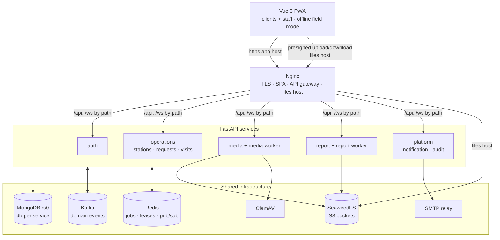
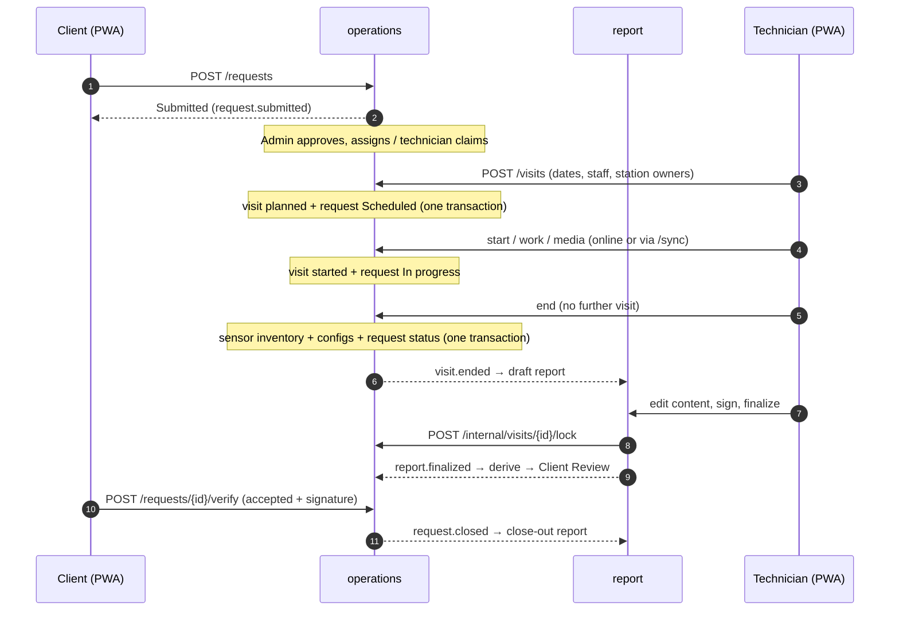
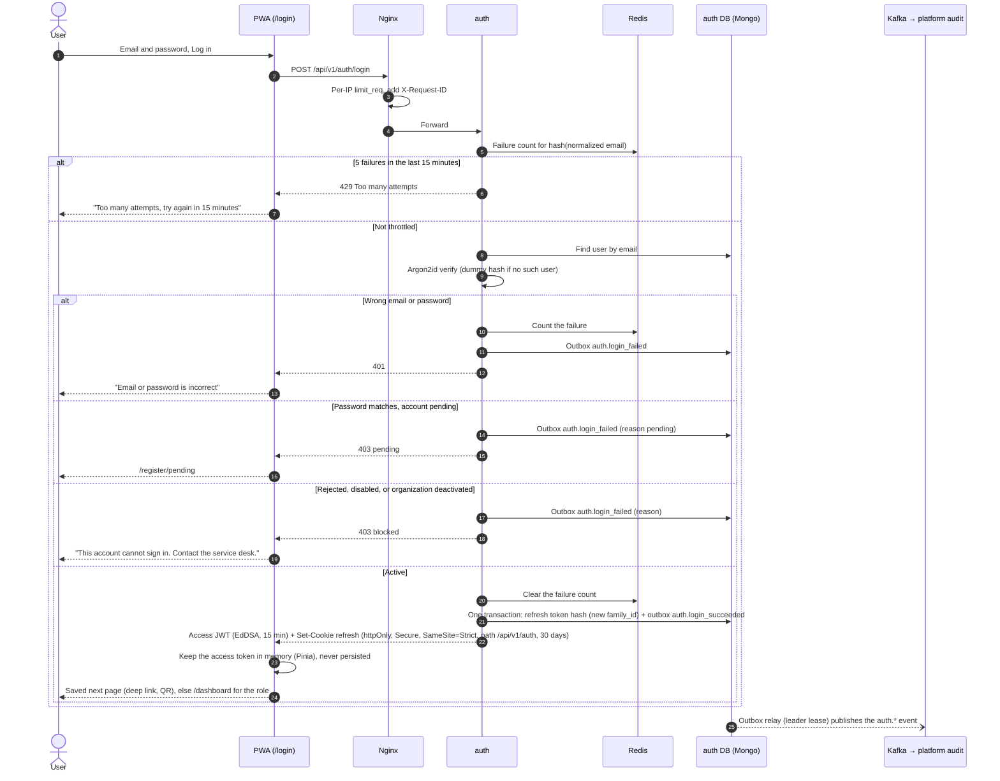
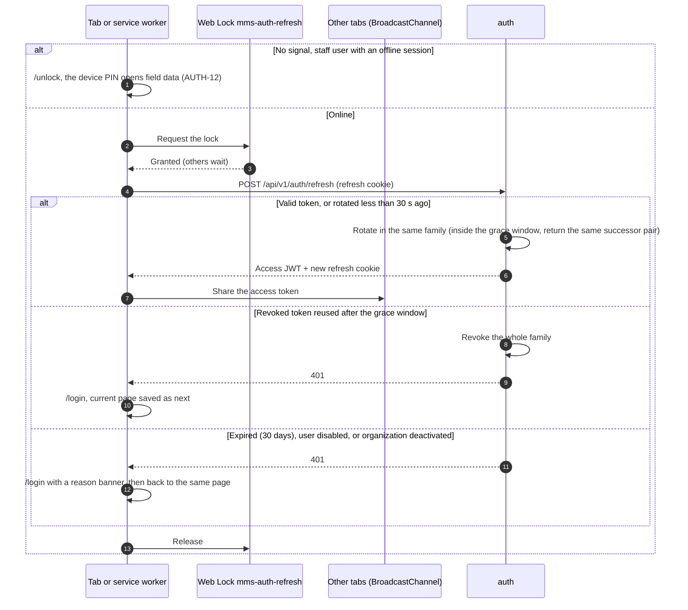
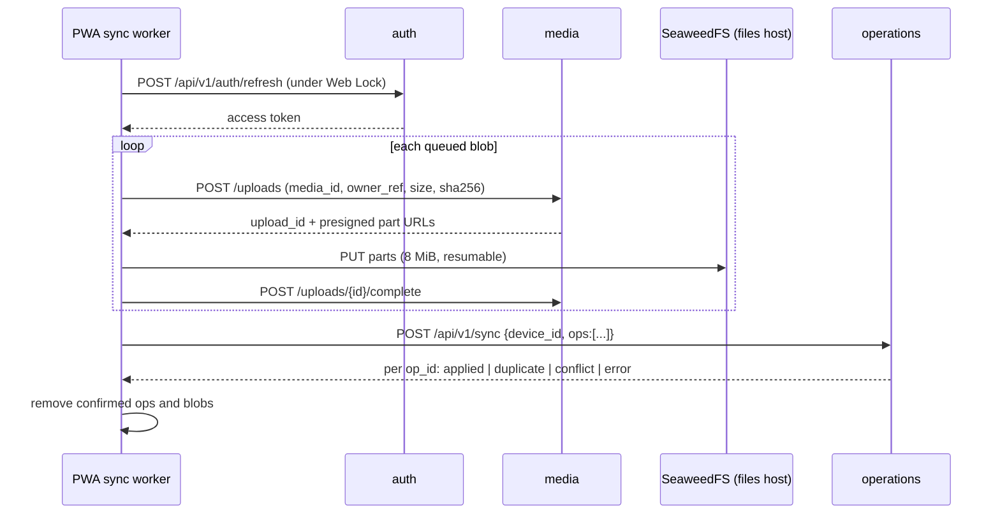

# Technical Requirements Document
## AWS-MMS — Automatic Weather Station Maintenance Management System

| | |
|---|---|
| **Version** | 2.12 |
| **Date** | 2026-10-19 |
| **Status** | Final draft for approval |
| **Companion document** | [PRD.md](PRD.md) v1.2 (Product Requirements Document) |
| **Supersedes** | TRD 1.3 and all drafts in [drafts/](drafts/) |
| **Changes in 1.1** | Dark theme, ApexCharts, and staff names shown to clients, from Design Brief decisions D2–D4 ([DBD.md](DBD.md)) |
| **Changes in 1.2** | The component library changes from PrimeVue 4 to **Vuetify 4**, still with Tailwind CSS 4 (ADR-11, §1.1, §13, NFR-11, CSP). Icons change from PrimeIcons to Material Design Icons |
| **Changes in 1.3** | §17 Testing strategy is summarized here and detailed in the Test Plan ([TP.md](TP.md)) |
| **Changes in 2.0** | From the 2026-10-16 engineering review. **Five services instead of nine** (ADR-1): station, maintenance and visit merge into `operations`; notification and audit merge into `platform`; the integration stub is dropped. **Kong is removed**; Nginx is the gateway (ADR-5). **SeaweedFS replaces MinIO** (ADR-6, R6). New: derived request status with parallel visits (ADR-17), one owner per station on a visit instead of offline merging (ADR-18), fail-closed file visibility (ADR-19), offline PIN session and refresh-token coordination (ADR-20, §6.1), sensor-action correction (§3.2), finalize saga (§11.2), outbox leader lease and `aggregate_version` (§8), read-model backfill (§8.6), and CSP, multipart and audit-role fixes |
| **Changes in 2.2** | Brand colours, motion and Settings (2026-10-17, decisions W4-10 to W4-13). The brand colours are a **Material 3 theme** that admins can change for everyone: `GET /api/v1/auth/branding` (public) and `PUT` (admin, with `version`), stored in auth's `settings` collection, audited as `branding.updated` (§3.1, §5.1, §8.4, §13.2). The PWA keeps the last answer in `localStorage` for the first paint and offline; the service worker still caches no API response (§13.3). Frontend adds **GSAP** for the shell's motion and `@material/material-color-utilities` (loaded only by Settings) to make a theme from one colour (§1.1, §13.2) |
| **Changes in 2.3** | Kafka authentication as built (decision W4-16, 2026-10-18, §15): SASL/SCRAM-SHA-512 on the broker's client listener, one Kafka user per service with ACLs on exactly its topics, dead-letter topics and consumer groups (`infra/kafka/users.yml`), and the controller and plaintext listeners on loopback only |
| **Changes in 2.4** | From the W4 checks on staging (2026-10-18): the app version comes from `frontend/package.json` and changes only on a deliberate bump, so back-end-only releases don't prompt phones to reload (W4-17, §13.3); the Mongo entrypoint writes the replica-set key file fresh on every start, including a plain restart (W4-18, §16.1) |
| **Changes in 2.5** | From the Android phone check (2026-10-18, decision W4-19, finding F14): the service worker installs its precache **six files at a time**, each tried up to three times, the build makes few large chunks and leaves icons out of the precache, and the app registers the worker again after a failed install (§13.3) |
| **Changes in 2.6** | The stations module as built (IP Phase 2 W5, 2026-10-18, decisions W5-1 to W5-7). Sensor units are installed and removed by **actions**, `POST /api/v1/sensor-units/{id}/install` and `/remove`; `installed` is reached only through them (§3.2). `GET /api/v1/stations/facets` for the list's filters; the list pages by code (§3.2). New events `sensor_model.created` / `.updated`; a unit's events are keyed by its station while installed and by the unit while in stock (§8.1, §8.4). operations keeps a copy of the organizations from `org.*` events and auth's snapshot, read at every start with its own service secret (§3.2, §5.2, §8.6). The station import format (§3.2). `upsert_if_newer` reads before writing so a consumer's transaction is never aborted by a duplicate key (§8.6) |
| **Changes in 2.7** | The station export (T4, decision W5-8, 2026-10-18): the organization's existing system is a MongoDB with `entities` and `sites` collections, brought in once from `mongoexport` files. Organizations gain `short_name` and `external_id` (unique where set) and carry them in `org.*` events and the snapshot (§5.1, §8.4); auth's `python -m app.cli import-orgs`. Stations gain `external_id` (unique where set; the list's search matches it), and the station import reads the `sites` export, one station per device (§3.2, §5.2). In the import, the country defaults to the organization's. Parameter codes may have up to 32 characters (was 16) and a station up to 40 of them, the API's limit, in the import too: the real export has codes of 18 characters and a device with 22 parameters |
| **Changes in 2.8** | The documents path as built (IP Phase 2 W6, 2026-10-19, decisions W6-1 to W6-6). The **media service** exists: `POST /api/v1/uploads` is idempotent by `media_id` and joins an open upload of the same file by the same person (size and SHA-256); `complete` takes **no part list** because media lists the parts itself and checks them against the announced size; the file is then checked in `media-worker` in one pass (SHA-256, magic bytes, ClamAV) and is never `ready` without a scan result. `MEDIA_SCAN_MODE=clamd|off`, and `off` is refused in production (T8: staging). Operations gains **documents** (`GET/POST /api/v1/documents`, `PATCH /{id}`, `/{id}/download`, `GET /stations/{id}/documents`), **configuration versions** (`POST` only files that are `ready`, `GET`, `/{version}`, `/{version}/diff`), a calibration's `certificate_media_id`, `GET /internal/attachable` for the owner check, and a consumer for `media.processed` / `media.failed`. New events `document.uploaded`, `document.updated`, `config.version_created`, `media.visibility_requested` (operations) and the four `media.*` (§8.4). **Background jobs are a small Redis queue** (`mms_common.jobs`, a sorted set with a lease) instead of arq, which pins `redis<6` (§9). SeaweedFS runs `-volume.max=0` with 256 MB volumes: the default 8 slots ran out on the second bucket (§10.1, R6) |
| **Changes in 2.12** | Comments and PDF attachments as built (IP Phase 3 W9 slice 2, 2026-10-21, decisions W9-5 to W9-8). `POST /requests/{id}/comments` is idempotent by a device-made `id`; the author edits within 15 minutes; staff may mark their own comment internal; the thread, the count and the owner check all filter internal comments for a client in the repository layer. Attachments are PDFs (5 per request or comment, 25 MB each), uploaded under `request:<id>` or `comment:<request id>:<id>` before the owner exists, and attach only when media has marked them `ready`. A request is created with `media_ids`. A client downloads through `GET /requests/{id}/attachments/{media_id}/download` or the comment version, never from media directly. `comment.added` and `comment.updated` carry no text. |
| **Changes in 2.11** | Assigning, claiming, releasing and the queue as built (IP Phase 3 W9 slice 1, 2026-10-21, decisions W9-1 to W9-4). `POST /requests/{id}/assign` (admin; also changes the staff of a request that is still Assigned, with no status change), `/claim` (self only; two claims at once have one winner, the other gets 409 `already_assigned` with the winner's name) and the new `/release` (an Assigned request goes back to Approved when nobody is left; a technician removes only themselves, an admin everyone). Staff are checked through auth's new `POST /internal/users/lookup` (rule 1). `GET /queue` is staff only (a client gets 404) and `GET /requests/workload` (admin) counts open requests per person for the Assign dialog. New events `request.assigned`, `request.staff_changed`, `request.released`; every request event gains optional `title` and `created_by`. |
| **Changes in 2.10** | The requests module as built (IP Phase 3 W8, 2026-10-21, decisions W8-1 to W8-8): the state machine is one table in `domain/requests/state.py`; `GET /api/v1/requests/{id}` carries `actions` (what the caller may do now); `POST /api/v1/requests` is idempotent by a device-made `id` (200 on a repeat); a status change applies only if the request is still in the status the caller decided from (409 `request_changed` otherwise). `request.status_changed` fields are `from_status` and `to_status` (a field cannot be called `from`), and every request event carries the same facts (`request_id`, `ref`, `org_id`, `station_ids`, `category`, `priority`, `status`). PDF attachments move to W9 with comments. `derive_status` breaks ties between visits that ended together toward "another visit needed". |
| **Changes in 2.9** | QR codes and label sheets as built (IP Phase 2 W7, 2026-10-20, decisions W7-1 to W7-4). The map's tiles are a self-hosted Protomaps extract of the Caribbean served at `/tiles/`, not OpenStreetMap's servers (W7-9; §13.3 and the CSP changed). `GET /api/v1/qr/{token}` answers 410 `qr_revoked` for a replaced token to anyone who may see its station, 404 to everyone else; `POST /api/v1/stations/{id}/qr/regenerate` revokes the old token in the same transaction (a `qr_revoked` collection) and emits `qr.regenerated`, which carries no token. The **report service** exists as a skeleton: `POST /api/v1/reports/labels` queues a `report_jobs` record on a Redis queue, `report-worker` reads the stations and their tokens from operations' `POST /internal/labels` (tokens travel in no event or snapshot), draws an A4 sheet of ten labels with Jinja and WeasyPrint, stores it in `mms-reports` and `GET /api/v1/reports/jobs/{id}` returns a 10-minute inline download link to the person who asked (§3.2, §3.4, §11.1) **The frontend as built (W7, decisions W7-5 to W7-8):** the scanner reads the camera itself (`BarcodeDetector` where it exists, otherwise jsQR in a module worker served from our own origin, because the `qr-scanner` library builds its worker from a `blob:` URL that `worker-src 'self'` refuses, F16); `/s/:token` is open to clients (their camera app scans a label) and answers by case; the map loads Leaflet on first view and the service worker keeps viewed OpenStreetMap tiles (cache first, 2,000 entries, 30 days, 200 answers only, never fetched ahead, emptied when the session ends, §13.3, F1 still open on the policy letter); the label tool is admin only and polls the job |
| **Changes in 2.1** | From building auth and the audit module (IP Phase 1 W3, 2026-10-17). Reset and invitation links are **minted on send** through `POST /internal/account-links`; no event carries a token (§3.1, §4.2, §6.2). `/register` takes the organization name as free text. Disabling a user, deactivating an organization, a reset or a role change **revokes access tokens at once** through a Redis revocation list (§6.1, §9). Refresh expiry slides (30 days from the last refresh); the grace successor is sealed under a key derived from the replaced token; the cookie is `__Secure-mms_refresh`; login and refresh return `refresh_expires_at` (§6.1). The breached-password check fails open with a fallback and a metric (§6.2). New events `auth.password_reset_requested`, `auth.token_reuse_detected`, `user.created`, `user.purged`; `user.*` data carry the directory fields; the envelope's actor carries `name` (§8.3, §8.4). Audit appends serialize on the `audit_state` head instead of a single writer task (§12). `GET /users/{id}` added; logout needs only the cookie |

Requirement IDs in this document (AUTH-1, VIS-7, …) refer to the PRD.

---

## 1. Overview

AWS-MMS is built as **five FastAPI services**, split by business capability. Nginx sits at the edge and is also the API gateway. The frontend is a Vue 3 PWA built with Vuetify and Tailwind. All services share one MongoDB replica set, with one database per service (the platform service owns two). Files are stored in an S3-compatible store (SeaweedFS). Domain events between services go through **Kafka** with a transactional outbox. **Redis** handles background jobs, caching, leader leases and WebSocket fan-out. Everything runs with Docker Compose on the organization's own servers.

### 1.1 Technology stack

| Layer | Technology |
|---|---|
| Frontend | Vue 3.5 (Composition API, TypeScript), Vite, **Vuetify 4** (`vite-plugin-vuetify`, themes and global defaults set to the brand), Material Design Icons (`@mdi/js`, SVG), **Tailwind CSS 4** (no preflight, in a cascade layer between Vuetify's), Pinia, Vue Router, Dexie.js, vite-plugin-pwa (Workbox, `injectManifest`), Web Locks API, Leaflet + Leaflet.markercluster, jsQR (QR decoding in a same-origin worker; `qr-scanner` is not used, finding F16), qrcode (drawing a station's label), signature_pad, date-fns + @date-fns/tz, ApexCharts (`vue3-apexcharts`) |
| Backend | Python 3.13, FastAPI, Pydantic v2, PyMongo async API (`AsyncMongoClient`), httpx, aiokafka, structlog |
| Background jobs | `mms_common.jobs` (a Redis queue with a lease) and Redis-locked cron (arq was planned; see §9) |
| Database | MongoDB 8 replica set |
| Event streaming | Apache Kafka 4.x (KRaft mode, no ZooKeeper) |
| Cache / queues / pub-sub | Redis 7.4+ (AOF persistence) |
| Object storage | **SeaweedFS** (S3 API). See R6 |
| Media | ffmpeg (video), Pillow + pillow-heif (images, WebP), pdftoppm (PDF thumbnails) |
| PDF | WeasyPrint + Jinja2, segno (QR codes), ApexCharts in headless Chromium (Playwright for Python) for summary-report charts |
| Virus scanning | ClamAV (clamd) |
| Edge and API gateway | Nginx (TLS, static SPA, path routing to services, rate limits, request IDs, file host) |
| Deployment | Docker, Docker Compose, self-hosted |
| Observability | Prometheus, Grafana, Loki, Grafana Alloy, kafka-exporter, nginx-prometheus-exporter |
| CI/CD | GitHub Actions + GitHub Container Registry (see T2) |

### 1.2 Architecture decisions

| # | Decision | Rationale |
|---|---|---|
| ADR-1 | **Five services** by business capability: `auth`, `operations` (stations, requests, visits), `media`, `report`, `platform` (notification + audit). *Changed from nine in 2.0* | Microservices are required (NFR-13). Stations, requests and visits change together (ending a visit updates the request and the sensor inventory), so they live in one service and change in one transaction. Five services are what one developer can build and run |
| ADR-2 | One MongoDB replica set; one database and one DB user per service. `platform` owns two databases (`notification`, `audit`) with separate users | The replica set gives transactions (for the outbox) and change streams. Separate databases and users enforce ownership, and the audit user can stay insert-only |
| ADR-3 | Kafka for domain events **between services**, with a transactional outbox. Inside `operations`, modules call each other directly within one transaction | Durable, ordered, replayable event log between services; no eventual consistency where none is needed |
| ADR-4 | Redis for jobs, cache, leader leases, login throttling and WebSocket pub/sub, not for domain events | Job queues need different semantics (retry, timeout, cron) from domain events |
| ADR-5 | **Nginx is the edge and the API gateway.** *Kong removed in 2.0: Kong Gateway OSS has had no releases since 3.9.x* | Nginx already terminates TLS and serves the SPA and file host. Path routing, `limit_req` rate limits, `X-Request-ID` and JSON access logs cover what Kong did. API-key auth for the later integration release is done in the integration service itself |
| ADR-6 | Presigned direct uploads to the S3 store (**SeaweedFS**, *replaces MinIO in 2.0*) on a separate `files.` host | Large files never pass through Python services. Resumable multipart uploads. The application uses only the S3 API |
| ADR-7 | JWT (EdDSA / Ed25519) verified locally in each service; JWKS fetched from auth over the internal network | No auth round-trip per request |
| ADR-8 | Client-generated UUIDv7 IDs and idempotency keys | Records created offline keep their identity. Sync is safe to retry |
| ADR-9 | Monorepo with a shared `mms_common` library | One developer, consistent patterns, atomic changes across services |
| ADR-10 | Docker Compose on one host | The load is small. Services are stateless and can be scaled with `--scale` |
| ADR-11 | Vuetify 4 for components, Tailwind for layout and utilities, ordered with CSS cascade layers | Tailwind sits in its own layer after Vuetify's components and utilities and before `vuetify-final`. Preflight is skipped and Vuetify's utility and colour classes are off, so Tailwind is the only utility system. One set of brand tokens feeds both |
| ADR-12 | Media and report services each run their API and worker from **one image** as two containers | ffmpeg and PDF rendering never compete with API latency |
| ADR-13 | The audit module of `platform` consumes every event and writes to a hash-chained, insert-only collection | One complete, tamper-evident trail |
| ADR-14 | Report content is stored as structured JSON. Finalized versions are immutable | Supports edit → sign → finalize and reproducible PDFs |
| ADR-15 | All times are stored in UTC. Each station carries an IANA time zone used for display | Stations span several countries and time zones |
| ADR-16 | A resource outside the user's scope returns **404**, not 403 | Doesn't reveal that other organizations' records exist |
| ADR-17 | *New.* Once a request is assigned, its status is **derived** from its visits and visit reports and recomputed in the same transaction as every change (§3.2.2). A request may have several visits open at once | Supports parallel teams without status drift, and makes every transition idempotent |
| ADR-18 | *New.* **One owner per station on a visit.** Only the owner edits that station's work record; any attending staff can add media | No offline merge is needed, so no edit is ever silently overwritten (PRD OFF-11 v1.1) |
| ADR-19 | *New.* **Files start staff-only.** The owning service makes a file client-visible with an outbox event in the same transaction that attaches it | Fail closed: a missed or late update hides a file rather than leaking it |
| ADR-20 | *New.* **Offline field session:** a cached profile unlocked by a device PIN. Tokens are never stored on the device | Staff can reopen their work after a restart with no signal (OFF-3) without long-lived credentials on the phone |

---

## 2. System architecture



### 2.1 Hosts and edge routing

Two host names point at the server, for example `mms.example.org` (the app) and `files.mms.example.org` (the S3 store, presigned URLs only).

**Nginx, `mms.` host** (`infra/nginx/`). Services mount their own `/api/v1/...` prefix; Nginx passes the path unchanged.

| Path prefix | Target | Notes |
|---|---|---|
| `/` | Static SPA build | `try_files … /index.html`; `sw.js`, `index.html`, `theme-init.js` and `manifest.webmanifest` served `no-cache` (F10); hashed assets cached for 1 year. The `web` image keeps the `/assets/` of every release replaced in the last 7 days, so open tabs and installed apps on an older build still load their chunks (F9, `infra/scripts/carry_assets.py`); the router turns a chunk-load error into the update prompt |
| `/api/v1/auth`, `/api/v1/users`, `/api/v1/organizations` | `auth:8000` | Login, register and password-reset paths use the `auth` rate-limit zone |
| `/api/v1/stations`, `/api/v1/sensor-models`, `/api/v1/sensor-units`, `/api/v1/calibrations`, `/api/v1/documents`, `/api/v1/qr`, `/api/v1/requests`, `/api/v1/queue`, `/api/v1/client-reports`, `/api/v1/my-work`, `/api/v1/visits`, `/api/v1/checklist-templates`, `/api/v1/sync` | `operations:8000` | |
| `/api/v1/media`, `/api/v1/uploads` | `media:8000` | |
| `/api/v1/reports`, `/api/v1/dashboard` | `report:8000` | `/api/v1/reports/verify` uses the `auth` zone (public endpoint) |
| `/api/v1/notifications`, `/api/v1/audit` | `platform:8000` | |
| `/ws` | `platform:8000` | WebSocket upgrade headers; 1 h read timeout |
| `/api/v1/integrations/` | `return 501` | Problem-details JSON body. Reserved for the integrations release (PRD §10) |
| `/internal/`, `/.well-known/`, any other `/api/` path | `return 404` | Internal endpoints and JWKS are never reachable from outside |

Nginx edge features:

| Feature | Setting |
|---|---|
| Request ID | `X-Request-ID` taken from the request or generated from `$request_id`; passed upstream and echoed in the response |
| Rate limits | `limit_req` zone `api`: 300 requests/min per IP, burst 100. Zone `auth`: 10/min per IP, burst 5, on login, register, password reset and report verify. An allowlist (`geo`) raises the `api` zone for the organization's office IPs, which many staff share behind NAT |
| Body size | 10 MB on `/api/` (files go directly to the S3 store) |
| CORS | None. The SPA and the API share one origin, so cross-origin API calls are refused by the browser |
| Logs and metrics | JSON access log with route, status, request time and request ID (shipped to Loki); `stub_status` scraped by nginx-prometheus-exporter |
| TLS and headers | TLS 1.2+, HTTP → HTTPS redirect, HSTS (1 year), gzip, and the security headers in §15 |

Nginx does not verify JWTs; every service verifies them locally (ADR-7).

**Nginx, `files.` host** → `seaweedfs:8333` (S3 API), with `Host` preserved (needed for presigned signatures), `proxy_buffering off`, `client_max_body_size 16m` (multipart part size 8 MiB). There is no bucket listing (all buckets are private). The S3 store's CORS configuration allows origin `https://mms.<host>`, methods `GET`, `PUT` and `HEAD`, and **exposes the `ETag` header**, which the browser needs to complete multipart uploads. Admin UIs (SeaweedFS master and filer UIs) are reachable only via VPN or an SSH tunnel.

---

## 3. Service specifications

### 3.0 Common service layout

```
services/<name>/
  app/
    main.py          FastAPI app; lifespan starts DB, Redis, Kafka producer, outbox relay (leader lease), consumers
    config.py        pydantic-settings (env prefix per service, e.g. OPS_)
    api/             public routers (/api/v1/...), internal routers (/internal/...), schemas
    domain/          business rules and state machines (no FastAPI/Mongo/Kafka imports)
    repo/            data access; organization scoping applied here
    events/          event publishers (via outbox) and consumers
    jobs/            queue tasks and cron jobs (where used)
    migrations/      forward-only scripts NNNN_*.py
  tests/             unit (domain), api (httpx + testcontainers), contract (events)
  Dockerfile
  pyproject.toml
```

`operations` groups its code by module inside each layer: `api/stations/`, `api/requests/`, `api/visits/`, and the same under `domain/` and `repo/`. Modules call each other through `domain` and `repo` functions inside one transaction, never over HTTP.

Every service exposes `GET /health` (process alive), `GET /ready` (Mongo, Redis and Kafka reachable), `GET /metrics` (Prometheus) and OpenAPI at `/docs` (disabled in production; the schema is exported in CI). Every service that produces events also exposes `GET /internal/snapshot/{entity}?after=&limit=` for read-model backfill (§8.6).

**Background tasks.** The outbox relay runs only in the worker holding the service's Redis leader lease (§8.2), however many uvicorn workers or containers run. Kafka consumers run in every worker (one consumer group per service). Cron jobs take a Redis lock per run.

**Routing rules.** Path parameters named `{id}` are typed as a UUIDv7 string pattern, and literal paths (`/stations/geo`, `/visits/mine`, `/calibrations/due`) are declared before `/{id}` routes.

### 3.1 auth

**Owns:** users, roles, client organizations, registration approval, login, tokens, password reset, invitations, JWKS, service tokens.

| Method | Path | Roles | Purpose |
|---|---|---|---|
| POST | `/api/v1/auth/register` | public | Client self-registration → Pending (AUTH-1) |
| POST | `/api/v1/auth/login` | public | Returns an access token and sets the refresh cookie |
| POST | `/api/v1/auth/refresh` | cookie | Rotates the refresh token and returns a new access token (30 s grace for the previous token, §6.1) |
| POST | `/api/v1/auth/logout` | cookie | Revokes the refresh token family; works with an expired access token |
| POST | `/api/v1/auth/password-reset/request` | public | Opens a reset; notification emails the link (always returns 202; at most 3 per email per hour) |
| POST | `/api/v1/auth/password-reset/confirm` | public | Sets a new password and revokes all sessions and access tokens; activates an invited user |
| POST | `/api/v1/auth/invitations/accept` | public (token) | Sets the password for an invited user and signs them in |
| GET / PATCH | `/api/v1/auth/me` | any | Current user; update name, phone, password, time zone, theme |
| GET | `/api/v1/auth/branding` | public | The organization's brand colours: `{material, version, updated_at}`; `material` is null for the built-in colours (W4-12) |
| PUT | `/api/v1/auth/branding` | admin | Save the brand colours for everyone: `{material \| null, version}`; a Material 3 theme with exactly the 49 roles of each scheme and tones 0–100 of the five palettes, all `#RRGGBB`; a stale `version` is 409 |
| GET | `/api/v1/users` | admin | List and filter users (status, role, org) |
| POST | `/api/v1/users` | admin | Invite a staff or client user (AUTH-6) |
| GET | `/api/v1/users/{id}` | admin | One user |
| PATCH | `/api/v1/users/{id}` | admin | Update roles, status, org (with `version`); disable or a role change revokes all sessions and access tokens |
| POST | `/api/v1/users/{id}/approve` | admin | Approve a pending client; body: `org_id` or a new org |
| POST | `/api/v1/users/{id}/reject` | admin | Reject with a reason |
| GET / POST / PATCH | `/api/v1/organizations[/{id}]` | admin (read: staff; a client reads their own) | Manage client organizations |
| GET | `/.well-known/jwks.json` | internal network only | Public signing keys; not routed by Nginx |
| POST | `/internal/service-token` | service secret (HTTP Basic) | Short-lived token for service-to-service calls |
| POST | `/internal/account-links` | service (platform) | Mints the reset or invitation link when the email is sent: `{kind, id}` → `{url, email, name, expires_at}`; minting again replaces the token |
| GET | `/internal/snapshot/{users\|organizations}` | service | Backfill (§8.6) |

**Cron:** purge pending registrations older than 30 days (AUTH-5), daily. Expired reset, invitation and refresh tokens go by TTL indexes.
**CLI:** `python -m app.cli create-admin` (the first admin) and `seed` (TP seed users; refused in production).
**Emits:** `user.*`, `org.*`, `auth.*` security events, `branding.updated` (§8.4).

### 3.2 operations

**Owns:** stations, sensor models, sensor units, installation history, calibrations, document metadata (per model and per station), configuration versions, QR tokens, map GeoJSON; maintenance requests and their state, queue and assignment, comments, attachments, client reports, client verification (with signature), auto-close; site visits, station owners, work records, checklist templates, field bundles and the sync endpoint.

**Stations module**

| Method | Path | Roles | Purpose |
|---|---|---|---|
| GET | `/api/v1/stations` | any (client: own org) | List, filter (org, country, type, status, parameter), search, paginate |
| POST | `/api/v1/stations` | technician, admin | Create a station |
| GET | `/api/v1/stations/facets` | any (scoped) | Countries, types, parameters and organizations present, for the list's filters (as built 2.6) |
| GET | `/api/v1/stations/geo` | any (scoped) | GeoJSON FeatureCollection for the map |
| GET | `/api/v1/stations/{id}` | any (scoped) | Detail, including installed units and calibration status |
| PATCH | `/api/v1/stations/{id}` | technician, admin | Update (owner organization can't change: BSD B5) |
| GET | `/api/v1/stations/{id}/installations` | any (scoped) | Sensor installation history |
| GET / POST | `/api/v1/stations/{id}/config-versions` | staff (read) / technician, admin (write) | List; create a version `{files:[media_id], notes, visit_id?}` |
| GET | `/api/v1/stations/{id}/config-versions/{v}/diff?against=` | staff | File-level diff by checksum (CFG-3) |
| POST | `/api/v1/stations/import` | admin | Bulk import from CSV/XLSX (STN-8); dry-run mode |
| GET | `/api/v1/qr/{token}` | any (scoped) | Resolve a QR token → `{station_id, code, name, view: staff\|client}` (as built 2.9). A replaced token: 410 `qr_revoked` if the caller may see the station, else 404 (QR-4, rule 4) |
| POST | `/api/v1/stations/{id}/qr/regenerate` | admin | New token; the old one is revoked into `qr_revoked` in the same transaction; emits `qr.regenerated` (no token in the event or the audit record). Returns the station (as built 2.9) |
| GET / POST / PATCH | `/api/v1/sensor-models[/{id}]` | staff (write: technician, admin) | Sensor model catalogue |
| GET / POST / PATCH | `/api/v1/sensor-units[/{id}]` | staff (write: technician, admin) | Units by serial; status (not `installed`); interval override; serial and model corrections; `needs_review` |
| POST | `/api/v1/sensor-units/{id}/install` | technician, admin | Install a unit in stock at a station for a parameter; opens an installation (as built 2.6) |
| POST | `/api/v1/sensor-units/{id}/remove` | technician, admin | Remove it with a reason into stock, repair or retirement; closes the installation (as built 2.6) |
| GET | `/api/v1/calibrations/due?within_days=30` | staff | Units due or overdue (CAL-4) |
| GET / POST | `/api/v1/calibrations` | staff | List (filter by unit, station, due window) / record a lab calibration |
| GET / POST / PATCH | `/api/v1/documents[/{id}]` | scoped (client: `client_visible` only) | Documents by `scope=model\|station`; new version via `supersedes_id` |
| GET | `/api/v1/documents/{id}/download` | scoped | Checks access (below), then returns a presigned URL from media `POST /internal/media/{id}/url` |

**As built (2.6).** The list is sorted by code and pages with `after` = the last code, and returns `total` and each station's next calibration due date. For clients, a station's `qr_token` and `current_config_version` come back empty. A unit becomes `installed` only through `install`: from stock, for a parameter its model measures and the station lists, not already measured there, at a station that isn't decommissioned; a PATCH to or from `installed` is refused (`409 unit_installed`). A station's parameter can't be dropped while a unit measures it (`409 parameter_in_use`). A calibration sets the unit's last calibration and due date only when it is the newest; a `fail` adds the flag `calibration_failed` and a later pass or adjustment clears it (CAL-6). A new model default interval moves the due date of every unit without an override, each with `sensor_unit.updated`.

**Station import (STN-8, as built 2.6).** One XLSX with sheets `Stations` and `Sensors`, or CSV files (the stations file, and optionally a sensors file). Headers are matched ignoring case, spaces and underscores, with aliases. Stations need `code`, `name`, `organization` (an existing active organization's name), `country` (ISO code or English name), `latitude`, `longitude`; `time_zone` defaults for a country with one zone (IANA `zone.tab`). Sensors need `station_code`, `manufacturer`, `model`, `serial`, and `parameter` for a sensor; missing models are created. Dates are the station's local midnight. Every problem is reported with its sheet and row number; a code that exists is skipped; valid rows are written one station per transaction with their units, installations and events. `dry_run` defaults to true. The same job runs as `python -m app.cli import-stations` inside the container. Limits: 10 MB per file, 5,000 stations and 20,000 sensors. Since 2.7 the organization can be given by name or by external ID, and the country defaults to the organization's.

**The existing system's export (decision W5-8, T4).** The organization keeps its stations in its own MongoDB: an `entities` collection (one document per client organization) and a `sites` collection whose documents hold `devices`. Both come as a one-off `mongoexport` (JSON array or one document per line) **with the `web` and `device` credentials removed**. First `python -m app.cli import-orgs FILE [--commit]` in auth: `organization` → `name` (the full name; `name` when there is none), `name` → `short_name` (an acronym such as ABC), `code` → `country`, `id` → `external_id`; nothing else is read, and an organization whose external ID or name exists is skipped. Then the `sites` export goes to the station import as a `.json` file: **each device is a station**: `name` → `code`, `longname` → `name`, `id` → `external_id`, `lat`/`lon`, `timezone`, `params[].param` → `parameters`; the site's `entity` is matched to the organization's `external_id`, the country is the organization's, and a disabled site's devices are `decommissioned`. A device whose `id` is already on a station is skipped, so the import can run again. The source has no sensor makes, models or serials: units are added in the app or with a sensors CSV.

**Document access for clients.** A station document is readable when the station is in the client's organization and the document is `client_visible`. A **model** document (DOC-1) is readable when it is `client_visible` and the client's organization has a station with a unit of that model currently installed (BSD B4). Model-document files carry no `org_id` in media and stay `visibility = staff`, so clients reach them only through this endpoint.

**As built (2.8).** Documents are rows that point at a file in media: `{_id, scope, scope_id, org_id, doc_type, title, version_label, language, description, client_visible, media_id, filename, size_bytes, supersedes_id, is_current, status, scan_status, created_by_name}`, with `media_id` unique. `POST /api/v1/documents` is idempotent by the client's `id`, takes only a file the caller uploaded for `document:<scope>:<id>` (kind `pdf` or `document`) that has arrived, and creates the row `pending` (or `available` if media already reports `ready`); `media.processed` makes it `available` and `media.failed` marks it `failed`. Because media's verdict can arrive before the row exists, it is also stored in `media_outcomes`, which both the consumer and the insert write inside their transactions so the database orders them. A new version names the one it replaces (`supersedes_id`): the earlier row stops being current but staff can still download it; clients see only current versions. Document types by scope: model `datasheet`, `operations_manual`, `maintenance_manual`, `other`; station `installation`, `site_drawing`, `other`. `client_visible` on a station document sends `media.visibility_requested` (`org` or `staff`, versioned by the document's `version`) in the same transaction; a model document never does, and clients reach it only through `/download`. A client sees a document that is current, client-visible and `available`, of their own station or of a model installed at one of their stations (B4). Configuration versions: `config_versions` `{_id, station_id, version, files:[{media_id, filename, sha256, size_bytes}], notes, visit_id}`; `version` is the number (taken atomically from the station's `config_version_seq`), not a concurrency counter, and a file may belong to one version only. Only files that are `ready` go in, so a version never holds a file that later fails (W6-2). `GET /internal/attachable?owner_ref=&user_id=&roles=&org_id=` answers media's owner check: 200 `{org_id}`, 404 for an owner that does not exist or that a client cannot see, 403 for a role that may not write. Owner references: `document:station:<id>`, `document:model:<id>`, `config:<station id>`, `calibration:<unit id>`.

**Requests module**

| Method | Path | Roles | Purpose |
|---|---|---|---|
| GET | `/api/v1/requests` | any (scoped) | List and filter (REQ-15) |
| POST | `/api/v1/requests` | client, admin | Create. Admin-created → Approved |
| GET | `/api/v1/requests/{id}` | any (scoped) | Detail, including status history and a visit summary |
| PATCH | `/api/v1/requests/{id}` | client (own, until Assigned), admin (until done) | Edit title, description, category, priority, stations; `version` guards a stale edit (as built 2.10) |
| POST | `/api/v1/requests/{id}/approve` | admin | Submitted → Approved |
| POST | `/api/v1/requests/{id}/deny` | admin | Submitted → Denied (reason) |
| POST | `/api/v1/requests/{id}/assign` | admin | Set staff → Assigned; on an Assigned request only the staff change (as built 2.11) |
| POST | `/api/v1/requests/{id}/claim` | technician, admin | Claim from the queue → Assigned (self) |
| POST | `/api/v1/requests/{id}/release` | technician, admin | Let go of a claim (admin: unassign all) → Approved when nobody is left (as built 2.11) |
| GET | `/api/v1/requests/workload` | admin | Open requests per staff ID, for the Assign dialog |
| POST | `/api/v1/requests/{id}/cancel` | client (own, Submitted / Approved / Assigned), admin (any state before Closed; reason required from Scheduled on) | → Cancelled. Planned visits are cancelled in the same transaction |
| POST | `/api/v1/requests/{id}/verify` | client | `{outcome: accepted\|rejected, comment, signature?}`; a signature is required when accepted |
| GET | `/api/v1/queue` | technician, admin, viewer (client: 404) | Approved, unassigned requests, oldest approval first |
| GET / POST | `/api/v1/requests/{id}/comments` | scoped (internal hidden from clients); viewers read only | Flat thread; POST is idempotent by `id` (as built 2.12) |
| PATCH | `/api/v1/requests/{id}/comments/{cid}` | author, within 15 min | Edit a comment (body; staff may also toggle `internal`) |
| GET | `/api/v1/requests/{id}/attachments/{media_id}/download`, `/comments/{comment_id}/attachments/{media_id}/download` | scoped (internal hidden from clients) | Ten-minute link to a PDF. Files attach at creation (`media_ids` on `POST /requests`) or with a comment, not afterwards (as built 2.12) |
| GET / POST | `/api/v1/client-reports` | client (own org), staff (read) | List; create (`kind: pdf\|form`, status draft) |
| PATCH | `/api/v1/client-reports/{id}` | client (own, draft only) | Update the form draft |
| POST | `/api/v1/client-reports/{id}/submit` | client | Submit (form → PDF rendered by report) |
| GET | `/api/v1/my-work` | staff | My assigned requests |
| GET | `/internal/requests/{id}` | service | Request, org, stations, staff and status (used by report) |

**Visits module**

| Method | Path | Roles | Purpose |
|---|---|---|---|
| POST | `/api/v1/visits` | assigned staff, admin | Schedule a visit: planned dates, staff, lead, `stations: [{station_id, owner_staff_id}]` (owner defaults to the lead) |
| GET | `/api/v1/visits/mine` | staff | My upcoming and active visits |
| GET | `/api/v1/visits?request_id=&staff_id=&from=&to=` | scoped | List |
| GET | `/api/v1/visits/{id}` | scoped | Visit with stations, owners, work records and media links |
| PATCH | `/api/v1/visits/{id}` | assigned staff, admin | Planned: reschedule; change staff, lead, stations, owners, notes. Started: change station owners only (lead or admin; §7.4) |
| POST | `/api/v1/visits/{id}/cancel` | assigned staff, admin | Planned → Cancelled. Warns when the visit is prepared on a device |
| POST | `/api/v1/visits/{id}/restore` | admin | Cancelled → Planned, when work was recorded offline on a cancelled visit (§7.4) |
| POST | `/api/v1/visits/{id}/start` | attending staff | Planned → Started |
| PUT | `/api/v1/visits/{id}/stations/{sid}/work` | station owner | Save a work record (`base_version`; rejected when locked) |
| POST | `/api/v1/visits/{id}/stations/{sid}/media` | attending staff | Link `media_id` with phase and caption |
| POST | `/api/v1/visits/{id}/end` | attending staff | `{additional_visit_required, follow_up_notes, overrides[]}` |
| GET | `/api/v1/visits/{id}/field-bundle` | attending staff | Offline package; records `prepared_by` device and user |
| POST | `/api/v1/sync` | staff | Apply a batch of offline operations (§7) |
| GET / POST / PATCH | `/api/v1/checklist-templates[/{id}]` | admin (read: staff) | Templates, versioned |
| POST | `/internal/visits/{id}/lock` | service (report) | Lock work records; idempotent per `{report_id, report_version}`; returns the final snapshot version |
| POST | `/internal/visits/{id}/unlock` | service (report) | Unlock for correction or after a failed finalize; idempotent |
| GET | `/internal/visits/{id}` | service | Full visit for report rendering |
| GET | `/internal/attachable?owner_ref=&user=` | service (media) | May this user attach a file here? Returns `org_id` |
| POST | `/internal/labels` | service (report) | `{station_ids}` (1 to 200) → `[{station_id, code, name, qr_token, org_name, country}]` in the order asked, unknown stations left out. The only place report can read tokens (as built 2.9) |
| GET | `/internal/snapshot/{stations\|requests\|visits\|sensor_units\|calibrations}` | service | Backfill (§8.6) |

#### 3.2.1 Visit rules

- **VIS-6** is enforced in the domain layer on depart and on `end`: each station needs ≥1 Before and ≥1 After image, or an override reason.
- **Station owner (ADR-18).** Each station on a visit has `owner_staff_id`, one of the visit's staff (default: the lead). Only the owner records arrival, departure, the work record and the media override. Any attending staff can add media to any station. Admins can edit any station.
- Work edits after `end` are allowed until the visit is locked; they re-run the sensor reconciliation (§3.2.3) and emit `visit.work_updated`.

#### 3.2.2 Request status (ADR-17)

The request state machine lives in `domain/requests/state.py`. Submitted, Approved, Denied, Cancelled, Reopened and Closed are set by explicit actions (PRD §5.1). From assignment until closure, the status is **derived** by one pure function and recomputed in the same transaction as every visit change, and when a visit-report status arrives from the report service:

```python
def derive_status(req, visits) -> Status:
    # Only while req.status in {assigned, scheduled, in_progress, client_review}
    live = [v for v in visits if v.status != "cancelled"]
    if any(v.status == "started" for v in live):
        return IN_PROGRESS
    if any(v.status == "planned" for v in live):
        return SCHEDULED
    ended = sorted((v for v in live if v.status == "ended"), key=lambda v: v.ended_at)
    if not ended or ended[-1].additional_visit_required:
        return ASSIGNED
    if any(v.report_status != "final" for v in ended):
        return IN_PROGRESS                      # awaiting a visit report
    if req.rework_since and not activity_after(ended, req.rework_since):
        return ASSIGNED                         # client rejected; nothing new since
    return CLIENT_REVIEW
```

`activity_after` is true when a visit ended, or a visit report was finalized, after `rework_since` (set when the client rejects). Effects:

- **Parallel visits.** A request may have several visits planned or started at once. Its status follows the busiest visit.
- **Report reopened in Client Review** → a report is no longer final → **In progress**. `review_started_at` and `reminders_sent` are cleared, so reminders and auto-close stop. Re-finalizing starts a fresh Client Review.
- **Report reopened after Closed** → the request stays Closed. The report service regenerates the close-out report when the corrected version is final, and the client is notified (PRD RPT-6).
- **Report-only correction after a rejection** → reopening a report gives In progress; finalizing it gives Client Review.
- **Cancel.** Cancelling a request cancels its planned visits in the same transaction. A started visit is left as it is: its work is still accepted and synced (no data loss), but the request stays Cancelled.

Every status change appends `status_history` and emits `request.status_changed` (plus the specific event, for example `request.client_review_started`) through the outbox.

#### 3.2.3 Applying and correcting sensor actions

When a visit ends, and on every later work save until the visit is locked, the domain reconciles the inventory with the visit's `sensor_actions` in the same transaction:

1. Each applied action has a `sensor_applications` record (`_id` = action ID) listing its effects: installations opened or closed, unit status before and after, calibration created, unit created for an unknown serial.
2. A **new** action is applied and recorded. An **unchanged** action is skipped (idempotent). A **changed** action is reversed (its effects undone exactly) and re-applied. A **removed** action is reversed.
3. Reversal is refused with `409 sensor_changed_later` when a later visit or a manual inventory change has touched the same unit or the same station parameter since. The correction is then made on the later visit or by an admin in the inventory.
4. Unknown serials are created once (keyed by action ID) and flagged `needs_review` (SEN-5).
5. Configuration versions captured in a visit are created at `end` with their device IDs. A created version never changes (CFG-2); a correction adds a new version.

**Consumes:**

| Event | Effect |
|---|---|
| `report.finalized` (visit) | Set `visit.report_status = final` (guarded by report version), recompute the request status |
| `report.reopened` (visit) | Set `visit.report_status = draft`, recompute the request status |
| `report.generated` (client_form) | Attach the rendered PDF to the client report |
| `org.created`, `org.updated` | Refresh operations' copy of the organization (`organizations`: name, country, status, guarded by `aggregate_version`) and the owner name copied onto its stations. The copy is also filled from auth's `/internal/snapshot/organizations` at every start (§8.6); new stations need an active organization (as built 2.6) |

**Cron (Redis-locked):** client-review reminders on days 7, 21 and 28 (`request.review_reminder`); auto-close on day 30 (`request.closed` with `auto_closed: true`), both daily and configurable (`OPS_REVIEW_REMINDER_DAYS`, `OPS_AUTO_CLOSE_DAYS`); weekly calibration-due digest (`calibration.due_digest`, CAL-5).

### 3.3 media (media + media-worker)

| Method | Path | Roles | Purpose |
|---|---|---|---|
| POST | `/api/v1/uploads` | any (owner check) | Create a media record `{media_id, owner_ref, kind, filename, size, sha256}`; idempotent by `media_id`; returns a multipart upload ID and presigned part URLs |
| POST | `/api/v1/uploads/{id}/parts` | uploader | More presigned part URLs (resume); lists parts already uploaded |
| POST | `/api/v1/uploads/{id}/complete` | uploader | Complete the multipart upload, verify the checksum, enqueue processing |
| GET | `/api/v1/media/{id}` | scoped | Metadata + presigned URLs (view, thumbnail, original while kept) |
| GET | `/api/v1/media?owner_ref=` | scoped | List media for an owner |
| PATCH | `/api/v1/media/{id}` | uploader, staff | Caption |
| DELETE | `/api/v1/media/{id}` | uploader (until the visit is locked), admin | Delete (soft; audited) |
| POST | `/internal/media/{id}/url` | service | Presigned URL for a caller that has done its own access check (model documents) |

**Owner check on upload:** media calls the owning service's `GET /internal/attachable?owner_ref=&user=` once per upload creation. The result fixes the record's `org_id` (null for model documents).
**Visibility (ADR-19):** every file starts `visibility = staff`. The owning service changes it only by emitting `media.visibility_requested {media_ids, visibility, visibility_version}` in the **same transaction** that attaches the file: visit media, request attachments, non-internal comments, client reports, and documents marked client-visible. Media applies the newest `visibility_version` only. Making a comment internal, or a document staff-only, emits the same event with `staff`.
**Read check (local, no network call):** staff roles → allowed. Client → `media.org_id == user.org_id and media.visibility == "org"`.
**Worker tasks (Redis queue):** `process_media` for documents (Phase 2); `process_image` and `process_video` follow in Phase 4. **Cron:** `purge_originals` (daily, originals 30 days after `ready`), `abort_stale_uploads` (daily: aborts multipart uploads older than 48 h and marks their records `failed`), `reconcile` (re-enqueues media stuck in `uploaded` for 15 min).
**Consumes:** `media.visibility_requested`.
**As built (2.8).** `POST /api/v1/uploads` returns `{media_id, status, part_size, part_count, parts_done, urls:[{part_number, url}], expires_at, resumed, media}`; the path `{id}` of `/parts` and `/complete` is the `media_id`. The record is inserted before the multipart upload is created, so a crash between the two is repaired by the next call; a second call with the same `media_id` and the same file returns the same upload, with a different file `409 media_id_reused`, and with another person's ID `404`. `complete` lists the parts, checks each against the size announced (a presigned URL cannot enforce it), answers `409 incomplete_upload` with the missing numbers or aborts the upload (`size_mismatch`), then joins the parts and queues `process_media`, which streams the object once for the SHA-256, the magic bytes and the ClamAV scan. `GET /internal/media/{id}` (service `operations`) returns owner, uploader, kind, status and scan status for the attach check. `DELETE` removes only an upload that is `pending` or `failed`; a stored file is kept (documents keep their versions, configuration can never be deleted). `kind` `image` and `video` answer `422 kind_not_enabled` until Phase 4.
**Emits:** `media.uploaded`, `media.processed`, `media.failed`, `media.deleted`.

### 3.4 report (report + report-worker)

**Owns:** visit report drafts and versions, report content editing, technician signatures, close-out reports, rendered client-form reports, label sheets, summary reports, dashboard read model.

| Method | Path | Roles | Purpose |
|---|---|---|---|
| GET | `/api/v1/reports?subject_ref=&type=` | scoped (clients: final only) | List reports and versions |
| GET | `/api/v1/reports/{id}` | scoped | Report with content and signatures |
| PATCH | `/api/v1/reports/{id}/content` | attending staff, admin (draft only) | Edit narrative sections and photo selection (`content_version` for optimistic concurrency) |
| POST | `/api/v1/reports/{id}/preview` | staff | Render a draft PDF (job) |
| POST | `/api/v1/reports/{id}/sign` | attending staff | Add a signature to the draft (§11.3) |
| POST | `/api/v1/reports/{id}/finalize` | lead technician, admin | Requires the lead's signature; starts the finalize saga (§11.2) |
| POST | `/api/v1/reports/{id}/reopen` | admin | Reason required. New draft version; the current final becomes superseded; unlocks the visit |
| GET | `/api/v1/reports/{id}/download` | scoped | Presigned URL to the PDF |
| POST | `/api/v1/reports/verify` | **public**, rate-limited | `{sha256}` or uploaded PDF → `{number, version, status, finalized_at}` of the matching version, or "no match". Returns no content (RPT-11) |
| POST | `/api/v1/reports/labels` | admin | Label sheet PDF for selected stations (QR-6) → job ID |
| POST | `/api/v1/reports/summary` | staff, viewer (client: limited types, own org) | `{type, format: pdf\|csv, from, to, org_id?, country?, station_ids?}` → job ID |
| GET | `/api/v1/reports/jobs/{id}` | requester | Job status and result |
| GET | `/api/v1/dashboard?view=admin\|technician\|client` | role-appropriate | Dashboard figures from the read model |

**Consumes:**

| Event | Effect |
|---|---|
| `visit.ended` | Create a draft visit report (waits up to 5 min for `media.processed` on that visit, then renders with what is ready) |
| `visit.work_updated` | Refresh the draft's facts snapshot (draft only; clears signatures, §11.2) |
| `media.processed` | Refresh the thumbnails in the draft |
| `request.closed` | Render the close-out report |
| `client_report.submitted` (form) | Render the client report PDF → `report.generated` |
| `request.*`, `visit.*`, `sensor.*`, `calibration.*`, `station.*`, `config.*` | Update the read model (§5.4), upserting only when `aggregate_version` is newer |

**Cron:** finalization reminders after 2 and 5 working days (`report.finalize_reminder`); resume finalize sagas stuck in `finalizing` for more than 15 minutes.

**As built (2.9, W7).** Only the label sheet exists; the rest arrives in Phases 6 and 7. `POST /api/v1/reports/labels` (admin) takes `{station_ids (1 to 200), contact_phone?}` and answers 202 with a job; the phone defaults to `REPORT_LABEL_CONTACT_PHONE` and is printed only when set. The job is a `report_jobs` record `{type, params, status: queued|running|done|failed, attempts, result, error, requested_by}` plus an entry in the Redis queue `report` (`mms_common.jobs`, two at a time). The worker claims the job with a conditional update (a job a dead worker left `running` is taken again, a finished one is not touched), asks operations for the labels, draws the PDF, puts it at `labels/{job_id}.pdf` in `mms-reports` (the same key on a repeat) and records `pdf_sha256`, `pages`, `template_version` and the stations it could not find. Operations unreachable or the store failing retries after 30 s, three attempts, then `failed` with `unavailable`; any other error fails at once with `render_failed`; no known station fails with `no_stations`. `GET /api/v1/reports/jobs/{id}` shows the job to the person who asked (anyone else: 404) with a download link valid 10 minutes, `Content-Disposition: inline` so the browser's viewer can print it. The image carries Pango, Inter and JetBrains Mono for WeasyPrint; the headless Chromium for summary charts (§11.1) arrives with Phase 7. The service emits no events yet; its Kafka user and topics exist for Phase 6.

### 3.5 platform (notification + audit)

`platform` holds two modules with separate databases and Mongo users: `notification` and `audit`.

| Method | Path | Roles | Purpose |
|---|---|---|---|
| WS | `/ws` | any | Real-time channel; first message `{type:"auth", token}` |
| GET | `/api/v1/notifications?after=` | any | List (catch-up after reconnecting) |
| POST | `/api/v1/notifications/{id}/read`, `/read-all` | any | Mark as read |
| GET / PUT | `/api/v1/notifications/preferences` | any | Email preferences per type (NOT-4) |
| GET | `/api/v1/audit/events` | admin | Search by actor, action, resource, org, date; cursor-paginated |
| GET | `/api/v1/audit/events/export.csv` | admin | CSV export of a search |
| GET | `/api/v1/audit/resources/{type}/{id}` | staff (incl. viewer) | History tab for one resource (AUD-6) |
| POST | `/api/v1/audit/verify` | admin | Run a hash-chain integrity check (job) → result |

**Notification module.** Consumes the user-facing events in PRD Appendix B. For each event: resolve recipients from the local `user_directory` read model (built from `user.*` events, backfilled from auth on first start) and from the event data (org, assigned staff, attending staff) → store the notification → publish to Redis channel `ws:user:{id}` → every platform instance pushes to its connected sockets → send email if enabled. Entity changes (`request.status_changed`, `comment.added`) are also pushed as `entity.updated` messages for live pages (NOT-5). Account emails (NOT-3) are sent in Phase 1, before WebSocket delivery exists.

**Audit module.** Consumes every `mms.*.events` topic (§12).

---

## 4. Cross-service flows

### 4.1 Request to closure



### 4.2 Consistency rules

- Inside `operations`, stations, requests and visits change in **one transaction**, so the request status, the sensor inventory and the visit never disagree.
- Between services, changes are **eventually consistent** (typically under 1 s). The UI shows the new state when `entity.updated` arrives over the WebSocket.
- Consumers record `processed_events` **in the same transaction** as their own writes, so each event takes effect exactly once.
- Consumers never apply deltas blindly. State-machine consumers recompute from current state (§3.2.2). Read models upsert only when the event's `aggregate_version` is newer than the stored one. An event therefore can't be lost or double-counted because of ordering.
- An event that can't be applied yet (for example, its aggregate isn't there) raises a retryable error: it is retried with backoff and then sent to the dead-letter topic. Nothing is dropped silently.
- Synchronous internal calls are used only where the caller needs an immediate answer: visit lock and unlock, report rendering reads, media owner checks, presigned URLs for model documents, account links for reset and invitation emails, and snapshots for backfill.

---

## 5. Data model

Conventions: `_id` is a UUIDv7 string generated by the creator (including the PWA). Every document has `created_at`, `updated_at`, `created_by` and `version` (int, optimistic concurrency; also the `aggregate_version` carried by events). Times are UTC ISO 8601. Each producing database has an `outbox`, each consuming database a `processed_events` (TTL 30 days), and every database a `_migrations` collection.

**Databases:** `auth`, `operations`, `media`, `report`, `notification`, `audit` (six databases, five services).

### 5.1 auth

```js
users {
  _id, email /*unique, lowercase*/, password_hash, name, phone, time_zone,
  theme: "system"|"light"|"dark" /*default system*/,
  roles: ["client"|"technician"|"admin"|"viewer"],
  org_id /*clients*/, proposed_org_name /*pending*/,
  status: "pending"|"invited"|"active"|"rejected"|"disabled",
  rejection_reason, last_login_at
}
organizations { _id, name /*unique*/, short_name /*2.7, e.g. an acronym*/, external_id /*2.7: its ID in the system its data came from; unique where set*/, country /*ISO 3166-1 alpha-2*/, contact_email, phone, address, status: "active"|"inactive" }
refresh_tokens { _id, user_id, token_hash, family_id, expires_at /*TTL*/, revoked_at, replaced_by, rotated_at, device_label }
password_resets { _id, user_id, token_hash, expires_at /*TTL*/, used_at }
invitations { _id, user_id, token_hash, expires_at /*TTL*/, used_at }
signing_keys { _id /*kid*/, public_jwk, private_key_ref, active, created_at, retired_at }
settings { _id: "branding", material: { name, seed, schemes: { light, dark }, palettes } | null, updated_at, updated_by, version }
```

Indexes: `users.email` unique; `users.status`; `users.org_id`; `refresh_tokens.token_hash` unique; TTL on `expires_at`. Validation rule: a `client` role cannot be combined with any staff role.

As built (2.1): `organizations.name_key` (case- and space-insensitive, unique); `refresh_tokens.successor_enc` (the successor sealed for the 30 s grace, §6.1); `password_resets` and `invitations` are created with `token_hash: null`, get `minted_at` when the link is minted, and `superseded` when a newer link replaces them (the `token_hash` index is unique only where it is a string).

### 5.2 operations

```js
// stations module
stations {
  _id, code /*unique, e.g. BB-CHR-014*/, name, type,
  external_id /*2.7: the device ID in the system its data came from; unique where set*/,
  owner_org_id /*never changes: BSD B5*/, owner_org_name,
  country /*ISO alpha-2*/, time_zone /*IANA, e.g. America/Barbados*/, region,
  location: { type: "Point", coordinates: [lon, lat] }, elevation_m,
  parameters: ["AT","RH","BP","RAIN","WS","WD","SR", ...] /*upper-case codes of up to 32 characters, at most 40*/,
  logger: { model, serial, firmware },
  comms: { type, provider, identifier },
  power: { panel_w, battery_ah, controller },
  install_date, status: "operational"|"degraded"|"offline"|"decommissioned",
  access_notes, photos: [media_id], qr_token /*unique*/,
  current_config_version
}
sensor_models {
  _id, kind: "sensor"|"logger"|"modem"|"battery"|"solar_panel"|"other",
  manufacturer, model, parameters: [], default_calibration_interval_days
}
sensor_units {
  _id, model_id, serial, status: "in_stock"|"installed"|"in_repair"|"retired",
  current_station_id, current_org_id /*copied from the station; null when not installed*/,
  current_parameter,
  calibration_interval_days /*override, nullable*/,
  last_calibrated_at, calibration_due_at, last_calibration_result,
  needs_review: bool, flags: ["calibration_failed", ...], notes
}
installations {
  _id, sensor_unit_id, station_id, org_id /*copied from the station*/, parameter,
  installed_at, removed_at, removal_reason,
  installed_visit_id, removed_visit_id, source_action_id
}
calibrations {
  _id /*= sensor action id when from a visit*/, sensor_unit_id, station_id, org_id, visit_id,
  at, method: "field_check"|"field_adjust"|"lab",
  reference_instrument: { model, serial, certificate_due },
  readings: [{ reference, before, after, unit }],
  result: "pass"|"adjusted"|"fail", certificate_media_id, performed_by, notes
}
sensor_applications {
  _id /*= sensor action id*/, visit_id, station_id, action_hash,
  effects: { installations_opened: [], installations_closed: [], unit_status: [{unit_id, before, after}],
             calibration_id, unit_created }
}
documents {
  _id, scope: "model"|"station", scope_id,
  doc_type: "datasheet"|"operations_manual"|"maintenance_manual"|"installation"|"site_drawing"|"other",
  title, version_label, language, description, client_visible: bool,
  media_id, supersedes_id, is_current: bool
}
config_versions {
  _id, station_id, version /*1..n per station*/,
  files: [{ media_id, filename, sha256, size_bytes }],
  notes, visit_id
}

// requests module
requests {
  _id, ref /*MR-YYYY-NNNN, unique*/, org_id, station_ids: [],
  title, description,
  category: "fault"|"communications"|"power"|"calibration"|"relocation"|"inspection"|"other",
  priority: "low"|"normal"|"high"|"urgent",
  status: "submitted"|"approved"|"denied"|"assigned"|"scheduled"|"in_progress"|
          "client_review"|"reopened"|"closed"|"cancelled",
  status_history: [{ from, to, by, at, note, event_id }],
  assigned_staff_ids: [], denial_reason, cancel_reason,
  rework_since /*set on client rejection*/, review_started_at, reminders_sent: [7, 21],
  client_verification: {
    outcome: "accepted"|"rejected"|"auto_closed", by, at, comment,
    signature: { typed_name, image_png_b64, attestation, ip, user_agent }
  },
  reopen_count, attachments: [media_id],
  milestones: { submitted_at, approved_at, assigned_at, first_visit_at, review_started_at, closed_at }
}
comments { _id, request_id, org_id, author_id, author_name, author_role, body, attachments: [], internal, edited_at }
client_reports {
  _id, request_id, org_id, kind: "pdf"|"form", status: "draft"|"submitted",
  media_id /*pdf upload or rendered pdf*/, report_id /*rendered form*/,
  form: { title, report_date, station_ids, summary,
          observations: [{ station_id, text }], data_quality_notes, attachments: [] },
  submitted_by, submitted_at
}

// visits module
site_visits {
  _id, ref /*VR-YYYY-NNNN-NN*/, request_id, org_id,
  staff_ids: [], lead_staff_id, planned_start, planned_end, notes,
  status: "planned"|"started"|"ended"|"cancelled",
  locked: bool, report_status: "none"|"draft"|"final", report_version,
  prepared_on: [{ user_id, device_id, at }],
  started_at, ended_at, additional_visit_required, follow_up_notes,
  stations: [{
    station_id, station_code, station_name, time_zone,
    owner_staff_id,
    arrived_at, departed_at,
    media: [{ media_id, phase: "before"|"during"|"after", caption, captured_at, added_by }],
    media_override_reason,
    work: WorkRecord
  }]
}
WorkRecord {
  checklist_template: { id, version, items: [...] } /*copied*/,
  condition_on_arrival: { status, notes },
  checklist: [{ item_id, label, result: "ok"|"fixed"|"issue"|"na", note, ad_hoc: bool }],
  sensor_actions: [{ id, action: "replace"|"calibrate"|"clean"|"repair"|"remove"|"install",
                     parameter, sensor_model_id, old_serial, new_serial, removal_reason,
                     calibration: { method, reference_instrument, readings: [], result } | null,
                     note }],
  config_versions: [{ id, files: [media_id], notes }],
  parts_used: [{ id, description, quantity }],
  issues_found: [{ id, description, severity }],
  data_downloaded: { done, from, to },
  condition_on_departure: { status, notes }, notes,
  version, updated_by, updated_at, device_id
}
checklist_templates { _id, name, station_type, sensor_model_id, version, items: [{ id, label, help }], active }
sync_operations { _id /*client op id*/, user_id, device_id, type, result, applied_at /*TTL 90d*/ }
counters { _id /*"MR-2026" or "VR-2026-0042"*/, seq }
```

Indexes: `stations.code` unique, `stations.qr_token` unique, `stations.owner_org_id`, `stations.country`, 2dsphere on `location`; `sensor_units` unique on `(model_id, serial)`, plus `calibration_due_at` and `current_org_id`; `installations` on `(station_id, removed_at)`, `org_id` and unique `source_action_id`; `calibrations` on `(sensor_unit_id, at)` and `org_id`; `documents` on `(scope, scope_id, is_current)`; `config_versions` unique on `(station_id, version)`; `requests.ref` unique; `requests` on `(org_id, status)`, `(status, assigned_staff_ids)`, `(status, review_started_at)`; `comments` on `(request_id, created_at)`; `client_reports` on `request_id`; `site_visits` on `request_id`, `(staff_ids, planned_start)`, `status`; `checklist_templates` on `(station_type, active)`.

### 5.3 media

```js
media {
  _id, owner_service, owner_ref /*e.g. "visit:{id}:station:{sid}:before"*/, org_id /*null for model documents*/,
  visibility: "staff"|"org", visibility_version,
  kind: "image"|"video"|"pdf"|"config"|"document",
  filename, mime, size_bytes, checksum_sha256,
  original_key, processed_key, thumbnail_key, original_purged_at,
  width, height, duration_s, captured_at, caption,
  status: "pending"|"uploaded"|"processing"|"ready"|"failed"|"deleted",
  error, upload_id /*S3 multipart*/, upload_started_at, uploaded_by
}
```

Indexes: `owner_ref`; `(org_id, kind)`; `status`; `upload_id`.

### 5.4 report

```js
reports {
  _id, type: "visit"|"closeout"|"client_form"|"summary"|"labels",
  subject_ref /*"visit:{id}", "request:{id}", ...*/, request_id, org_id,
  number /*VR-2026-0042-02*/, version /*1..n*/,
  status: "draft"|"finalizing"|"final"|"superseded",
  content: {
    facts: { ... },          // snapshot from operations and media, refreshed while draft
    narrative: { summary, stations: [{ station_id, work_performed }],
                 recommendations, follow_up },
    media_selection: [{ station_id, media_id, phase, caption, in_body: bool }]
  },
  content_version, content_hash /*sha256 of canonical JSON, final only*/,
  template_version, pdf_key, pdf_sha256, finalize_attempts, finalize_error,
  finalized_at, finalized_by, supersedes_id
}
signatures {
  _id, report_id, report_version, signer_id, signer_role, typed_name,
  image_png_b64 /*≤ 100 KB*/, attestation, signed_at, ip, user_agent, content_hash
}
report_jobs { _id, type, params, status, report_id, error, requested_by }
// read model (from events and backfill); each row keeps the aggregate_version it was built from
request_facts { _id /*request_id*/, org_id, country, station_ids, category, priority, status,
                submitted_at, approved_at, assigned_at, first_visit_at, review_started_at,
                closed_at, auto_closed, reopen_count, visit_count, aggregate_version }
visit_facts { _id /*visit_id*/, request_id, org_id, staff_ids, station_ids, started_at, ended_at,
              sensor_action_count, report_finalized_at, aggregate_version }
sensor_events { _id, sensor_model_id, serial, station_id, org_id, action, at }
calibration_facts { _id, sensor_unit_id, station_id, org_id, at, result, due_at }
station_facts { _id /*station_id*/, org_id, country, type, status, code, name, aggregate_version }
```

Indexes: `reports` on `(subject_ref, version)` unique, `pdf_sha256`, `(type, status)`, `request_id`; `signatures` on `report_id`; `request_facts` on `(org_id, status)`; `calibration_facts` on `(org_id, due_at)`.

### 5.5 notification (platform)

```js
notifications { _id, user_id, type, title, body, link, read_at, created_at /*TTL 1 year*/ }
preferences { _id /*user_id*/, email: { "<type>": bool } }
user_directory { _id /*user_id*/, email, name, roles, org_id, status, aggregate_version }   // from user.* events
```

### 5.6 audit (platform)

```js
audit_events {
  _id /*= source event_id*/, seq /*monotonic*/, at, received_at,
  actor: { user_id, name, roles, ip, user_agent, device_id },
  action /*e.g. "request.approved"*/, resource: { type, id }, org_id,
  before, after, metadata, correlation_id, source_service,
  prev_hash, hash /*sha256(prev_hash + canonical(record without hash))*/
}
audit_state { _id: "chain", last_seq, last_hash }
```

Indexes: `seq` unique; `(resource.type, resource.id, at)`; `(actor.user_id, at)`; `(action, at)`; `(org_id, at)`.

---

## 6. Authentication and authorization

### 6.1 Tokens and sessions

| Token | Format | Lifetime | Storage |
|---|---|---|---|
| Access | JWT, EdDSA (Ed25519) | 15 min | Memory only (Pinia); never persisted |
| Refresh | 256-bit random, stored as a SHA-256 hash | 30 days from the last refresh, rotated on each use | `__Secure-mms_refresh`: httpOnly, Secure, SameSite=Strict cookie, path `/api/v1/auth` |
| Service | JWT, `roles:["service"]`, `sub:<service-name>` | 5 min | Service memory |

Access token claims: `sub`, `roles`, `org_id`, `name`, `iat`, `exp`, `jti`, `kid`.

- **Rotation and reuse.** Presenting a revoked token revokes its whole `family_id`, except within a **30-second grace window** after rotation. A token rotated less than 30 s ago returns the same successor pair instead, so concurrent refreshes from two tabs or the service worker never log the user out. The successor is kept sealed (AES-GCM) under a key derived from the token it replaced, so only that token's holder can open it and the database never holds a usable token. Reuse after the window emits `auth.token_reuse_detected`. Failed refreshes return 401 with `reason` `no_session`, `session_expired`, `session_revoked` or `account_blocked`, and clear the cookie.
- **Expiry.** 30 days from the last refresh (sliding). Login and refresh return `refresh_expires_at`, which the PWA keeps as `offline_until`.
- **Immediate revocation.** Access tokens are stateless, so disabling a user, deactivating an organization, a password reset or a role change also writes `auth:revoked:user:<id>` or `auth:revoked:org:<id>` in Redis with the time (kept 17 minutes). `mms_common.auth` in every service refuses tokens issued at or before it (AUTH-11, ORG-4).
- **Refresh coordination in the PWA.** Pages and the service worker refresh only while holding the Web Lock `mms-auth-refresh`. The holder calls `/refresh` and shares the new access token over a `BroadcastChannel`; the others wait for it.
- **Key rotation.** A new `kid` is added to JWKS. Services fetch JWKS from `http://auth:8000/.well-known/jwks.json` on the internal network, cache it in Redis for 10 min, and refetch on an unknown `kid`.
- **Offline field session (ADR-20, AUTH-12).**
  - When a staff user first prepares a visit for the field, the app asks them to set a 4–6 digit **device PIN**.
  - The device stores, in Dexie `meta`, the user's profile (`id`, `name`, `roles`, `org_id`), a PIN verifier (PBKDF2-SHA-256 with 310,000 iterations and a random salt, via Web Crypto) and `offline_until` (the refresh cookie's expiry).
  - When the app starts with no signal and no access token, staff with a valid offline session see **Unlock** (`/unlock`). The PIN opens their local field data; route guards then read roles from the cached profile.
  - Five wrong PINs disable offline unlock until the next online login. Local data is kept.
  - No token is stored, so syncing still needs a successful `/refresh`. If the refresh fails, data stays queued and the user is asked to log in.
  - Logging out removes the offline profile and the prepared bundles. Queued, unsynced work is kept and can be synced only by the same user.
  - Clients have no offline session.

#### 6.1.1 Login sequence

Login with email and password (AUTH-7, AUTH-10; AFD J2 and §6). The throttle and the dummy Argon2 check run before anything about the account is revealed. Account status is checked only after the password matches. The 401, 403 and 429 codes are proposed here; the error body is RFC 9457 problem details, the Test Plan's default for V1.



Returning to the app. The access token is never stored, so every app start, reload or expiry gets a new one from `/refresh`. Only one tab or the service worker refreshes at a time (§6.1).



### 6.2 Passwords

- Argon2id (`argon2-cffi`, parameters at least time=3, memory=64 MiB).
- At least 10 characters, checked against a breached-password list (HIBP range API if outbound access is allowed, otherwise a local k-anonymity file; see T1).
- Reset and invitation tokens: 256-bit, stored hashed, single use; 1-hour expiry for resets, 7 days for invitations. A successful reset revokes all refresh tokens and access tokens. **Minted on send:** the request creates a row with no token and emits `auth.password_reset_requested` (or `user.invited`); platform's notification module calls `POST /internal/account-links` when it sends the email, and auth mints the token then. No token ever passes through Kafka, the DLQ, the outbox or the audit trail. Minting again replaces the earlier token. An invited user whose link expired finishes through a reset, which activates them.
- Breached-password check order: a built-in list of common passwords, then HIBP (`Add-Padding`), then the local file when HIBP is unreachable. With neither reachable the password is accepted and `auth_breached_check_unavailable_total` counts it, so an outage never blocks registration.
- Registering an email that already has an account answers exactly like a new registration (202) and changes nothing. Reset requests are limited to 3 per email per hour, silently.
- Per-account login throttling in Redis (5 failures → 15-minute delay), keyed by the hash of the normalized email **whether or not the account exists**. Unknown emails run a dummy Argon2 verification, so neither the message nor the timing reveals whether an email is registered (AUTH-10). Nginx adds the per-IP limit.

### 6.3 Authorization

Implemented in `mms_common.auth`:

```python
@router.post("/api/v1/requests/{id}/approve")
async def approve(id: str, user: User = Depends(require_roles("admin"))): ...
```

- **Role groups:** `STAFF = {technician, admin, viewer}`; `STAFF_WRITE = {technician, admin}`. Viewers pass `require_staff()` for reads only. Every mutating route uses `require_roles(...)` without `viewer`. A test asserts that no mutating route accepts `viewer`.
- **Organization scoping** is applied in the repository layer. For a `client`, every query is merged with `{"org_id": user.org_id}`, or `owner_org_id` for stations and `current_org_id` for sensor units. Endpoint code cannot bypass it. Installations and calibrations carry their own `org_id`, so no join is needed.
- **Visit edit rights:** media by users in `site_visits.staff_ids`; a station's work record, arrival, departure and override by its `owner_staff_id`; admins may edit any of them.
- **Internal comments, draft reports, staff-only documents and config versions** are filtered out for clients in the repository layer.
- **Staff names for clients** (DBD D4): request and visit responses include assigned and attending staff, and station owners, as `{id, name}` for clients too. Staff email and phone are never sent to client users.
- A resource outside the user's scope returns **404**.

### 6.4 Service-to-service calls

Services obtain a service token from `auth /internal/service-token` using a per-service secret (Docker secret) and call `/internal/*` endpoints over the internal network with `Authorization: Bearer`. `X-Request-ID` is always propagated.

---

## 7. Offline capture and sync

### 7.1 Client-side storage (Dexie / IndexedDB)

| Table | Contents |
|---|---|
| `bundles` | Prepared visits and station bundles (JSON), per user |
| `files` | Manuals, documents and the latest configuration files downloaded during prepare, as blobs (presigned URLs expire, so offline files are never stored as URLs) |
| `visits` | Local working copy of visits and the work records this user owns |
| `outbox` | Ordered operations `{op_id, user_id, visit_id, type, payload, created_at, attempts, status}` |
| `blobs` | Captured media and config files `{media_id, owner_ref, file, size, sha256, upload_id, parts_done[], state}` |
| `meta` | Device ID, offline profile, PIN verifier, `offline_until`, failed PIN count, last sync time, storage estimate |

The app calls `navigator.storage.persist()` on first field use, shows the remaining quota, and warns below 1 GB free.

### 7.2 Operation types

| Type | Who | Payload |
|---|---|---|
| `visit.start` | attending staff | `{visit_id, started_at, device_id}` |
| `station.arrive` | station owner | `{visit_id, station_id, arrived_at}` |
| `work.save` | station owner | `{visit_id, station_id, work_record, base_version}` |
| `media.attach` | attending staff | `{visit_id, station_id, phase, media_id, caption, captured_at}` (queued after the upload completes) |
| `station.depart` | station owner | `{visit_id, station_id, departed_at, media_override_reason?}` |
| `visit.end` | attending staff | `{visit_id, ended_at, additional_visit_required, follow_up_notes}` |

Sensor swaps, calibrations and configuration versions travel inside `work.save` (`sensor_actions[]`, `config_versions[]`). Their IDs are generated on the device, so applying them is idempotent.

### 7.3 Sync protocol



- Media uploads first, so that `media.attach` references media that exists. `visit.end` is applied even if some media is still processing.
- `/sync` applies operations in order, in one transaction per op. An `op_id` already in `sync_operations` returns the stored result (idempotent).
- Each op returns `applied`, `duplicate`, `conflict` (with a reason code and the server copy) or `error` (with a message). A failed op stops the later ops for the same visit, but not for other visits.
- Triggers: the `online` event, Background Sync (where supported; not on iOS), app start, every 5 minutes while online, and "Sync now".
- Batch size: at most 100 ops per request.

### 7.4 Conflicts

There is no merge (ADR-18). Each conflict has a reason code, and in every case **the device keeps its copy** until the user exports it or an admin resolves the conflict.

| Situation | Server response | What happens next |
|---|---|---|
| `work.save`, `station.arrive` or `station.depart` from someone who isn't the station's owner (owner changed while they were offline) | `conflict: not_owner` | Device keeps the work for export. Lead and admins notified. The new owner re-enters it |
| `work.save` with an older `base_version` (the owner edited on another device) | `conflict: stale_version` | Server copy shown; device keeps its copy for export |
| Any op on a **locked** visit | `conflict: locked` | Device keeps its copy for export |
| `visit.start` or later ops on a visit that was **cancelled** while the device was offline | `conflict: visit_cancelled` | Admins notified ("Work recorded on a cancelled visit"). An admin may **restore** the visit (`POST /visits/{id}/restore`), and the next sync applies the queued ops |
| Work for a station that was **removed** from the visit while offline | `applied` | The station is added back (it must be one of the request's stations), and the change is logged |
| `visit.end` on a visit already ended by another attending technician | `conflict: already_ended` | No data lost; work saves still apply until the visit is locked |
| `visit.start` on a started visit | `duplicate` | No-op |

Changing a station's owner or cancelling a visit while it is prepared on a device (`prepared_on`) shows a warning that unsynced work may be returned as a conflict.

### 7.5 Client-side media handling

- Images are resized in the browser (`createImageBitmap` + canvas) to at most 2560 px on the longest side, JPEG quality 0.85, before storage.
- Videos are stored as recorded (no in-browser transcoding). The UI suggests a 2-minute limit.
- SHA-256 is computed with Web Crypto for integrity.
- Capture time is read from the file's `lastModified` or EXIF before resizing and stored as `captured_at`.

### 7.6 Caching, logout and shared devices

- The service worker precaches the app shell and caches nothing else (the map page keeps its own tile ranges). **API responses are never cached by the service worker.** Offline data comes only from Dexie, keyed by user.
- On logout or a change of user, the app deletes that user's `bundles`, `files` and `visits` and clears runtime caches. Queued `outbox` items and `blobs` stay, tagged with `user_id`, and sync only for that user.

---

## 8. Events (Kafka)

### 8.1 Topology

| Item | Setting |
|---|---|
| Broker | Kafka 4.x, KRaft combined mode, single node in v1 (see R2) |
| Topics | One per producer: `mms.auth.events`, `mms.operations.events`, `mms.media.events`, `mms.report.events`. `platform` produces none |
| Partitions | 3 per topic |
| Message key | The **root aggregate**: `user_id` or `org_id` (auth); `request_id` for request, comment, client-report and visit events; `station_id` for station, sensor, calibration, document and config events; `media_id` (media); `request_id` for visit-report and close-out events (report). As built (2.6): a sensor unit in stock has no station, so its events are keyed by `unit_id`; sensor model events by `model_id` |
| Retention | 14 days (Kafka is not a system of record; MongoDB is) |
| Dead letters | `mms.dlq.<consumer-service>`, retention 30 days |
| Producer | aiokafka, `enable_idempotence=True`, `acks="all"` |
| Consumers | Group ID = consumer service name (`platform` runs two groups: `notification` and `audit`). Manual commit after successful handling. `processed_events` written in the handler's transaction |
| Retries | In-process retry up to 5 times with exponential backoff (1 s → 30 s), then publish to the DLQ and commit |
| Admin UI | Kafka UI container, reachable only via VPN or SSH tunnel |

### 8.2 Outbox

```python
async with client.start_session() as s:
    async with await s.start_transaction():
        await requests.update_one(..., session=s)           # bumps version
        await outbox.insert_one(event.model_dump(), session=s)  # carries aggregate_version
# relay (leader only): read outbox where published_at is null, oldest first → produce → set published_at
```

- **One relay per service.** The relay runs only in the process holding the Redis lease `outbox-leader:<service>` (`SET NX PX 10000`, renewed every 3 s). Another worker takes over within 10 s if the leader dies, so relays never run in parallel and never publish out of order.
- A change stream on `outbox` wakes the relay, with a 1 s polling fallback.
- Published outbox rows are kept for 7 days (TTL) for diagnosis; read models are rebuilt by backfill (§8.6), not by replaying the outbox.

### 8.3 Envelope

```json
{
  "event_id": "0192f0c4-…",
  "type": "visit.ended",
  "version": 1,
  "occurred_at": "2026-10-15T14:02:11Z",
  "source": "operations",
  "key": "<root aggregate id>",
  "aggregate_version": 7,
  "actor": { "user_id": "…", "name": "…", "roles": ["technician"], "ip": "…", "user_agent": "…", "device_id": "…" },
  "org_id": "…",
  "resource": { "type": "visit", "id": "…" },
  "correlation_id": "…",
  "audit": { "before": { }, "after": { } },
  "data": { }
}
```

Schemas live in `mms_common.events` as Pydantic models keyed by `(type, version)`. Adding optional fields is non-breaking. A breaking change publishes a new `version`, and both versions are supported until every consumer has moved. A schema registry is not used in v1.

### 8.4 Catalogue

| Event | Producer | Consumers | Key `data` fields |
|---|---|---|---|
| `auth.login_succeeded` / `auth.login_failed` / `auth.logout` / `auth.password_reset` | auth | platform (audit) | user_id?, email_hash, reason? |
| `auth.password_reset_requested` | auth | platform | user_id, reset_id (the link is minted on send) |
| `auth.token_reuse_detected` | auth | platform (audit) | user_id, family_id |
| `user.registered` | auth | platform | user fields¹, proposed_org_name |
| `user.invited` | auth | platform | user fields¹, invitation_id |
| `user.created` | auth | platform | user fields¹, via (the CLI) |
| `user.approved` / `user.rejected` | auth | platform | user fields¹, reason? |
| `user.updated` / `user.disabled` | auth | platform | user fields¹, changed_fields? |
| `user.purged` | auth | platform | user_id |
| `org.created` / `org.updated` | auth | operations, report, platform | org_id, name, country, status |
| `branding.updated` | auth | platform (audit) | custom, name?, seed? (key `branding`; audit before/after: custom, name, seed, light and dark primary) |
| `station.created` / `station.updated` | operations | report, platform (audit) | station_id, code, name, org_id, country, status |
| `qr.regenerated` | operations | platform (audit) | station_id |
| `sensor_model.created` / `sensor_model.updated` | operations | platform (audit) | model_id, kind, manufacturer, model, parameters, default_calibration_interval_days (as built 2.6) |
| `sensor_unit.created` / `sensor_unit.updated` | operations | report, platform | unit_id, serial, model_id, status, needs_review, current_station_id, calibration_due_at |
| `sensor.installed` / `sensor.removed` / `sensor.application_reversed` | operations | report, platform (audit) | unit_id, serial, model_id, station_id, parameter, visit_id, action_id |
| `calibration.recorded` / `calibration.voided` | operations | report, platform (audit) | calibration_id, unit_id, station_id, result, due_at |
| `calibration.due_digest` | operations | platform (notification) | units: [{unit_id, serial, station_id, due_at}] |
| `document.uploaded` / `document.updated` | operations | platform (audit) | document_id, scope, scope_id, doc_type, client_visible |
| `config.version_created` | operations | report, platform (audit) | station_id, version, file_count, visit_id? |
| `media.visibility_requested` | operations | media | media_ids, visibility, visibility_version |
| `request.submitted` | operations | platform, report | request_id, ref, station_ids, priority |
| `request.updated` | operations | report, platform (audit) | request_id, changed_fields |
| `request.approved` / `request.denied` | operations | platform, report | request_id, reason? |
| `request.assigned` | operations | platform, report | request_id, staff_ids, claimed |
| `request.status_changed` | operations | platform, report | request_id, ref, org_id, station_ids, category, priority, status, from_status (null on creation), to_status, reason? |
| `request.client_review_started` | operations | platform, report | request_id |
| `request.review_reminder` | operations | platform (notification) | request_id, day |
| `request.reopened` | operations | platform, report | request_id, comment |
| `request.closed` | operations | platform, report | request_id, outcome, auto_closed, signature? |
| `request.cancelled` | operations | platform, report | request_id, reason? |
| `comment.added` / `comment.edited` | operations | platform | request_id, comment_id, internal |
| `client_report.submitted` | operations | report, platform | client_report_id, request_id, kind, form? |
| `visit.scheduled` / `visit.rescheduled` | operations | platform, report | visit_id, request_id, planned_start, planned_end, staff_ids, lead_staff_id, station_owners |
| `visit.cancelled` / `visit.restored` | operations | platform, report | visit_id, request_id |
| `visit.started` | operations | report, platform (audit) | visit_id, request_id, started_at |
| `visit.ended` | operations | report, platform | visit_id, request_id, station_ids, sensor_actions[], config_versions[], additional_visit_required, overrides[] |
| `visit.work_updated` | operations | report, platform (audit) | visit_id, station_id, sensor_actions[], config_versions[] |
| `visit.station_owner_changed` | operations | platform | visit_id, station_id, from, to |
| `visit.sync_conflict` | operations | platform (notification) | visit_id, user_id, reason |
| `visit.locked` / `visit.unlocked` | operations | platform (audit) | visit_id, report_id |
| `media.uploaded` / `media.processed` / `media.failed` / `media.deleted` | media | report, platform | media_id, owner_ref, kind, error? |
| `report.draft_ready` | report | platform | report_id, visit_id |
| `report.signed` | report | platform (audit) | report_id, version, signer_id, signer_role |
| `report.finalized` | report | operations, platform, report (read model) | report_id, type, subject_ref, request_id, version |
| `report.finalize_failed` | report | platform | report_id, version, error |
| `report.reopened` | report | operations, platform | report_id, new_version, reason |
| `report.generated` | report | operations, platform | report_id, type, subject_ref |
| `report.finalize_reminder` | report | platform (notification) | report_id, working_days |

¹ User fields: `user_id`, `email`, `name`, `roles`, `status`, `org_id`, so `user_directory` can upsert from any `user.*` event (§5.5).

### 8.5 Consumer rules

1. Validate the envelope against `mms_common.events` for its `(type, version)`; an unknown type or invalid payload goes straight to the DLQ.
2. In one transaction: insert `processed_events {_id: event_id}` (a duplicate key means already handled → commit offset), then apply the effect.
3. Recompute state, or upsert a read model only when `aggregate_version` is newer.
4. Retry transient errors; never skip an event without a DLQ record.

### 8.6 Read-model backfill

Read models (report's facts, platform's `user_directory`, operations' copied organization names) are rebuilt from **current state**, not from event history. Kafka keeps only 14 days and the outbox only 7.

- Each producer exposes `GET /internal/snapshot/{entity}?after=<id>&limit=500`, returning current documents with their `aggregate_version`.
- `infra/scripts/backfill.py --consumer <service>` pages through the snapshots and upserts the read model with the same `aggregate_version` guard. The consumer then continues from its committed Kafka offset, so events during the backfill are applied or skipped correctly.
- `upsert_if_newer` reads the stored `aggregate_version` before writing and never provokes a duplicate-key error: inside a consumer's transaction that error aborts the transaction even when caught (as built 2.6).
- It runs on the first deploy of a consumer (for example, `report` in Phase 6 over data entered since Phase 2), after Kafka data loss, and when a new read model is added.

---

## 9. Background jobs (Redis queue)

**As built (2.8).** Jobs run on `mms_common.jobs`: one Redis sorted set per queue holds job IDs scored by the time they are due. A worker *claims* a due job by moving its score a lease (10 minutes) into the future and *acks* it by removing it; a job whose worker died becomes due again by itself, so every job runs at least once and must be safe to repeat. Queuing an ID that is already queued keeps its place, so a file is queued once. The plan was arq, but arq 0.28 requires `redis<6` and installing it downgraded the library's Redis. The media jobs move a file with conditional updates (`uploaded` → `processing` → `ready` or `failed`), so a second run finds nothing to do; `reconcile` queues again any file stuck in `uploaded` and puts back any stuck in `processing`.

| Queue | Worker | Tasks | Concurrency / timeout |
|---|---|---|---|
| `media` | media-worker | `process_image`, `process_video`, `process_document` | 4 image, 2 video jobs; video timeout 10 min |
| `report` | report-worker | `render_draft`, `render_final`, `render_closeout`, `render_client_form`, `render_labels`, `render_summary` | 2 jobs; timeout 5 min |
| cron | each service | Scheduled jobs listed in §3 | One run at a time per job, using a Redis lock (`SET NX PX`) |

Redis also holds the JWKS cache, the per-account login throttle, the access-token revocation list (§6.1), the outbox leader leases, WebSocket pub/sub (`ws:user:{id}`) and the dashboard figure cache (60 s). Persistence: AOF `everysec`. Redis is not a system of record. Losing it loses only queued jobs, which reconciliation crons re-enqueue (for example, media still `uploaded` but never processed after 15 minutes, or reports stuck in `finalizing`).

---

## 10. Media processing

| Input | Processing | Output |
|---|---|---|
| Image (JPEG, PNG, HEIC) | Pillow + pillow-heif: apply EXIF orientation, read capture time, strip EXIF/GPS, resize to 2048 px on the longest side | WebP q80 + 400 px WebP thumbnail |
| Video (MP4, MOV, WebM) | `ffmpeg -i in -vf "scale='min(1280,iw)':-2" -c:v libx264 -preset medium -crf 28 -c:a aac -b:a 96k -movflags +faststart out.mp4`; poster frame at 1 s | H.264/AAC MP4 + WebP thumbnail; duration |
| PDF | ClamAV scan; page-1 thumbnail (pdftoppm) | Original unchanged + thumbnail |
| Config / other documents | ClamAV scan; checksum check | Original unchanged |

- File type is validated by magic bytes (`python-magic`), not by extension, against an allowlist per `kind`.
- An infected file → `status=failed`, object quarantined, `media.failed` published, admin notified.
- The media-worker container is limited to 2 CPUs.

### 10.1 Buckets

| Bucket | Contents | Policy |
|---|---|---|
| `mms-originals` | Raw image and video uploads | Deleted by the `purge_originals` cron 30 days after `ready` (configurable, NFR-8). Doesn't rely on store lifecycle rules |
| `mms-media` | Processed images, videos, thumbnails | Kept |
| `mms-documents` | Manuals, datasheets, configuration files, client PDFs, certificates | Kept. Versioning and object lock on config files (both work in SeaweedFS 4.48, Phase 0 spike) |
| `mms-reports` | Generated PDFs | Kept. Versioning and object lock on finals where supported |

Object keys are generated by the backend and never reused (`<org_id or "shared">/<owner_type>/<owner_id>/<media_id>/<variant>.<ext>`), and no API overwrites or deletes a finalized report or config object. Immutability therefore holds even without store-level object lock; versioning and lock are an extra layer.

All buckets are private. Access is only through presigned URLs on the `files.` host: 10 minutes for GET, 1 hour for upload parts.

### 10.2 Limits

200 MB per video, 25 MB per image, 50 MB per PDF or document. The multipart part size is **8 MiB** (S3 requires at least 5 MiB for every part except the last). A soft warning appears at 50 media items per visit.

---

## 11. Reports and electronic signatures

### 11.1 Rendering

- Templates: `services/report/app/templates/{visit,closeout,client_form,labels,summary_*}.html.j2`, with a shared `base.html.j2` and `print.css` (`@page` A4, running header and footer, page counters, "DRAFT" watermark for drafts).
- Images are embedded at reduced size (1024 px, converted from WebP to JPEG for WeasyPrint), at most 6 per station section. The rest go in the appendix.
- Video entries include a QR code (segno) linking to `/visits/{id}/media/{media_id}` in the app.
- Times are formatted in the station's `time_zone`, with the zone abbreviation. Signature blocks show both UTC and local time.
- Each report stores its `template_version`, so old reports can be reproduced.
- Label sheets (QR-6) are rendered by the report-worker from station data read through `operations /internal/snapshot/stations`.
- Summary reports read only the report service's read model; they make no cross-service calls. CSV uses the same query as the PDF table.
- **Charts in summary reports** use ApexCharts, the same library as the dashboards (DBD D3). WeasyPrint cannot run JavaScript, so the report-worker keeps one headless Chromium (Playwright for Python). It loads a standalone chart page (the ApexCharts bundle plus `charts/presets.ts`, built from the frontend and copied into the report image), renders each chart in the light palette, exports SVG and embeds it in the template. A chart that fails or takes over 30 s is left out with a note, and its table still prints.

### 11.2 Visit report lifecycle

1. **Draft created** on `visit.ended`. `content.facts` is snapshotted through internal reads (operations, media). `content.narrative` is pre-filled from the work-record notes and follow-up notes. `media_selection` defaults to the first Before and After images per station.
2. **Editing:** `PATCH /content` with `content_version`. A `visit.work_updated` event refreshes `facts` only and never overwrites `narrative`.
3. **Signing:** `POST /sign` stores a signature against the current `content_version` and `content_hash`. **Any later content change**, including a facts refresh from a corrected work record, clears the signatures, which must be given again.
4. **Finalizing** is a saga that the report service drives and can resume:
   1. Check the lead's signature; set `status = finalizing`, which blocks content edits.
   2. `POST /internal/visits/{id}/lock` (idempotent per report version) → visit locked; returns the final work version.
   3. Re-snapshot `facts`. If they changed, the signatures no longer match: unlock, return to `draft` and ask for signatures again. Otherwise compute `content_hash` = SHA-256 of the canonical JSON (sorted keys, UTF-8) of `content` plus the signature metadata.
   4. Render the PDF (the footer shows the first 16 hex characters of `content_hash`). Store it, compute `pdf_sha256`, then set `status = final` and insert `report.finalized` in the outbox, in one transaction.
   5. If rendering fails, retry 3 times with backoff. After the last failure: `status = draft`, unlock the visit, keep the signatures (the content didn't change), store `finalize_error`, and emit `report.finalize_failed` so the signer can try again. A cron resumes any report left in `finalizing` for more than 15 minutes.
5. **Reopening** (admin, reason required): the current final → `superseded`; a new draft is created with `version + 1` and the content copied; the visit is unlocked; `report.reopened` is emitted. Operations recomputes the request: Client Review → In progress (§3.2.2). If the request is Closed, it stays Closed. When the new version is finalized, the report service regenerates the close-out report as a new version and the client is notified.

### 11.3 Signature capture

- The PWA uses `signature_pad` to capture a drawn signature (PNG, trimmed, ≤ 100 KB), plus a typed full name and an attestation checkbox showing the configured wording.
- The server records signer ID, role, `signed_at` (server time), IP, user agent and the `content_hash` / `content_version` signed.
- **Client acceptance signature** is captured on `POST /requests/{id}/verify` and stored in `requests.client_verification.signature`. It is carried in `request.closed` and rendered on the close-out report.
- Signing needs a connection (OFF-10).
- A certificate-based PDF signature (PAdES, for example with pyHanko and an organization certificate) is not in v1 but can be added at step 4.4 without data-model changes (PRD Q3).

---

## 12. Audit

- The audit module of `platform` consumes every `mms.*.events` topic with consumer group `audit`. Each event maps to an audit record using `actor`, `resource`, `org_id` and the `audit.before/after` block in the envelope. Events marked notification-only (`*.reminder`, `*.digest`, `visit.sync_conflict`) are skipped.
- **Ordering and chain:** each append assigns `seq = last_seq + 1` and computes `hash = SHA-256(prev_hash ‖ canonical(record))`, updating `audit_state` in the same transaction. Every append writes the `audit_state` head first, so concurrent appends from several workers serialize on it: the chain order is the commit order and no two records share a `seq` (2.1; replaces the single writer task). Canonical form: sorted keys, no spaces, UTF-8, times as UTC ISO 8601 with milliseconds (times are stored to the millisecond). A duplicate delivery is skipped by `processed_events` and `_id = event_id`.
- **Immutability:** the audit database user has a custom role with only `find` and `insert` on `audit_events`; `find`, `insert` and `update` on `audit_state` and `_migrations`; and `createIndex` on the `audit` database, so migrations can add indexes. It has no `update` or `remove` on `audit_events`. No API updates or deletes records. Backups preserve the chain.
- **Integrity check** (`POST /verify`): recompute the chain over a range and report the first broken `seq`, if any. It also runs weekly by cron, and a failure raises an alert.
- **Completeness:** every audited action in PRD AUD-1 is either an event already (state changes via the outbox) or is emitted explicitly as an `auth.*` security event. A contract test checks that each AUD-1 action has a mapped event type.

---

## 13. Frontend

### 13.1 Structure

```
frontend/src/
  app/            router, guards, layouts (client, staff, field, public), theme/ (brand.ts tokens, vuetify.ts, icons.ts, settings.scss, tailwind.css, base.css); the layer order is in public/layers.css
  api/            typed clients (generated from OpenAPI), auth interceptor (Web Lock refresh), error mapping
  features/
    auth/ dashboard/ requests/ visits/ stations/ sensors/ calibration/
    documents/ reports/ client-reports/ admin/ audit/ notifications/
  offline/        db.ts (Dexie schema), session.ts (PIN unlock), outbox.ts, sync.ts, blobs.ts, bundles.ts
  charts/         ApexCharts presets (also built into the report image, §11.1)
  components/     shared components (SignaturePad, MediaCapture, StationCard, StatusChip, SyncBadge, ConfirmDialog, ...)
  stores/         Pinia stores
  sw/             service worker (Workbox injectManifest)
```

### 13.2 Conventions

- **Vuetify 4** through `vite-plugin-vuetify`, which auto-imports and tree-shakes components and compiles Vuetify's Sass with `app/theme/settings.scss`. `app/theme/vuetify.ts` calls `createVuetify` once with:
  - the `light` and `dark` themes, built in `app/theme/brand.ts` from a Material 3 theme (`app/theme/material.ts` maps its roles and palettes onto the token names; W4-12) plus the fixed status colours. At start it uses the organization's theme last fetched (`localStorage` `mms-branding`), else the built-in `material-theme.json`; `stores/branding.ts` fetches `GET /api/v1/auth/branding` at start and when the app returns to the front (at most every 5 min) and updates Vuetify's theme colours in place
  - global `defaults` that give the DBD look, so pages don't repeat props: flat buttons 40 px tall with a 6 px radius, outlined `compact` inputs, flat cards with a 1 px border and 10 px radius, and `ripple: false`. The field shell wraps its pages in a `VDefaultsProvider` that raises buttons and inputs to 48 px.
  - the `mdi-svg` icon set, with icons imported from `@mdi/js` and listed in `app/theme/icons.ts` (SVG paths, no icon font)
  - display thresholds equal to Tailwind's breakpoints (`sm` 640, `md` 768, `lg` 1024, `xl` 1280, `xxl` 1536), so `useDisplay()` and Tailwind's `md:` agree
  - `theme.utilities: false`
- **Fonts:** `@fontsource-variable/google-sans` (titles), `@fontsource-variable/roboto-flex` (body) and `@fontsource-variable/jetbrains-mono`, bundled. `app/theme/base.css` sets `--v-font-body` to Roboto Flex and `--v-font-heading` to Google Sans, and gives `h1` to `h4` and `legend` the heading font; Tailwind's `font-sans`, `font-heading` and `font-mono` read the same families. Only the `latin` and `latin-ext` files are precached.
- **Tailwind CSS 4** is for layout and spacing. Components come from Vuetify. No custom component CSS unless unavoidable.
- **Cascade layers.** `public/layers.css` is the first stylesheet linked in `index.html`, ahead of every stylesheet the build injects, and fixes the order (a production build links lazy chunks' CSS before the main bundle and drops a bare `@layer` statement from it, so an import in `main.ts` is not enough): `vuetify-core, vuetify-components, vuetify-overrides, vuetify-utilities, tailwind, vuetify-final`. Tailwind's theme and utilities are imported into the `tailwind` layer. Its preflight is not imported, because Vuetify has its own reset. Tailwind must stay before `vuetify-final`, or Vuetify's transitions break. Vuetify's own utility and colour classes are turned off (`$utilities: false`, `$color-pack: false` in `settings.scss`), so `rounded-*`, `bg-*` and `text-*` always mean Tailwind's. Classes that Vuetify adds from props (`rounded-md`, `elevation-8`) are safelisted with `@source inline(...)`.
- **Shared tokens.** Tailwind's `@theme` removes its default palette and maps each brand colour to Vuetify's theme variable (`--color-primary: rgb(var(--v-theme-primary))`, `--color-surface-700: rgb(var(--v-theme-surface-700))`), so `bg-primary` and `text-surface-700` follow the active theme with no `dark:` variant.
- **Light and dark themes** (DBD D2). `brand.ts` defines both Vuetify themes with the same colour names: `primary`, `primary-50` … `primary-950`, `surface-0` … `surface-900`, `background`, `surface`, the feedback colours with `*-container` pairs, and the status colours, each with its `on-*` pair. The theme store switches Vuetify (`useTheme().change('light' | 'dark')`) and the `.app-dark` class on `<html>` together. Tailwind's `dark:` variant uses that class (`@custom-variant dark (&:where(.app-dark, .app-dark *))`). The user's `theme` (`system`, `light` or `dark`) comes from `/auth/me` and is cached in `localStorage` (`mms-theme`) for the login pages. `public/theme-init.js`, an external script in `<head>`, sets the class before first paint, because the CSP (`script-src 'self'`) rules out an inline script. `system` follows `prefers-color-scheme` and updates live. Two `theme-color` meta tags (light `#22569A`, dark `#0B1220`) colour the browser bar.
- **Motion** (W4-10): GSAP (`gsap`, bundled) through `app/motion.ts`: the pane's width tween, page and pane-list entrances, the rail's hover, sliding indicator and tooltips. Durations are 0 under `prefers-reduced-motion` or the per-device Animations setting (`localStorage` `mms-motion`, also the `.app-reduced-motion` class for CSS). GSAP writes inline styles through the CSSOM, which the CSP allows.
- **Charts:** ApexCharts through `vue3-apexcharts`, with shared options in `charts/presets.ts` (Roboto Flex, tabular figures, toolbar off, palette per theme). Charts switch `theme.mode` with the app theme and turn animation off under `prefers-reduced-motion`.
- API types are generated with `openapi-typescript` from each service's OpenAPI schema in CI. A failed generation fails the build.
- **Route guards** check roles from the access token when online, or from the unlocked offline profile when offline (§6.1). The server still enforces every rule. Viewers see read-only views; action buttons are hidden, not just disabled.
- **Field mode layout** (phones): stepper per station (Before → Work → After → Review), bottom navigation, large touch targets, a persistent sync badge. A station owned by someone else opens read-only with media capture available.
- Camera capture: `<input type="file" accept="image/*,video/*" capture="environment">`.
- QR route `/s/:token` resolves online via `/api/v1/qr/{token}`, or offline from cached bundles after PIN unlock.
- Time display: user time zone by default. Visit and station screens show station local time with the zone label.

### 13.3 Service worker (Workbox)

| Resource | Strategy |
|---|---|
| App shell, JS, CSS, fonts, `theme-init.js` | Precache |
| Map tiles (our own PMTiles file at `/tiles/`) | Not a worker route. The page keeps the byte ranges it reads in Cache Storage (`mms-tiles`, at most 6,000, emptied at logout), as viewed (W7-9, F1) |
| API requests | **Never cached.** Offline data comes only from Dexie (§7.6) |
| Mutations, uploads | Never cached; sent through the outbox |

A new release waits for the user: the update prompt, never a silent reload (F5). Any change to a precached file changes `sw.js` and so shows the prompt on every device. The version the app shows (`Version 0.1.0` on the public pages) therefore comes from `frontend/package.json` and changes only when it is bumped for a release, never per commit (W4-17).

The first install must be quick on a phone's link, because until it ends the phone has no offline shell (W4-19, F14). Workbox installs a precache one file at a time, so the time is the number of files times a round trip: 71 files took about 180 s on Android over LTE. So:

- The worker installs the precache **six files at a time**, and tries each file up to three times before the install fails (`src/sw/sw.ts`).
- The build makes few, large chunks: `vendor` (the libraries the first page needs), `app` (all of `src/`), and one per library that a single page loads with `import()`. A large library used by one page goes behind `import()`, never into `app`.
- PNG icons and the favicon are not precached; the operating system keeps the installed app's icons.
- If an install fails, the app registers the worker again when the connection returns or the app comes back to the foreground and no worker is installed or installing.

### 13.4 WebSocket client

- Connects to `wss://<host>/ws` and must send `{type:"auth", token}` within 5 s or the connection is closed.
- Server messages: `{type:"notification", data}` and `{type:"entity.updated", entity, id, status}`.
- Reconnects with exponential backoff (1 s → 30 s). On reconnect it fetches `/api/v1/notifications?after=<last_id>`.
- The server sends a heartbeat ping every 25 s.

---

## 14. Non-functional implementation

| PRD ref | Implementation |
|---|---|
| NFR-1 Scale | Single host; stateless services; `docker compose up --scale`; Kafka partitions allow parallel consumers |
| NFR-2 Performance | Indexed queries; cursor pagination (max 100); presigned media; dashboard cache; p95 monitored per route |
| NFR-3 Availability | Health checks with `restart: unless-stopped`; alerts on downtime |
| NFR-4 Offline | §7 |
| NFR-5 Devices | Playwright on Chromium, Firefox, WebKit; field test on real Android and iOS |
| NFR-6 Security | §15 |
| NFR-8 Retention | `purge_originals` cron; TTL indexes for tokens, idempotency records and notifications; no TTL on business or audit data |
| NFR-9 Backup | §16.4 |
| NFR-11 Accessibility | Vuetify components (ARIA roles and keyboard support built in); axe checks in Playwright, run in both light and dark themes |
| NFR-12 Maintainability | Five services, `mms_common`, service template (`copier`), identical layout, CI, ADRs, CLAUDE.md |
| NFR-13 Architecture | Five microservices with Kafka events between them (ADR-1, ADR-3) |
| NFR-14 Time | UTC storage; IANA zones on stations; `@date-fns/tz` in the UI; `zoneinfo` in reports |
| NFR-15 Extensibility | Versioned events; snapshot endpoints; `/api/v1/integrations/` reserved at Nginx; REST APIs under `/api/v1` |

---

## 15. Security

- TLS 1.2+ at Nginx; HSTS (1 year); HTTP → HTTPS redirect.
- Only Nginx (ports 80/443) is published. The services, MongoDB, Kafka, Redis and SeaweedFS are on an internal Docker network. Admin UIs (SeaweedFS, Kafka UI, Grafana) are reachable only via VPN or an SSH tunnel. Nginx returns 404 for `/internal/` and `/.well-known/`.
- MongoDB, Redis, Kafka (SASL/SCRAM) and SeaweedFS S3 all require authentication. **Kafka** (decision W4-16): clients use SCRAM-SHA-512 on `kafka:9092`; each service is its own user (`<PREFIX>_KAFKA_USERNAME`, `_KAFKA_PASSWORD`, required in staging and production) with ACLs from `infra/kafka/users.yml`: Write on its own events topic and its consumer groups' dead letters, Read on the topics it consumes, Read on its groups; nothing else (`allow.everyone.if.no.acl.found=false`). The KRaft controller and a plaintext listener bind to 127.0.0.1 inside the broker's container; `kafka-init` shares that network namespace to create topics, users and ACLs, and the unauthenticated loopback principal is the only super user. Each service has its own Mongo user limited to its own database (platform has two), and its own S3 access key limited to the buckets it needs.
- **Same-origin API; no CORS.** The S3 files host allows only the app origin and exposes `ETag` (§2.1).
- **CSP (Nginx):** `default-src 'self'; img-src 'self' https://files.<host> data: blob:; media-src 'self' https://files.<host> blob:; connect-src 'self' https://files.<host> wss://<host>; script-src 'self'; worker-src 'self'; style-src 'self' 'unsafe-inline'`. The tile host is in `connect-src` because the service worker fetches tiles. Vuetify injects its theme stylesheet at runtime; `theme.cspNonce` is used if possible.
- Security headers: `X-Content-Type-Options: nosniff`, `Referrer-Policy: strict-origin-when-cross-origin`, `Permissions-Policy: camera=(self), microphone=(self), geolocation=()`, `X-Frame-Options: DENY`.
- Input validation with Pydantic on every endpoint. Mongo queries are built from typed values only (no raw operators from user input).
- Uploads: magic-byte validation, ClamAV scan, served with `Content-Disposition` and the correct `Content-Type`. Files are staff-only until the owning service makes them visible (ADR-19).
- Offline PIN: PBKDF2 verifier only, five-attempt lockout, no tokens on the device (§6.1).
- Audit trail per §12.
- Secrets in Docker secrets or `.env` files outside the repository; rotated yearly; signing keys rotated yearly.
- Dependency scanning in CI (`pip-audit`, `npm audit`, Trivy for images); base images updated monthly.
- A security review before launch (Phase 7) covers the OWASP ASVS L2 items relevant to the app.

---

## 16. Infrastructure and operations

### 16.1 Containers

| Container | Image | Notes |
|---|---|---|
| nginx | nginx:alpine + SPA build | Ports 80/443; TLS certificates mounted; gateway config in `infra/nginx/` |
| auth, operations, platform | python:3.13-slim | uvicorn, 2 workers |
| media | python:3.13-slim + ffmpeg, libmagic | API |
| media-worker | same image as media | `python -m app.worker` (Redis queue); `cpus: 2` |
| report | python:3.13-slim + WeasyPrint dependencies + Chromium (Playwright) | API |
| report-worker | same image as report | Redis queue |
| mongo | mongo:8 | Single-node replica set `rs0`. Its entrypoint deletes and rewrites the key file on every start: a restarted container keeps `/tmp`, where `fs.protected_regular` stops even root from reopening the old file (W4-18) |
| kafka | apache/kafka:4.x | KRaft combined mode; data on SSD |
| kafka-ui | kafbat/kafka-ui | Internal only |
| redis | redis:7.4 | `appendonly yes` |
| seaweedfs | chrislusf/seaweedfs (pinned) | `weed server -s3` (master, volume, filer, S3 gateway); data on a dedicated disk |
| clamav | clamav/clamav | Daily signature updates |
| prometheus, grafana, loki, alloy, kafka-exporter, mongodb-exporter, redis-exporter, nginx-prometheus-exporter | official | Monitoring |

### 16.2 Host sizing (production)

**8 vCPU, 32 GB RAM, 200 GB SSD** (OS, Docker, MongoDB, Kafka), **1 TB+ RAID-1** for SeaweedFS. A second host holds staging and backups.

Approximate memory budget: MongoDB 4 GB, Kafka 2 GB, ClamAV 3 GB, Python services ~2.5 GB, media-worker 2 GB, report-worker 1.5 GB (includes headless Chromium), SeaweedFS 1 GB, Redis 0.5 GB, monitoring 2 GB. That totals about 18.5 GB, leaving headroom.

**Storage estimate:** a 1-minute 720p clip ≈ 10–20 MB; a WebP photo ≈ 0.3–0.6 MB. A heavy visit is ≈ 400 MB processed. At about 10 visits a month, that is up to ≈ 50 GB a year, plus originals for 30 days (≈ 10 GB rolling).

### 16.3 Environments and configuration

- `local`: `compose.yml` + `compose.dev.yml` (hot reload, seeded data, Mailpit for email, self-signed TLS).
- `staging` and `production`: `compose.yml` + `compose.prod.yml`; images tagged with the commit SHA.
- **Interim staging host (2026-10-17, decision W4-8):** a shared server (`rnd.yanacreations.com`, files host `files.yanacreations.com`, about 2 GB of free memory) instead of the dedicated second host in §16.2. `compose.staging.yml` is added after `compose.prod.yml`: the server's own edge Nginx terminates TLS and passes both names to the MMS Nginx, which keeps every rule of §2.1 and §15 and trusts the edge's `X-Real-IP`; the data stores are capped. Timings measured there (IP W11) are lower bounds, not production figures.
- Configuration via environment variables (`pydantic-settings`), prefixed per service: `AUTH_`, `OPS_`, `MEDIA_`, `REPORT_`, `PLATFORM_` (for example `OPS_MONGO_URI`, `OPS_AUTO_CLOSE_DAYS`).

### 16.4 Backups

| Data | Method | Retention |
|---|---|---|
| MongoDB | Nightly `mongodump --oplog` of all six databases, compressed and encrypted, copied to the backup host | 14 daily, 12 monthly |
| Object store | Continuous replication to SeaweedFS on the backup host (`weed filer.sync`); a nightly `rclone check` confirms the copies match | Replica + bucket versioning where enabled |
| Config / secrets | Encrypted archive on change | Last 10 |
| Kafka | Not backed up. MongoDB plus the outbox is the source of truth; read models are rebuilt with `backfill.py` (§8.6) | — |

Restore is tested quarterly into staging, including an audit chain verification, and the results are recorded. Targets: RPO ≤ 24 h, RTO ≤ 8 h.

### 16.5 Observability

- **Logs:** JSON via `structlog`, with `service`, `request_id`, `correlation_id`, `user_id`, `event_id`. Nginx sets `X-Request-ID`; it is propagated in httpx calls and becomes the event `correlation_id`. Alloy ships container logs to Loki.
- **Metrics:** `prometheus-fastapi-instrumentator` per service, nginx-prometheus-exporter, MongoDB, Redis and Kafka exporters, and custom metrics for outbox lag, leader-lease changes, consumer lag, DLQ size, media job duration, sync results by conflict reason, and report render time.
- **Dashboards:** API latency and error rate per service, consumer lag per group, media queue, sync results, disk usage.
- **Alerts (email):** service down > 2 min; 5xx rate > 2% for 5 min; any DLQ topic non-empty; oldest unpublished outbox row > 5 min; consumer lag > 5 min; a report in `finalizing` > 30 min; disk > 80%; backup job failed or missing; audit integrity check failed; ClamAV signatures older than 3 days.

---

## 17. Testing strategy

The full plan, with fixtures, seed users, CI stages, tests by phase and traceability, is the Test Plan ([TP.md](TP.md)). This section summarizes it.

| Level | Tooling | Scope |
|---|---|---|
| Unit | pytest, Hypothesis | Domain logic: request status derivation (every combination of visit and report states), visit end rules, owner rules, sensor reconciliation and reversal, report lifecycle, finalize saga and signature invalidation, audit hash chain, permissions (including "viewer can never mutate") |
| API | pytest + httpx `AsyncClient` + testcontainers (Mongo, Redis, Kafka) | Each endpoint, including org scoping, 404-for-out-of-scope and role checks; the authorization matrix generated from OpenAPI |
| Contract | pytest | Each consumer validates fixtures against producer schemas in `mms_common.events`; every AUD-1 action maps to an event |
| Integration | pytest against the Compose stack | Event flows: request → visit → report → client review → close; outbox leader failover and consumer faults; backfill; time-based jobs with a clock override |
| Frontend unit | Vitest + Vue Test Utils + MSW | Stores, offline outbox, sync, PIN session, refresh lock, signature component |
| End-to-end | Playwright against the Compose stack | AFD journeys J1–J10, including offline mode via `context.setOffline(true)`; axe and CSP checks on every route |
| Visual regression | Playwright screenshots; PDF pages rendered to PNG | The three shells in light and dark; visit, close-out, label and summary PDFs |
| Field test | Real Android and iOS devices | Full visit in a no-signal area, restart and PIN unlock, sync on return, sign the report next day |
| Load (light) | Locust | 50 concurrent users; 20 simultaneous video uploads; a 1-hour soak |

Each rule in `CLAUDE.md` has a test that fails the build when it is broken (TP "Rule-enforcement tests"). Time-dependent code reads an injectable clock from `mms_common.time`.

Coverage targets: 90% for `domain/` packages; 70% overall.

---

## 18. CI/CD

1. On push or PR: detect changed paths. For each changed service: Ruff, mypy, pytest. For the frontend: ESLint, vue-tsc, Vitest, build. If `mms_common` changed, test all services. `nginx -t` on the gateway config.
2. Build Docker images for changed components, tagged `sha-<commit>`; scan them with Trivy.
3. On `main`: push images to the registry and deploy to staging (`docker compose pull && up -d` over SSH). Run Playwright smoke tests.
4. Nightly on staging: the full Playwright suite in Chromium, Firefox and WebKit, visual regression and an OWASP ZAP baseline scan. Weekly: a restore drill with the audit chain check, and mutation tests on the state machines. A nightly failure blocks the next production deploy.
5. Production deploy: manual approval, the same images, then smoke tests. Rollback is redeploying the previous tag.
6. Database changes: forward-only migration scripts per service (`migrations/NNNN_*.py`), run on startup with a lock in `_migrations`.
7. Kafka topics and the Nginx gateway config are declared in the repo (`infra/kafka/topics.yml`, `infra/nginx/`) and applied on deploy.

---

## 19. Repository layout

```
MARS-MMS/
  services/
    auth/ operations/ media/ report/ platform/
  libs/mms_common/        auth, events, outbox, kafka, consumer, mongo, logging, errors, ids, time, snapshot
  templates/service/      copier template for new services
  frontend/
  infra/
    compose.yml compose.dev.yml compose.prod.yml
    nginx/ kafka/ seaweedfs/ prometheus/ grafana/ loki/ alloy/
    scripts/ (backup.sh, restore.sh, seed.py, import_stations.py, backfill.py)
  docs/
    PRD.md TRD.md AFD.md DBD.md BSD.md IP.md TP.md adr/ drafts/
    index.html assets/ diagrams/   developer docs site (how the system is wired; updated every phase)
  CLAUDE.md
  .github/workflows/
```

---

## 20. Implementation phases

Replaced by the Implementation Plan ([IP.md](IP.md) v1.1): Phase 0 readiness, seven build phases, a 2-week buffer and a 3-week pilot, with go-live at the end of week 25.

---

## 21. Risks and mitigations

| # | Risk | Impact | Mitigation |
|---|---|---|---|
| R1 | One developer building five services plus Kafka | High | Five services instead of nine (ADR-1); shared library and copier template; identical layout; strict phase scope; Compose-only operations |
| R2 | Single-node Kafka (replication factor 1) | Medium | Kafka is not a system of record; state lives in MongoDB; read models rebuild from snapshots (§8.6); nightly DB backups; a 3-node cluster can be added later without code changes |
| R3 | Eventual consistency between services confuses users (status lags an action) | Low | Request, visit and inventory changes are synchronous inside `operations`; `entity.updated` over WebSocket; optimistic UI with an "updating…" state; lag monitored |
| R4 | iOS Safari may evict PWA storage or limit large blobs | High | `storage.persist()`, install-to-home-screen prompt, quota display, upload as soon as there is signal, field test on iOS in Phase 5 |
| R5 | Electronic signatures not accepted by a client jurisdiction | Medium | Confirm Q3 before Phase 6; design allows adding a PAdES certificate signature at finalize |
| R6 | SeaweedFS S3 coverage differs from AWS S3 (multipart, presigned URLs, CORS, versioning, object lock) | Low (was Medium) | **Phase 0 spike passed 2026-10-16** on SeaweedFS 4.48: presigned PUT/GET through the `files.` host, refusal of expired and edited URLs, multipart with presigned parts, list and abort of open uploads, CORS (app origin only, `ETag` exposed), versioning and COMPLIANCE object lock; browser uploads passed in Chrome and Firefox, and a 152.8 MiB video uploaded from an Android phone over Wi-Fi in 20 presigned parts. For the media service: the global `-s3.allowedOrigins` flag is enough for CORS; boto3's default checksums work. Pin the image version and re-run the spike before upgrading it. Immutability doesn't depend on object lock (§10.1). Fallback: Garage. The app uses only the S3 API. **Found building W6 (2026-10-19): volume slots.** The volume server allows 8 volumes by default, a bucket takes 7 more when it first receives data and the filer's own volumes count too, so the second bucket written to failed with "No writable volumes" (the spike wrote to one bucket). The stack runs `-volume.max=0` (sized from free disk), `-master.volumeSizeLimitMB=256` and `-volume.minFreeSpace=5`; the host needs free disk for about 35 slots (about 9 GB counted, not used) |
| R7 | Media volume grows faster than expected | Medium | Compression, 30-day original purge, disk alerts at 80%, storage report per org |
| R8 | ClamAV memory use on a shared host | Low | 3 GB budgeted; scan queue is asynchronous and does not block users |
| R9 | Headless Chromium for PDF charts adds image size (~400 MB) and memory to the report worker | Low | One shared browser, one chart page at a time, 30 s timeout; a failed chart is left out and its table still prints |
| R10 | Nginx has no API-key plugin for the later integrations release | Low | The integration service will verify scoped API keys itself (PRD §10); Nginx only routes |
| R11 | A lost phone with an offline session | Medium | PIN with five-attempt lockout; no tokens stored; admins disable the user (refresh fails) and the session ends at `offline_until`; phones use device encryption (BSD) |

---

## 22. Open technical questions

| # | Question | Default |
|---|---|---|
| T1 | Is outbound internet allowed from the servers (breached-password API, OSM tiles, Let's Encrypt)? | Assume yes; fall back to a local password list and an internal CA. Map tiles are self-hosted already (W7-9) |
| T2 | Existing Git hosting and container registry? | GitHub + GHCR |
| T3 | SMTP server details and sending domain (SPF/DKIM/DMARC)? | Organization SMTP relay. **Interim, 2026-10-17:** staff-only staging sends through a Gmail account (`smtp.gmail.com:465`, `PLATFORM_SMTP_SECURITY=ssl`, an app password only in the staging host's `infra/.env`, `PLATFORM_MAIL_FROM` set to that Gmail address). Not for the pilot: the sender would be a gmail.com address, Gmail allows about 500 emails a day, and the organization's domain has no SPF, DKIM or DMARC for it. **Still open** |
| T4 | Format of the existing station and sensor data for import? | CSV/Excel. **Decided 2026-10-18 (W5-8):** the existing system's `entities` and `sites` MongoDB exports, one station per device (§3.2) |
| T5 | Is MongoDB or Kafka failover (3 nodes) needed at launch? | No; single node + backups |
| T6 | Domain names for the app and file hosts; TLS certificate source? | `mms.<org-domain>` and `files.mms.<org-domain>`; Let's Encrypt |
| T7 | S3-compatible store? | **Decided 2026-10-16: SeaweedFS** (MinIO community edition is archived). **Confirmed 2026-10-16** by the Phase 0 spike: every MUST check passed (R6) |
| T8 | Can the production host provide 32 GB RAM? | Yes; otherwise drop ClamAV to a scheduled scan and reduce worker counts |
