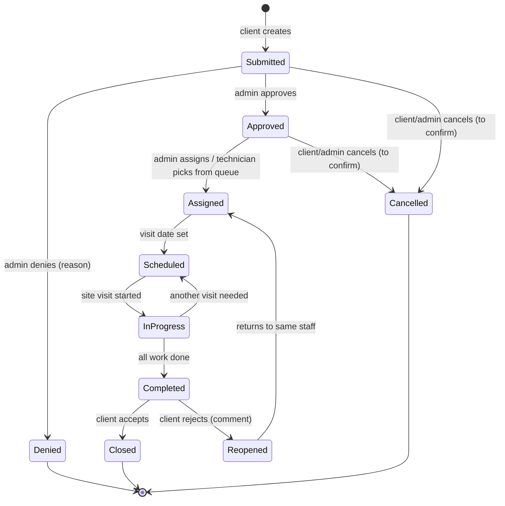

# Product Requirements Document
## AWS Maintenance Tracker

| | |
|---|---|
| **Version** | 1.0 (draft) |
| **Date** | 2026-10-15 |
| **Status** | Draft for review |
| **Companion document** | TRD.md (Technical Requirements Document) |

---

## 1. Purpose

The AWS Maintenance Tracker is a web application for managing maintenance of **Automatic Weather Stations (AWS)**. It lets external client organizations request maintenance on their stations. It lets the organization's instrument staff plan, carry out and document that work in the field, including without mobile signal. It produces PDF reports of every site visit and summary reports across the station network.

### 1.1 Problems it solves

- Maintenance requests arrive by email and phone and are hard to track.
- Clients have no visibility of request status.
- Field work is recorded inconsistently, and photos sit on personal phones.
- There is no reliable history of which sensor (by serial number) was installed where, or when it was calibrated.
- Station documentation (configs, datasheets, manuals) is scattered and hard to reach on site.
- Reports are written by hand after each visit.

### 1.2 Goals

| # | Goal | Measure of success |
|---|---|---|
| G1 | Every maintenance request is tracked from submission to closure | 100% of requests created in the app within 3 months of launch |
| G2 | Clients can see request status without contacting staff | 50% fewer status-enquiry calls/emails (baseline to be measured) |
| G3 | Every site visit is documented consistently | 100% of visits have arrival and departure media and a structured work record |
| G4 | Visit reports are produced automatically | Visit report available within 10 minutes of a visit ending and syncing |
| G5 | Full sensor history per station | Every sensor swap recorded with old and new serial numbers |
| G6 | Staff can work at sites with no signal | Complete visit can be recorded offline and synced later without data loss |

### 1.3 Non-goals (out of scope for v1)

- Ingesting or displaying live weather observations from the stations.
- Invoicing, billing or contracts.
- Native iOS/Android apps (the web app is installable as a PWA instead).
- Single sign-on, social login or two-factor authentication.
- SMS notifications.
- Service-level targets, deadlines or escalation.
- Report sign-off workflows.
- Integrations with external systems (to be defined later; see §10).

---

## 2. Users and roles

### 2.1 Definitions

| Term | Meaning |
|---|---|
| **Staff** | Users who work in the organization that built and runs the app |
| **Client** | Users from external organizations that own one or more stations and submit maintenance requests |
| **Client organization** | An external organization; owns stations; has one or more client users |
| **Station (AWS)** | An automatic weather station at a fixed site |
| **Maintenance request** | A client's request for work on one or more stations. Completed through one or more site visits |
| **Site visit** | A trip to one or more sites to carry out work for a request (or for routine maintenance) |
| **Routine maintenance** | Planned preventive visits started by staff, not by a client request |
| **Work record** | The structured record of what was done at one station during one visit |

### 2.2 Roles

| Role | Description | Key permissions |
|---|---|---|
| **Client** | External user belonging to one client organization | Create requests for their organization's stations; view their organization's requests, stations and reports; comment; upload PDF reports; accept or reject completed work |
| **Instrument staff** | Technicians who carry out maintenance | View all stations and requests; pick approved requests from the queue; record visits, work and media; maintain station data, sensors, configs and documents |
| **Admin staff** | Staff who manage the service | Everything instrument staff can do, plus approve/deny requests, approve/reject client registrations, assign staff, manage users, organizations, checklist templates and routine plans |

- One person may hold **both** staff roles.
- A client may not hold a staff role.
- Clients can only ever see their own organization's stations, requests and reports.

### 2.3 Personas

**Maria, client operations officer** at an agricultural agency that owns 12 stations. She notices a station has stopped reporting rainfall and wants to report it, see when someone will go, and confirm the fix.

**Devon, instrument technician.** He drives to remote hillside sites, often without signal. He needs station details, the right manual and the sensor history on his phone. He needs to record photos, videos and the work done quickly, and to trust that nothing is lost.

**Andrea, admin and senior technician.** She reviews incoming requests, approves new client accounts, assigns work, and needs an overview of workload, turnaround and station health. She sometimes goes on visits herself.

---

## 3. Scope summary

| Area | v1 |
|---|---|
| Authentication (register, approval, login, password reset) | ✅ |
| Client organizations and station ownership | ✅ |
| Maintenance requests (multi-station) with full workflow | ✅ |
| Request queue, assignment, multi-staff visits | ✅ |
| Site visits with arrival/departure images and videos | ✅ |
| Structured work records with checklists | ✅ |
| Sensor inventory and serial-number history | ✅ |
| Offline field capture with later sync | ✅ |
| Routine (preventive) maintenance flow | ✅ |
| Station information, configs (versioned) and sensor documentation | ✅ |
| Station QR codes and printable labels | ✅ |
| Map of stations | ✅ |
| Real-time in-app notifications and email | ✅ |
| Visit, close-out and summary PDF reports | ✅ |
| Admin dashboard | ✅ |

---

## 4. Functional requirements

Priorities: **M** = must have for launch, **S** = should have, **C** = could have.

### 4.1 Authentication and accounts

| ID | Requirement | Priority |
|---|---|---|
| AUTH-1 | A client can self-register with name, email, phone, password and organization (choose an existing one or name a new one). | M |
| AUTH-2 | A newly registered client account has status **Pending** and cannot log in until approved. The user sees a "waiting for approval" message. | M |
| AUTH-3 | Admin staff see a list of pending registrations and can approve (linking to an existing organization or creating one) or reject with a reason. | M |
| AUTH-4 | The user is emailed when their account is approved or rejected. | M |
| AUTH-5 | Pending registrations not acted on within 30 days are deleted automatically (period configurable). | S |
| AUTH-6 | Staff accounts are created by admin staff only; new staff receive an email to set their password. | M |
| AUTH-7 | All users log in with email and password. | M |
| AUTH-8 | Users can reset a forgotten password through a single-use emailed link valid for 1 hour. | M |
| AUTH-9 | Passwords are at least 10 characters and must not be on a known breached-password list. | M |
| AUTH-10 | Repeated failed logins are rate-limited. Error messages do not reveal whether an email is registered. | M |
| AUTH-11 | Admins can disable a user; a disabled user is logged out of all devices. | M |
| AUTH-12 | Staff stay logged in on their field device for up to 30 days so they can work offline. | M |
| AUTH-13 | Users can edit their own name, phone and password. | S |

### 4.2 Client organizations

| ID | Requirement | Priority |
|---|---|---|
| ORG-1 | Admins can create, edit and deactivate client organizations (name, contact email, phone, address). | M |
| ORG-2 | Each station is owned by exactly one organization. | M |
| ORG-3 | All users of an organization see all of that organization's stations, requests and reports. | M |

### 4.3 Stations

| ID | Requirement | Priority |
|---|---|---|
| STN-1 | Staff can create and edit stations with: code, name, type, owner organization, latitude, longitude, elevation, measured parameters (AT, RH, BP, RAIN, WS, WD, SR, etc.), logger details, communications, power system, install date, status and access notes. | M |
| STN-2 | Station status is one of: Operational, Degraded, Offline, Decommissioned. | M |
| STN-3 | Staff can attach station photos. | S |
| STN-4 | Staff can upload station configuration files. Each upload creates a new version; earlier versions remain downloadable. | M |
| STN-5 | Each station page shows the installed sensors (model, serial, install date, last calibration). | M |
| STN-6 | Station list can be searched and filtered by organization, type, status and parameter. | M |
| STN-7 | Clients can view (not edit) their own organization's stations. | M |
| STN-8 | A station page shows its open requests, visit history and reports. | M |

### 4.4 Sensors and documentation

| ID | Requirement | Priority |
|---|---|---|
| SEN-1 | Staff can manage a catalogue of sensor models (manufacturer, model, parameter, default calibration interval). | M |
| SEN-2 | Datasheets, operation manuals and maintenance manuals are stored **per sensor model** and shown on every station using that model. Documents are versioned. | M |
| SEN-3 | Staff can manage individual sensor units by serial number with status: In stock, Installed, In repair, Retired. | M |
| SEN-4 | The system keeps a full installation history: which serial was installed at which station, when, and on which visit, and when it was removed. | M |
| SEN-5 | Sensor swaps recorded during a visit update the inventory and history automatically. | M |
| SEN-6 | A serial number entered in the field that is not yet in inventory is created automatically and flagged for an admin to complete. | M |
| SEN-7 | Staff can record calibration dates and attach calibration certificates to a sensor unit. | S |

### 4.5 Maintenance requests

| ID | Requirement | Priority |
|---|---|---|
| REQ-1 | A client can create a maintenance request with title, description, category (fault, calibration, relocation, inspection, other), priority and **one or more** of their stations. | M |
| REQ-2 | A client can attach photos and PDF documents when creating a request. | M |
| REQ-3 | Each request gets a human-readable reference, e.g. `MR-2026-0042`. | M |
| REQ-4 | A request follows the workflow in §5. Invalid status changes are not possible. | M |
| REQ-5 | Admins can approve or deny a submitted request. Denial requires a reason that the client sees. | M |
| REQ-6 | Approved requests appear in a **queue**. Admins can assign one or more staff, and instrument staff can pick a request from the queue themselves. | M |
| REQ-7 | Clients can view the status and full status history of their requests. | M |
| REQ-8 | Clients and staff can comment on a request. Comments can have attachments. | M |
| REQ-9 | Staff can mark a comment as **internal**; internal comments are never shown to clients. | S |
| REQ-10 | Clients can upload their own report as a PDF to a request at any time. | M |
| REQ-11 | When a request is Completed, the client is asked to **accept** or **reject** the work. Rejection requires a comment. | M |
| REQ-12 | Accepting closes the request. Rejecting reopens it and returns it to the same assigned staff, and admins are notified. | M |
| REQ-13 | Requests can be listed and filtered by status, organization, station, assigned staff and date. | M |
| REQ-14 | A client can cancel a request before it is Scheduled. *(Assumption – to confirm.)* | S |
| REQ-15 | If a client does not verify a completed request within 14 days, it is accepted automatically, with reminders on days 3 and 10. *(Assumption – to confirm.)* | S |

### 4.6 Site visits

| ID | Requirement | Priority |
|---|---|---|
| VIS-1 | Assigned staff or admins can schedule a site visit for a request, choosing the date, the staff attending (one or more) and which of the request's stations it covers. | M |
| VIS-2 | At the start of a visit, staff upload **arrival** images and videos for each station. | M |
| VIS-3 | Staff record a **structured work record** per station (see VIS-4). | M |
| VIS-4 | A work record includes: condition on arrival; checklist results (OK / Fixed / Issue / N/A, with notes); sensor actions (replace, calibrate, clean, repair, remove, install) with parameter, old serial, new serial, before/after readings and reference instrument; parts used; issues found; whether data was downloaded; condition on departure; free-text notes. | M |
| VIS-5 | Checklists come from templates by station type and/or sensor model. A visit keeps a copy of the template it used. | M |
| VIS-6 | At the end of a visit, staff upload **departure** images and videos for each station. | M |
| VIS-7 | When ending a visit, staff state whether another visit is needed. If yes, they note the remaining work and a new visit is scheduled. If no, the request becomes Completed. | M |
| VIS-8 | Up to about 50 media items per visit; videos typically 30 seconds to 1 minute. | M |
| VIS-9 | A visit report PDF is generated automatically when a visit ends (see §4.10). | M |
| VIS-10 | Clients can see visits, their media and reports for their requests. | M |

### 4.7 Offline field work

| ID | Requirement | Priority |
|---|---|---|
| OFF-1 | Staff can "prepare" an assigned visit while online, downloading everything needed: request, stations, installed sensors, latest configs, checklist templates and optionally manuals. | M |
| OFF-2 | With no connection, staff can start a visit, capture photos and videos, complete work records and end the visit. | M |
| OFF-3 | Offline data is stored on the device and survives the app or phone being closed or restarted. | M |
| OFF-4 | The app shows clearly how many changes and files are waiting to sync. | M |
| OFF-5 | Data syncs automatically when a connection returns, and on demand with a "Sync now" button. | M |
| OFF-6 | Interrupted uploads resume rather than restart. | M |
| OFF-7 | Syncing the same data twice never creates duplicates. | M |
| OFF-8 | Local copies are deleted only after the server confirms receipt. | M |
| OFF-9 | The app warns before starting a visit that has not been prepared for offline use. | S |
| OFF-10 | Offline mode applies to site visits and station lookup only. Approvals, request creation and admin work need a connection. | M |

### 4.8 Routine maintenance

| ID | Requirement | Priority |
|---|---|---|
| RTN-1 | Admins can create routine maintenance plans: stations, frequency (e.g. every 90 days), checklist template. | M |
| RTN-2 | When a plan falls due, a routine visit is created and shown to admins for scheduling. | M |
| RTN-3 | Routine visits follow their own flow (Due → Scheduled → In progress → Completed) with no approval or client verification. | M |
| RTN-4 | Routine visits use the same visit recording, media and report features as request visits. | M |
| RTN-5 | Staff can raise a linked maintenance request from a routine visit when they find a fault; it starts in Approved status. | S |
| RTN-6 | Routine visit reports are visible to the owning client. *(Assumption – to confirm.)* | S |

### 4.9 Media

| ID | Requirement | Priority |
|---|---|---|
| MED-1 | Images are converted to WebP and resized for viewing; thumbnails are generated. | M |
| MED-2 | Videos are compressed with ffmpeg to a format that plays in all browsers, with a thumbnail. | M |
| MED-3 | Uploaded PDFs and documents are stored unchanged and checked for viruses. | M |
| MED-4 | Users can only view media for stations and requests they have access to. | M |
| MED-5 | Media shows capture time where available. | S |
| MED-6 | Limits: 200 MB per video, 25 MB per image, 50 MB per PDF. | M |

### 4.10 Reports

| ID | Requirement | Priority |
|---|---|---|
| REP-1 | A **visit report** PDF is generated for each completed visit, using the template in Appendix A. | M |
| REP-2 | A **request close-out report** PDF is generated when a request is closed. | M |
| REP-3 | Regenerating a report creates a new version; earlier versions are kept. | S |
| REP-4 | Staff can generate **summary reports** as PDF, filtered by date range, organization and station: station history, client activity, request turnaround, technician workload, sensor reliability, calibration due, network status. | M |
| REP-5 | Clients can generate station-history and client-activity reports for their own organization only. | S |
| REP-6 | Admins have a dashboard showing open requests by status, requests awaiting approval, pending registrations, overdue routine visits and station status counts. | M |
| REP-7 | Reports carry the organization's branding. | M |

### 4.11 QR codes

| ID | Requirement | Priority |
|---|---|---|
| QR-1 | Every station has a unique QR code. | M |
| QR-2 | Scanning the code opens the station in the app, after login if needed. | M |
| QR-3 | The page shown depends on role: staff see full details, sensors, configs, manuals, history and "Start visit"; clients see a summary, open requests, past reports and "Report a problem". | M |
| QR-4 | A client scanning a station owned by another organization sees no details. | M |
| QR-5 | The app has a built-in QR scanner, which also works offline for prepared stations. | S |
| QR-6 | Admins can print label sheets (QR code, station name and code, contact phone). | M |
| QR-7 | Admins can revoke and regenerate a station's QR code. | S |

### 4.12 Map

| ID | Requirement | Priority |
|---|---|---|
| MAP-1 | A map (Leaflet, OpenStreetMap) shows all stations the user can see, coloured by status. | M |
| MAP-2 | Markers cluster when zoomed out. | S |
| MAP-3 | Clicking a station shows name, type, status, open requests and a link to its page. | M |
| MAP-4 | The map can be filtered by organization, type, status and "has open request". | S |

### 4.13 Notifications

| ID | Requirement | Priority |
|---|---|---|
| NOT-1 | Users receive real-time in-app notifications (via WebSockets) for events relevant to them (Appendix B). | M |
| NOT-2 | A notification list shows unread and recent notifications; missed notifications appear after reconnecting. | M |
| NOT-3 | Account events (approval, rejection, password reset) are always emailed. | M |
| NOT-4 | Users can turn email on or off per notification type. | S |
| NOT-5 | Open pages update live when a request's status changes. | S |

---

## 5. Maintenance request workflow

| From | To | Who | Condition |
|---|---|---|---|
| Submitted | Approved | Admin | — |
| Submitted | Denied | Admin | Reason required |
| Approved | Assigned | Admin, or technician from queue | At least one staff member |
| Assigned | Scheduled | Assigned staff or admin | Visit created with a date |
| Scheduled | In progress | Assigned staff | Visit started (can happen offline) |
| In progress | Scheduled | Assigned staff | Visit ended, another visit needed, new date set |
| In progress | Completed | Assigned staff | Visit ended, all work done |
| Completed | Closed | Client | Accepted |
| Completed | Reopened | Client | Rejected, comment required |
| Reopened | Assigned | System | Immediately |
| Submitted / Approved | Cancelled | Client or admin | To be confirmed |

**Site visit lifecycle:** Planned → Started (arrival media) → Work recorded → Ended (departure media, "another visit needed?") → Report generated.

---

## 6. Key user journeys

### 6.1 Client reports a fault
1. Maria logs in (or scans the station's QR code) and chooses **Report a problem**.
2. She selects the affected station(s), describes the problem and attaches a photo.
3. She sees the request as **Submitted** and receives notifications as it moves through Approved, Assigned and Scheduled (with the visit date).
4. After the visit she reads the visit report.
5. When the request is **Completed** she accepts it, or rejects it with a comment.

### 6.2 Technician carries out a visit with no signal
1. At the office, Devon opens his assigned visit and taps **Prepare for field**.
2. On site with no signal, he scans the station QR code; the station page opens from the device.
3. He taps **Start visit**, takes arrival photos and a short video.
4. He completes the checklist, records an RH sensor swap (old and new serial) and the calibration readings.
5. He takes departure media, answers "Another visit needed?" with **No** and ends the visit.
6. The app shows "4 changes and 18 files waiting to sync".
7. Back in coverage, the app syncs. The request becomes Completed, the report is generated and the client is notified.

### 6.3 Admin processes new work
1. Andrea's dashboard shows two pending registrations and three submitted requests.
2. She approves a registration, linking it to an existing organization.
3. She approves two requests and denies one with a reason.
4. She assigns one approved request to two technicians; the other stays in the queue for any technician to pick up.

---

## 7. Non-functional requirements

| ID | Category | Requirement |
|---|---|---|
| NFR-1 | Scale | Support 50–500 stations, about 200 users, 3–5 requests per month and up to 50 media items per visit, with room to grow 5×. |
| NFR-2 | Performance | Pages and API reads respond in under 1 second (95th percentile) on a normal connection. A visit report is ready within 10 minutes of sync. |
| NFR-3 | Availability | 99% during business hours. Planned maintenance outside business hours. |
| NFR-4 | Offline | A complete visit, including media, can be recorded with no connection and synced later without loss. |
| NFR-5 | Devices | Works on current Chrome, Edge, Firefox and Safari; usable on phones (field mode) and desktops. Installable as a PWA. |
| NFR-6 | Security | All traffic over HTTPS. Passwords hashed (Argon2id). Clients cannot access other organizations' data. Admin actions are audit-logged. Uploaded documents are virus-scanned. |
| NFR-7 | Privacy | GPS and other personal EXIF metadata are removed from processed images. |
| NFR-8 | Data retention | Requests, visits, reports, sensor history and config versions are kept indefinitely. Original (unprocessed) image and video files are deleted 30 days after processing (configurable). |
| NFR-9 | Backup and recovery | Nightly database backups; continuous file replication. Recovery point ≤ 24 hours, recovery time ≤ 8 hours. Restore tested quarterly. |
| NFR-10 | Hosting | Self-hosted on the organization's own servers. |
| NFR-11 | Accessibility | WCAG 2.1 AA for core screens. |
| NFR-12 | Maintainability | Built and run by one developer: consistent service structure, automated tests and deployment, monitoring and alerts. |
| NFR-13 | Architecture | Microservices (see TRD). |
| NFR-14 | Language | English user interface. Dates and times shown in the user's local time zone. |

---

## 8. Release plan

| Phase | Content | Estimate |
|---|---|---|
| 1. Foundations | Auth, registration approval, user and organization management, app shell | 2–3 weeks |
| 2. Stations | Stations, sensors and inventory, configs, documents, map, QR codes and labels | 2 weeks |
| 3. Requests | Request workflow, queue, assignment, comments, client PDFs, verification, notifications | 3 weeks |
| 4. Visits (online) | Visits, structured work records, checklists, media processing, sensor swaps | 3 weeks |
| 5. Offline field mode | PWA, prepare-for-field, offline capture, resumable sync | 2–3 weeks |
| 6. Reports | Visit and close-out PDFs, summary reports, admin dashboard | 2 weeks |
| 7. Routine and hardening | Routine maintenance, monitoring, backups, security review, user acceptance testing | 2 weeks |

**Launch criteria:** all **M** requirements done; a full visit recorded offline on real devices and synced with no loss; restore from backup tested; user acceptance testing passed with at least two clients and two technicians.

---

## 9. Assumptions and dependencies

- The organization provides servers, a domain name, a TLS certificate and an SMTP server for email.
- Staff have smartphones with a camera and a current browser.
- Existing station data can be imported from a spreadsheet (one-off import script).
- The organization supplies branding (logo, colours) and preferred report numbering.

## 10. Open questions

| # | Question | Current assumption |
|---|---|---|
| Q1 | Can a client cancel a request, and up to which status? | Yes, until Scheduled |
| Q2 | When work is rejected, does it go back to the same staff? | Yes |
| Q3 | Who closes a request if the client never verifies? | Auto-accept after 14 days with reminders |
| Q4 | Can clients see routine maintenance visits on their stations? | Yes |
| Q5 | Are internal (staff-only) comments wanted? | Yes |
| Q6 | Which external systems need integration, and how? | To be defined |
| Q7 | Branding, logo and report numbering format | To be supplied |

---

## Appendix A – Visit report template (A4 PDF)

1. **Header:** logo, organization name, "Site Visit Report", report number (`VR-2026-0042-02` = request 42, visit 2), visit date. Footer: page x of y, generated date.
2. **Summary:** request reference and title, client organization, stations visited, staff attending, arrival and departure times, outcome ("All work complete" or "Additional visit required").
3. **Per station:**
   - Station details: name, code, type, coordinates, elevation, parameters.
   - Condition on arrival with arrival photos.
   - Checklist results table (issues highlighted).
   - Sensor actions table: parameter, action, old serial, new serial, before/after readings, reference instrument.
   - Parts used, issues found.
   - Condition on departure with departure photos.
4. **Videos:** thumbnail, caption, duration and a QR code linking to the video in the app.
5. **Follow-up:** remaining work, recommendations, next routine visit due.
6. **Appendix:** remaining photos with captions and capture times.

The **request close-out report** contains: request details, status timeline, list of visits with report links, client verification outcome and comments.

## Appendix B – Notification matrix

| Event | Client | Assigned staff | Admin |
|---|---|---|---|
| Client registered | — | — | In-app |
| Account approved / rejected | Email | — | — |
| Request submitted | In-app | — | In-app + email |
| Request approved / denied | In-app + email | — | — |
| Request assigned | In-app | In-app + email | — |
| Visit scheduled | In-app + email | In-app | — |
| Visit completed / report ready | In-app + email | In-app | — |
| Request completed (verify) | In-app + email | — | — |
| Work accepted | — | In-app | In-app |
| Work rejected / reopened | — | In-app + email | In-app + email |
| Comment added | In-app (not internal) | In-app | — |
| Routine visit due | — | — | In-app |
| Password reset | Email | Email | Email |
