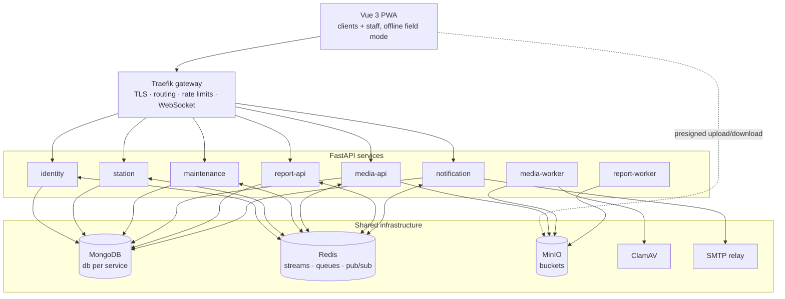
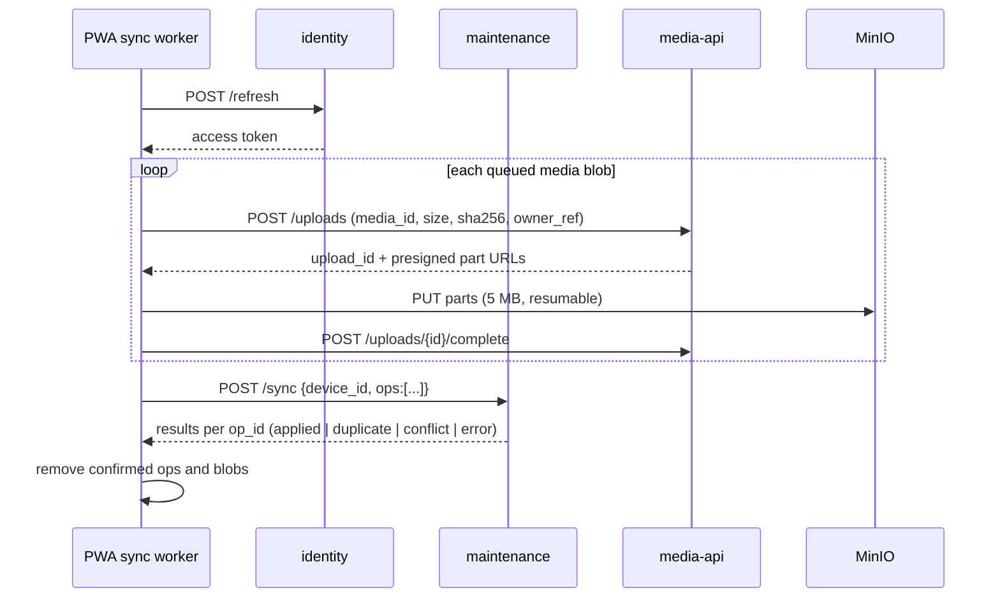

# Technical Requirements Document
## AWS Maintenance Tracker

| | |
|---|---|
| **Version** | 1.0 (draft) |
| **Date** | 2026-10-15 |
| **Status** | Draft for review |
| **Companion document** | PRD.md (Product Requirements Document) |

---

## 1. Overview

The system is a set of **seven coarse-grained services**: six FastAPI services plus a Traefik gateway. It uses a Vue 3 PWA frontend, a shared MongoDB replica set (one database per service), MinIO object storage and Redis Streams for events. Services are split by business area rather than by entity, because one developer builds and runs the whole system.

### 1.1 Technology stack

| Layer | Technology |
|---|---|
| Frontend | Vue 3 (Composition API, TypeScript), Vite, Vuetify 3, Tailwind CSS (layout only), Pinia, Vue Router, Dexie.js, vite-plugin-pwa (Workbox), Leaflet + Leaflet.markercluster, qr-scanner |
| Backend | Python 3.12, FastAPI, Pydantic v2, Motor (async MongoDB driver) or Beanie ODM, httpx |
| Background jobs | arq (Redis-backed async workers) |
| Database | MongoDB 7 replica set |
| Events / cache / queues | Redis 7 (Streams, Pub/Sub, AOF persistence) |
| Object storage | MinIO (S3-compatible) |
| Media | ffmpeg (video), Pillow (images, WebP) |
| PDF | WeasyPrint + Jinja2 |
| Virus scanning | ClamAV |
| Gateway | Traefik v3 |
| Deployment | Docker, Docker Compose, self-hosted |
| Observability | Prometheus, Grafana, Loki |
| CI/CD | GitHub Actions (or equivalent) |

### 1.2 Key architecture decisions

| # | Decision | Rationale |
|---|---|---|
| ADR-1 | Seven services split by business area | Microservices are required; a few large services keep the work manageable for one developer |
| ADR-2 | One MongoDB replica set, one database per service | Replica set gives transactions and change streams; separate databases keep ownership clear |
| ADR-3 | Redis Streams for events, transactional outbox | Durable, replayable events; Redis is already needed for queues and WebSocket fan-out |
| ADR-4 | Presigned direct uploads to MinIO | Large files never pass through Python services |
| ADR-5 | JWT (EdDSA) verified locally in each service | No auth round-trip per request |
| ADR-6 | Client-generated UUIDv7 IDs and idempotency keys | Offline-created records keep their identity; sync is safe to retry |
| ADR-7 | Monorepo with shared `aws_common` library | One developer; consistent patterns; atomic changes across services |
| ADR-8 | Docker Compose on one host, not Kubernetes | Load is tiny; Compose is simpler to run |
| ADR-9 | Vuetify for components, Tailwind for layout only with Preflight disabled and `tw-` prefix | Avoids style conflicts between the two |

---

## 2. System architecture



### 2.1 Gateway routing

| Path prefix | Target |
|---|---|
| `/` | frontend (nginx, static build) |
| `/api/identity/*` | identity |
| `/api/stations/*` | station |
| `/api/maintenance/*` | maintenance |
| `/api/media/*` | media-api |
| `/api/reports/*` | report-api |
| `/api/notifications/*`, `/ws` | notification |
| `/files/*` | MinIO (presigned URLs only; no listing) |

Traefik provides TLS termination, HSTS, gzip and rate limiting on `/api/identity/login`, `/register` and `/password-reset/*` (e.g. 10 requests/minute/IP). It also enforces request size limits (10 MB for JSON API; files go to MinIO).

---

## 3. Service specifications

All services follow the same internal layout:

```
services/<name>/
  app/
    main.py          FastAPI app, lifespan (DB, Redis, outbox relay, consumers)
    config.py        pydantic-settings
    api/             routers, request/response schemas
    domain/          business rules, state machines (no FastAPI/Mongo imports)
    repo/            data access; org scoping applied here
    events/          publishers (outbox), consumers
    workers/         arq tasks (media, report only)
  tests/             unit (domain), API (httpx + test Mongo), contract (events)
  Dockerfile
  pyproject.toml
```

Every service exposes `GET /health` (process alive), `GET /ready` (Mongo and Redis reachable), `GET /metrics` (Prometheus) and OpenAPI at `/docs` (disabled in production).

### 3.1 identity

**Responsibilities:** registration and approval, login, tokens, password reset, users, roles, client organizations, JWKS.

| Method | Path | Roles | Purpose |
|---|---|---|---|
| POST | `/register` | public | Client self-registration → Pending |
| POST | `/login` | public | Returns access token; sets refresh cookie |
| POST | `/refresh` | cookie | Rotates refresh token; new access token |
| POST | `/logout` | any | Revokes refresh token family |
| POST | `/password-reset/request` | public | Emails reset link (always 202) |
| POST | `/password-reset/confirm` | public | Sets new password; revokes all sessions |
| GET | `/me` | any | Current user |
| PATCH | `/me` | any | Update name, phone, password |
| GET | `/users` | admin | List/filter users (status, role, org) |
| POST | `/users` | admin | Create staff user (sends set-password email) |
| PATCH | `/users/{id}` | admin | Update roles, status, org |
| POST | `/users/{id}/approve` | admin | Approve pending client; body: org_id or new org |
| POST | `/users/{id}/reject` | admin | Reject with reason |
| GET/POST/PATCH | `/organizations[/{id}]` | admin (read: staff) | Manage client organizations |
| GET | `/.well-known/jwks.json` | public | Public signing keys |
| POST | `/service-token` | service secret | Short-lived token for service-to-service calls |

**Scheduled jobs:** purge pending registrations older than 30 days; purge expired reset and refresh tokens.

### 3.2 station

**Responsibilities:** stations, sensor models, sensor units, installation history, config file versions, documents, QR codes, map GeoJSON.

| Method | Path | Roles | Purpose |
|---|---|---|---|
| GET | `/stations` | any (client: own org) | List, filter, search, paginate |
| POST | `/stations` | staff | Create station |
| GET | `/stations/{id}` | any (scoped) | Station detail incl. installed sensors |
| PATCH | `/stations/{id}` | staff | Update |
| GET | `/stations/geo` | any (scoped) | GeoJSON FeatureCollection for map |
| POST | `/stations/validate` | service | Check IDs exist and belong to org (used by maintenance) |
| GET | `/stations/{id}/configs` | staff | Config files with versions |
| POST | `/stations/{id}/configs` | staff | Register new config version (media_id) |
| GET | `/stations/{id}/installations` | any (scoped) | Sensor install history |
| GET | `/stations/{id}/field-bundle` | staff | Everything needed offline for this station |
| GET | `/qr/{token}` | any (scoped) | Resolve QR token → station ID and view type |
| POST | `/stations/{id}/qr/regenerate` | admin | New token, old one revoked |
| POST | `/stations/labels` | admin | Label sheet PDF for selected stations |
| GET/POST/PATCH | `/sensor-models[/{id}]` | staff | Sensor model catalogue |
| POST | `/sensor-models/{id}/documents` | staff | Attach datasheet/manual version |
| GET/POST/PATCH | `/sensor-units[/{id}]` | staff | Units by serial; status; calibration |

**Consumes:** `visit.completed` → applies `sensor_actions` (close old installation, open new, update unit statuses, create unknown serials flagged `needs_review`).

### 3.3 maintenance

**Responsibilities:** requests and state machine, queue and assignment, site visits, work records, checklist templates, comments, client PDFs, routine plans, offline sync.

| Method | Path | Roles | Purpose |
|---|---|---|---|
| GET | `/requests` | any (scoped) | List/filter |
| POST | `/requests` | client, admin | Create (validates stations via station service) |
| GET | `/requests/{id}` | any (scoped) | Detail incl. history, visits |
| POST | `/requests/{id}/approve` | admin | Submitted → Approved |
| POST | `/requests/{id}/deny` | admin | Submitted → Denied (reason) |
| POST | `/requests/{id}/assign` | admin | Set staff → Assigned |
| POST | `/requests/{id}/claim` | instrument | Pick from queue → Assigned (self) |
| POST | `/requests/{id}/cancel` | client, admin | → Cancelled (if allowed) |
| POST | `/requests/{id}/verify` | client | `{outcome: accepted\|rejected, comment}` |
| GET | `/queue` | staff | Approved, unassigned requests |
| GET/POST | `/requests/{id}/comments` | any (scoped; internal hidden from clients) | Comments |
| POST | `/requests/{id}/attachments` | any (scoped) | Attach media_id (client PDF, photos) |
| POST | `/visits` | assigned staff, admin | Schedule visit (request or routine) |
| GET | `/visits/{id}` | any (scoped) | Visit with work records and media |
| PATCH | `/visits/{id}` | assigned staff, admin | Reschedule, change staff/stations |
| POST | `/visits/{id}/start` | assigned staff | Planned → Started |
| PUT | `/visits/{id}/stations/{sid}/work` | assigned staff | Save work record (versioned) |
| POST | `/visits/{id}/end` | assigned staff | `{additional_visit_required, follow_up_notes, next_date?}` |
| GET | `/visits/{id}/field-bundle` | assigned staff | Offline package (calls station for station bundles) |
| POST | `/sync` | staff | Apply batch of offline operations (§6) |
| GET/POST/PATCH | `/checklist-templates[/{id}]` | admin (read: staff) | Templates, versioned |
| GET/POST/PATCH | `/routine-plans[/{id}]` | admin | Routine plans |
| GET | `/my-work` | staff | Assigned requests and upcoming visits |

**Scheduled jobs:** create routine visits when plans fall due (daily); verification reminders on days 3 and 10; auto-accept on day 14 (if confirmed).

### 3.4 media (media-api + media-worker)

| Method | Path | Roles | Purpose |
|---|---|---|---|
| POST | `/uploads` | any (owner check) | Create media record; return presigned multipart upload |
| POST | `/uploads/{id}/parts` | uploader | Presigned URLs for further parts (resume) |
| POST | `/uploads/{id}/complete` | uploader | Complete multipart; enqueue processing |
| GET | `/media/{id}` | scoped | Metadata + signed URLs (view, thumbnail, original) |
| GET | `/media?owner_ref=` | scoped | List media for an owner |
| DELETE | `/media/{id}` | uploader (before visit ends), admin | Delete |

**Owner access check:** media-api asks the owning service via `GET /internal/access?user=&owner_ref=` (cached for 60 s), or uses the `org_id` stored on the media record for client checks.

**Worker tasks:** `process_image`, `process_video`, `process_document`, `purge_originals` (daily).

### 3.5 report (report-api + report-worker)

| Method | Path | Roles | Purpose |
|---|---|---|---|
| GET | `/reports?subject_ref=` | scoped | List report versions |
| GET | `/reports/{id}/download` | scoped | Signed URL to PDF |
| POST | `/reports/visit/{visit_id}/regenerate` | admin | New version |
| POST | `/reports/summary` | staff (client: limited types, own org) | `{type, from, to, org_id?, station_ids?}` → job ID |
| GET | `/reports/jobs/{id}` | requester | Job status and result |
| GET | `/dashboard` | admin | Dashboard figures from read model |

**Consumes:** `visit.completed` → generate visit report. `request.closed` → generate close-out report. `request.*`, `visit.*`, `sensor.*`, `station.*` → update read model.

To render a visit report, the worker fetches the visit (maintenance), stations (station) and media URLs (media) over internal HTTP, then renders the Jinja2 template with WeasyPrint.

### 3.6 notification

| Method | Path | Roles | Purpose |
|---|---|---|---|
| WS | `/ws` | any | Real-time channel; first message `{type:"auth", token}` |
| GET | `/notifications?after=` | any | List (for catch-up after reconnect) |
| POST | `/notifications/{id}/read`, `/read-all` | any | Mark read |
| GET/PUT | `/preferences` | any | Email preferences per type |

**Consumes:** user-facing events (see PRD Appendix B) → resolve recipients → store notification → push via Redis Pub/Sub channel `ws:user:{id}` → each notification instance pushes to its connected sockets → send email if preferred.

---

## 4. Data model

Conventions: `_id` is a UUIDv7 string, generated by the creator (including the PWA). Every document has `created_at`, `updated_at`, `created_by` and `version` (int, optimistic concurrency). Times are UTC ISO 8601.

### 4.1 identity

```js
users {
  _id, email /*unique, lowercase*/, password_hash, name, phone,
  roles: ["client"|"instrument_staff"|"admin_staff"],
  org_id /*clients*/, proposed_org_name /*pending*/,
  status: "pending"|"active"|"rejected"|"disabled",
  rejection_reason, last_login_at
}
organizations { _id, name /*unique*/, contact_email, phone, address, status }
refresh_tokens { _id, user_id, token_hash, family_id, expires_at, revoked_at, device_label }
password_resets { _id, user_id, token_hash, expires_at /*TTL*/, used_at }
```

Indexes: `users.email` unique; `users.status`; `refresh_tokens.token_hash` unique; TTL on `expires_at`.

### 4.2 station

```js
stations {
  _id, code /*unique, e.g. JM-KIN-014*/, name, type,
  owner_org_id, owner_org_name,
  location: { type: "Point", coordinates: [lon, lat] }, elevation_m,
  parameters: ["AT","RH","BP","RAIN","WS","WD","SR", ...],
  logger: { model, serial, firmware },
  comms: { type, provider, identifier },
  power: { panel_w, battery_ah, controller },
  install_date, status: "operational"|"degraded"|"offline"|"decommissioned",
  access_notes, photos: [media_id], qr_token /*unique*/
}
sensor_models {
  _id, manufacturer, model, parameter, default_calibration_interval_days,
  documents: [{ kind: "datasheet"|"operations_manual"|"maintenance_manual"|"other",
                title, version, language, media_id, uploaded_at }]
}
sensor_units {
  _id, model_id, serial, status: "in_stock"|"installed"|"in_repair"|"retired",
  current_station_id, last_calibrated_at,
  calibration_certificates: [media_id], needs_review: bool
}
installations {
  _id, sensor_unit_id, station_id, parameter,
  installed_at, removed_at, installed_visit_id, removed_visit_id
}
config_files {
  _id, station_id, kind, filename, version /*1..n per station+kind*/,
  media_id, checksum, notes
}
```

Indexes: `stations.code` unique, `stations.qr_token` unique, `stations.owner_org_id`, 2dsphere on `location`; `sensor_units` unique on `(model_id, serial)`; `installations` on `(station_id, removed_at)`; `config_files` unique on `(station_id, kind, version)`.

### 4.3 maintenance

```js
requests {
  _id, ref /*MR-YYYY-NNNN, unique*/, org_id, station_ids: [],
  title, description, category, priority: "low"|"normal"|"high"|"urgent",
  status, status_history: [{ from, to, by, at, note }],
  assigned_staff_ids: [], denial_reason,
  client_verification: { outcome, by, at, comment },
  reopen_count, attachments: [media_id]
}
site_visits {
  _id, ref /*VR-YYYY-NNNN-NN*/, kind: "request"|"routine",
  request_id, routine_plan_id, org_ids: [],
  station_ids: [], staff_ids: [], scheduled_for,
  status: "planned"|"started"|"ended"|"cancelled",
  started_at, ended_at,
  arrival_media: [{ station_id, media_id }],
  departure_media: [{ station_id, media_id }],
  station_work: [WorkRecord],
  additional_visit_required, follow_up_notes,
  history: [{ field, old, new, by, at, device_id }]
}
WorkRecord {
  station_id, checklist_template: { id, version, items: [...] } /*copied*/,
  condition_on_arrival: { status, notes },
  checklist: [{ item_id, label, result: "ok"|"fixed"|"issue"|"na", note }],
  sensor_actions: [{ id, action, parameter, sensor_model_id,
                     old_serial, new_serial, before_reading, after_reading,
                     reference_instrument, note }],
  parts_used: [{ id, description, quantity }],
  issues_found: [{ id, description, severity }],
  data_downloaded: { done, from, to },
  condition_on_departure: { status, notes }, notes,
  version, updated_by, updated_at
}
checklist_templates { _id, name, station_type, sensor_model_id, version, items: [{ id, label, help }], active }
comments { _id, request_id, author_id, author_name, author_role, body, attachments: [], internal }
routine_plans { _id, name, station_ids, frequency_days, checklist_template_id, next_due, active }
sync_operations { _id /*client op id*/, user_id, device_id, type, result, applied_at /*TTL 90d*/ }
outbox { _id /*event_id*/, stream, payload, created_at, published_at }
processed_events { _id /*event_id*/, processed_at /*TTL 30d*/ }
```

Indexes: `requests.ref` unique; `requests` on `(org_id, status)`, `(status, assigned_staff_ids)`; `site_visits` on `(request_id)`, `(staff_ids, scheduled_for)`; `outbox` on `published_at` (partial: null).

### 4.4 media

```js
media {
  _id, owner_service, owner_ref /*e.g. "visit:{id}:arrival:{station_id}"*/, org_id,
  kind: "image"|"video"|"pdf"|"config"|"document",
  filename, mime, size_bytes, checksum_sha256,
  original_key, processed_key, thumbnail_key,
  width, height, duration_s, captured_at,
  status: "pending"|"uploaded"|"processing"|"ready"|"failed",
  error, upload_id /*S3 multipart*/, uploaded_by
}
```

### 4.5 report

```js
reports { _id, type: "visit"|"closeout"|"summary", subject_ref, org_id,
          template_version, version, pdf_key, generated_at, generated_by }
report_jobs { _id, type, params, status, report_id, error, requested_by }
request_facts { _id /*request_id*/, org_id, station_ids, submitted_at, approved_at,
                assigned_at, first_visit_at, completed_at, closed_at, reopen_count, visit_count }
visit_facts { _id /*visit_id*/, kind, staff_ids, station_ids, started_at, ended_at, sensor_action_count }
sensor_events { _id, sensor_model_id, serial, station_id, action, at }
```

### 4.6 notification

```js
notifications { _id, user_id, type, title, body, link, read_at, created_at }
preferences { _id /*user_id*/, email: { "<type>": bool } }
```

---

## 5. Authentication and authorization

### 5.1 Tokens

| Token | Format | Lifetime | Storage |
|---|---|---|---|
| Access | JWT, EdDSA (Ed25519) | 15 min | Memory (Pinia) |
| Refresh | 256-bit random, stored as SHA-256 hash | 30 days, rotated on each use | httpOnly, Secure, SameSite=Strict cookie, path `/api/identity` |
| Service | JWT, `roles:["service"]`, `sub:<service-name>` | 5 min | Service memory |

Access token claims: `sub`, `roles`, `org_id`, `name`, `iat`, `exp`, `jti`, `kid`.

- Refresh token reuse detection: presenting a revoked token revokes the whole `family_id`.
- Signing keys are rotated by adding a new `kid` to JWKS. Services cache JWKS for 10 minutes and refetch on unknown `kid`.
- Offline: the PWA keeps working with an expired access token. Sync starts with `/refresh`. If refresh fails, data stays queued and the user is asked to log in again.

### 5.2 Passwords

- Argon2id (`argon2-cffi` defaults or stronger).
- Minimum 10 characters; checked against a breached-password list (offline k-anonymity file or HIBP range API if outbound access is allowed).
- Reset tokens: 256-bit, stored hashed, 1-hour expiry, single use. A successful reset revokes all refresh tokens.

### 5.3 Authorization rules

Implemented in `aws_common.auth`:

```python
@router.post("/requests/{id}/approve")
async def approve(id: str, user: User = Depends(require_roles("admin_staff"))): ...
```

- **Organization scoping** is applied in the repository layer: for a user with role `client`, every query is merged with `{"org_id": user.org_id}` (or `owner_org_id` for stations). Endpoint code cannot skip it.
- **Visit edit rights:** only staff in `site_visits.staff_ids` or admins.
- **Internal comments:** filtered out for clients in the repository layer.
- Unauthorized access to an existing resource returns **404** (not 403) to clients to avoid revealing that it exists.

---

## 6. Offline capture and sync

### 6.1 Client-side storage (Dexie / IndexedDB)

| Table | Contents |
|---|---|
| `bundles` | Prepared visits and station bundles (JSON) |
| `visits` | Local working copy of visits and work records |
| `outbox` | Ordered operations `{op_id, type, payload, created_at, attempts, status}` |
| `blobs` | Media blobs `{media_local_id, owner_ref, file, size, sha256, upload_state}` |
| `meta` | Device ID, last sync time, user |

The app calls `navigator.storage.persist()` on first field use and shows remaining quota.

### 6.2 Operation types

| Type | Payload |
|---|---|
| `visit.start` | `{visit_id, started_at, device_id}` |
| `work.save` | `{visit_id, station_id, work_record, base_version}` |
| `media.attach` | `{visit_id, phase, station_id, media_id}` (sent after upload completes) |
| `visit.end` | `{visit_id, ended_at, additional_visit_required, follow_up_notes, next_date?}` |

### 6.3 Sync protocol



- Media uploads first, so `media.attach` and `visit.end` reference media that exists. `visit.end` is applied even if some media is still processing.
- `/sync` applies operations in order inside a transaction per op. An `op_id` already in `sync_operations` returns the stored result (idempotent).
- The response for each op is one of `applied`, `duplicate`, `conflict` (with server copy) or `error` (with message). A failed op stops later ops for the same visit but not for other visits.
- Triggers: `online` event, Background Sync API (where supported), app start, every 5 minutes while online, and "Sync now".

### 6.4 Conflict resolution

- `work.save` carries `base_version`. If the server version is newer, the server merges:
  - List fields (`checklist`, `sensor_actions`, `parts_used`, `issues_found`) merge by item `id`.
  - Scalar fields: last write (by `updated_at`) wins; the overwritten value is recorded in `site_visits.history`.
- `visit.end` on a visit already ended returns `conflict`; the device shows the server state.
- `visit.start` on a started visit is accepted (no-op).

### 6.5 Client-side media handling

- Images: resized in the browser (canvas / `createImageBitmap`) to a maximum 2560 px longest side, JPEG quality 0.85, before storage.
- Videos: stored as recorded (no in-browser transcoding).
- SHA-256 computed with Web Crypto for integrity.

---

## 7. Events

### 7.1 Transport

- One Redis Stream per producer: `events.identity`, `events.station`, `events.maintenance`, `events.media`, `events.report`.
- Each consumer service uses its own consumer group per stream it reads.
- Messages are acknowledged after successful handling. A message is retried up to 5 times with backoff, then copied to `dead.<consumer>` and acknowledged.
- Streams are trimmed with `MAXLEN ~ 100000`.

### 7.2 Outbox

```python
async with await client.start_session() as s:
    async with s.start_transaction():
        await requests.update_one(..., session=s)
        await outbox.insert_one(event.model_dump(), session=s)
# relay task: poll outbox where published_at is null → XADD → set published_at
```

The relay runs in each service's lifespan, polling every 500 ms, and is woken by a change stream when possible.

### 7.3 Envelope

```json
{
  "event_id": "0192f0c4-…",
  "type": "visit.completed",
  "version": 1,
  "occurred_at": "2026-10-15T14:02:11Z",
  "actor": { "user_id": "…", "roles": ["instrument_staff"] },
  "org_id": "…",
  "correlation_id": "…",
  "data": { }
}
```

### 7.4 Catalogue

| Event | Producer | Consumers | Key `data` fields |
|---|---|---|---|
| `user.registered` | identity | notification | user_id, name, proposed_org_name |
| `user.approved` | identity | notification, maintenance | user_id, org_id, name |
| `user.rejected` | identity | notification | user_id, reason |
| `org.created` / `org.updated` | identity | station, maintenance | org_id, name |
| `station.created` / `station.updated` | station | report, maintenance | station_id, code, name, org_id, status |
| `sensor.installed` / `sensor.removed` | station | report | unit_id, serial, model_id, station_id, visit_id |
| `request.submitted` | maintenance | notification, report | request_id, ref, station_ids |
| `request.approved` / `request.denied` | maintenance | notification, report | request_id, reason? |
| `request.assigned` | maintenance | notification, report | request_id, staff_ids, claimed |
| `request.completed` | maintenance | notification, report | request_id |
| `request.closed` | maintenance | notification, report | request_id, auto_accepted |
| `request.reopened` | maintenance | notification, report | request_id, comment |
| `request.cancelled` | maintenance | notification, report | request_id |
| `visit.scheduled` | maintenance | notification, report | visit_id, request_id, scheduled_for, staff_ids |
| `visit.started` | maintenance | notification, report | visit_id, started_at |
| `visit.completed` | maintenance | station, report, notification | visit_id, request_id, station_ids, sensor_actions[], additional_visit_required |
| `comment.added` | maintenance | notification | request_id, comment_id, internal |
| `routine.due` | maintenance | notification | plan_id, visit_id |
| `media.processed` / `media.failed` | media | maintenance | media_id, owner_ref, error? |
| `report.generated` | report | maintenance, notification | report_id, type, subject_ref |

Schemas live in `aws_common.events` as Pydantic models, keyed by `(type, version)`. Adding fields is non-breaking. A breaking change publishes a new `version` and both versions are supported until all consumers have moved.

---

## 8. Media processing

| Input | Processing | Output |
|---|---|---|
| Image (JPEG, PNG, HEIC) | Pillow + pillow-heif: EXIF orientation, read capture time, strip EXIF/GPS, resize to 2048 px longest side | WebP q80 + 400 px WebP thumbnail |
| Video (MP4, MOV, WebM) | `ffmpeg -i in -vf "scale='min(1280,iw)':-2" -c:v libx264 -preset medium -crf 28 -c:a aac -b:a 96k -movflags +faststart out.mp4`; poster frame at 1 s | H.264/AAC MP4 + WebP thumbnail; duration |
| PDF | ClamAV scan; page-1 thumbnail (pdftoppm) | Original unchanged + thumbnail |
| Config / other docs | ClamAV scan; checksum verify | Original unchanged |

- File type is validated by magic bytes (`python-magic`), not by extension.
- Worker concurrency: 2 video jobs, 4 image jobs. The container is limited to 2 CPUs.
- Job timeout: 10 minutes for video; failure sets `status=failed` and publishes `media.failed`.

### 8.1 Buckets

| Bucket | Contents | Policy |
|---|---|---|
| `originals` | Raw uploads | Lifecycle: delete 30 days after `ready` (configurable) |
| `media` | Processed images, videos, thumbnails | Keep |
| `documents` | Manuals, datasheets, configs, client PDFs | Keep; versioning on |
| `reports` | Generated PDFs | Keep; versioning on |

All buckets are private. Access is only through presigned URLs: 10 minutes for GET, 1 hour for upload parts.

### 8.2 Limits

200 MB per video, 25 MB per image, 50 MB per PDF/document. Multipart part size is 5 MB. A soft warning appears at 50 media items per visit.

---

## 9. Reports

- Templates: `services/report/app/templates/{visit,closeout,summary_*}.html.j2` with a shared `base.html.j2` and `print.css` (`@page` A4, running header/footer, page counters).
- Images are embedded at reduced size (1024 px WebP converted to JPEG for WeasyPrint compatibility), with a maximum of 6 per station section and the rest in the appendix.
- Video entries include a QR code (generated with `segno`) linking to `/visits/{id}/media/{media_id}`.
- Generation is triggered by events and runs on report-worker. Results are stored in the `reports` bucket and published as `report.generated`.
- Summary reports query the read model only; no cross-service calls.
- The template version is stored on each report so old reports stay reproducible.

---

## 10. Frontend

### 10.1 Structure

```
frontend/src/
  app/            router, guards, layouts (client, staff, field), theme
  api/            typed clients (generated from OpenAPI), auth interceptor
  features/
    auth/ requests/ visits/ stations/ reports/ admin/ notifications/
  offline/        db.ts (Dexie schema), outbox.ts, sync.ts, blobs.ts
  components/     shared Vuetify-based components
  stores/         Pinia stores
```

### 10.2 Conventions

- Tailwind: `prefix: 'tw-'`, `corePlugins: { preflight: false }`, utilities for layout only. Colours come from the Vuetify theme; a shared `brand.ts` feeds both configs.
- API types are generated with `openapi-typescript` from each service's OpenAPI schema in CI. A failed generation fails the build.
- Route guards check `roles` from the access token. The server still enforces all rules.
- Field-mode layout: bottom navigation (Arrival → Work → Departure → Review), large touch targets, persistent sync badge.
- Camera capture: `<input type="file" accept="image/*,video/*" capture="environment">`.
- QR route `/s/:token` resolves online via `/api/stations/qr/{token}`, or offline from cached bundles.

### 10.3 Service worker (Workbox)

| Resource | Strategy |
|---|---|
| App shell, JS, CSS, fonts | Precache |
| `GET /api/stations/*`, documents | Stale-while-revalidate |
| Map tiles | Cache-first, max 2,000 entries, 30 days |
| Mutations, uploads | Never cached; through outbox |

### 10.4 WebSocket client

- Connects to `wss://<host>/ws` and sends `{type:"auth", token}` within 5 s or is closed.
- Server messages: `{type:"notification", data}` and `{type:"entity.updated", entity:"request", id, status}`.
- Reconnects with exponential backoff (1 s → 30 s). On reconnect it fetches `/notifications?after=<last_id>`.
- Server sends a heartbeat ping every 25 s.

---

## 11. Non-functional implementation

| PRD ref | Implementation |
|---|---|
| NFR-1 Scale | Single host; services stateless; can scale with `docker compose up --scale` |
| NFR-2 Performance | Indexed queries; pagination (cursor, max 100); presigned media; p95 monitored |
| NFR-3 Availability | Health checks with `restart: unless-stopped`; alerts on downtime |
| NFR-4 Offline | §6 |
| NFR-6 Security | §12 |
| NFR-8 Retention | MinIO lifecycle rules; TTL indexes for tokens and idempotency records |
| NFR-9 Backup | §13.4 |
| NFR-11 Accessibility | Vuetify accessible components; axe checks in Playwright tests |
| NFR-12 Maintainability | Shared library, identical service layout, CI, ADRs, CLAUDE.md |

---

## 12. Security

- TLS 1.2+ at Traefik; HSTS (1 year); HTTP → HTTPS redirect.
- Only Traefik is published. MongoDB, Redis, MinIO API and services use an internal Docker network. The MinIO console is reachable only via VPN or SSH tunnel.
- MongoDB and Redis require authentication; each service has its own Mongo user limited to its own database.
- CORS: own origin only. CSP: `default-src 'self'`; images from self and the MinIO host; no inline scripts.
- Security headers: `X-Content-Type-Options`, `Referrer-Policy`, `Permissions-Policy` (camera allowed for self).
- Input validation by Pydantic on every endpoint; Mongo queries built from typed values only (no raw operators from user input).
- Uploads: magic-byte validation, ClamAV scan, served with `Content-Disposition` and the correct `Content-Type`.
- Audit log (`audit` collection in each service) for approvals, denials, role/status changes, deletions and QR regeneration: who, what, when, before/after.
- Secrets in Docker secrets or `.env` files outside the repo; rotated yearly.
- Dependency scanning in CI (`pip-audit`, `npm audit`); base images updated monthly.

---

## 13. Infrastructure and operations

### 13.1 Containers

| Container | Image | Notes |
|---|---|---|
| traefik | traefik:v3 | Ports 80/443 |
| frontend | nginx:alpine + build | Static files |
| identity, station, maintenance, notification | python:3.12-slim | uvicorn, 2 workers each |
| media-api, report-api | python:3.12-slim | uvicorn |
| media-worker | python:3.12-slim + ffmpeg | arq; `cpus: 2` |
| report-worker | python:3.12-slim + WeasyPrint deps | arq |
| mongo | mongo:7 | Single-node replica set `rs0`; 3 nodes for failover later |
| redis | redis:7 | `appendonly yes` |
| minio | minio/minio | Data on dedicated disk |
| clamav | clamav/clamav | Signature updates daily |
| prometheus, grafana, loki, promtail | official | Monitoring |

### 13.2 Host sizing (production)

8 vCPU, 16 GB RAM, 100 GB SSD (OS, Docker, MongoDB), 500 GB+ RAID-1 disk for MinIO. A second host holds staging and backups.

**Storage estimate (approximate):** 1-minute 720p clip ≈ 10–20 MB; WebP photo ≈ 0.3–0.6 MB. A heavy visit is ≈ 400 MB; at about 10 visits/month that is up to ≈ 50 GB/year processed.

### 13.3 Environments and configuration

- `local`: `compose.yml` + `compose.dev.yml` (hot reload, seeded data, MailHog for email).
- `staging` and `production`: `compose.yml` + `compose.prod.yml`; images tagged with commit SHA.
- Configuration via environment variables (`pydantic-settings`), prefixed per service (e.g. `MAINT_MONGO_URI`).

### 13.4 Backups

| Data | Method | Retention |
|---|---|---|
| MongoDB | Nightly `mongodump --oplog` per database, compressed, copied to backup host | 14 daily, 12 monthly |
| MinIO | Continuous `mc mirror --watch` to backup host MinIO | Mirror + bucket versioning |
| Config / secrets | Encrypted archive on change | Last 10 |

Restore is tested quarterly into staging, with results recorded. Targets: RPO ≤ 24 h, RTO ≤ 8 h.

### 13.5 Observability

- Logs: JSON via `structlog`, with `service`, `request_id`, `correlation_id`, `user_id`. Traefik generates `X-Request-ID`; it is propagated in httpx calls and event `correlation_id`.
- Metrics: `prometheus-fastapi-instrumentator`, Redis and MongoDB exporters, custom metrics for outbox lag, stream pending counts, media job duration and sync operation results.
- Dashboards: API latency/error rate per service, event lag, media queue, disk usage.
- Alerts (email): service down > 2 min; 5xx rate > 2% for 5 min; dead-letter stream non-empty; outbox oldest unpublished > 5 min; disk > 80%; backup job failed or missing.

---

## 14. Testing strategy

| Level | Tooling | Scope |
|---|---|---|
| Unit | pytest | Domain logic, especially the request state machine (every allowed and disallowed transition), work-record merge, permissions |
| API | pytest + httpx `AsyncClient` + Mongo/Redis test containers (testcontainers) | Each endpoint incl. org scoping and role checks |
| Contract | pytest | Each consumer validates fixtures against producer event schemas in `aws_common` |
| Frontend unit | Vitest + Vue Test Utils | Stores, offline outbox and sync logic |
| End-to-end | Playwright against Compose stack | Key journeys (PRD §6), incl. offline mode via `context.setOffline(true)` |
| Field test | Real Android and iOS devices | Full visit in a no-signal area, sync on return |
| Load (light) | Locust | 50 concurrent users; 20 simultaneous video uploads |

Coverage target: 90% for `domain/` packages; 70% overall.

---

## 15. CI/CD

1. On push/PR: detect changed paths. For each changed service: Ruff, mypy, pytest. For the frontend: ESLint, vue-tsc, Vitest, build. If `aws_common` changed, test all services.
2. Build Docker images for changed components, tagged `sha-<commit>`.
3. On `main`: push images to the registry and deploy to staging (`docker compose pull && up -d`). Run Playwright smoke tests.
4. Production deploy: manual approval, same images, then smoke tests. Rollback is redeploying the previous tag.
5. Database changes: forward-only migration scripts per service (`migrations/NNNN_*.py`), run on startup with a lock in `_migrations` collection.

---

## 16. Repository layout

```
aws-maintenance/
  services/
    identity/ station/ maintenance/ media/ report/ notification/
  libs/aws_common/        auth, events, outbox, consumer, mongo, logging, errors, ids
  frontend/
  infra/
    compose.yml compose.dev.yml compose.prod.yml
    traefik/ prometheus/ grafana/ loki/
    scripts/ (backup.sh, restore.sh, seed.py, import_stations.py)
  docs/
    PRD.md TRD.md adr/ events.md
  CLAUDE.md
  .github/workflows/
```

**CLAUDE.md** should contain: the service layout rule, "never access another service's database", how to run each service and its tests, the outbox/event pattern, naming conventions and the definition of done (tests, types, OpenAPI regenerated).

---

## 17. Implementation phases

| Phase | Deliverables | Exit criteria |
|---|---|---|
| 1. Foundations | Monorepo, `aws_common`, Compose, Traefik, identity service, frontend shell + auth, CI | Register → approve → login → reset works end to end |
| 2. Stations | station service, media-api (documents), map, QR + labels | Station with sensors, config versions and manuals viewable via QR |
| 3. Requests | maintenance (requests, queue, comments, verification), notification service | Full request workflow with live notifications |
| 4. Visits online | Visits, work records, checklists, media-worker, sensor swap → inventory | Visit recorded online; sensor history updated |
| 5. Offline | PWA, Dexie, outbox, resumable uploads, `/sync` | Field test passes with zero data loss |
| 6. Reports | report service, templates, read model, dashboard | Visit PDF ≤ 10 min after sync; summary reports correct |
| 7. Routine + hardening | Routine plans, monitoring, alerts, backups, security review, UAT | PRD launch criteria met |

---

## 18. Open technical questions

| # | Question | Default |
|---|---|---|
| T1 | Is outbound internet allowed from servers (breached-password API, OSM tiles, Let's Encrypt)? | Assume yes; fall back to offline password list, internal CA, self-hosted tiles |
| T2 | Existing Git hosting and container registry? | GitHub + GHCR |
| T3 | SMTP server details and sending domain (SPF/DKIM)? | Organization SMTP relay |
| T4 | Format of existing station data for import? | CSV/Excel |
| T5 | Need for MongoDB failover (3-node replica set) at launch? | No; single node + backups |
| T6 | Integration targets and protocols (later)? | Expose events + REST; decide per system |
